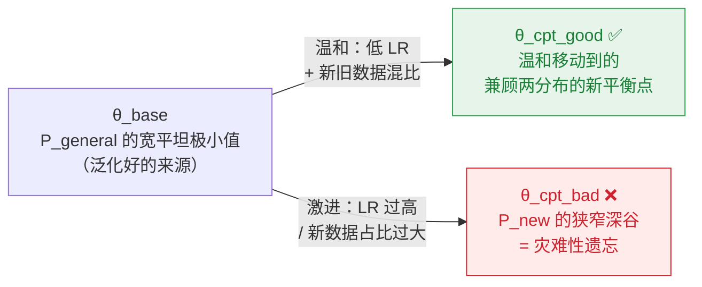

# LLM 训练教程 · Ch12 端到端 CPT（继续预训练）


# LLM 训练教程 · Ch12 端到端 CPT（继续预训练）

> [!info] TL;DR
> **核心思想**：CPT 是给成熟基座模型"增量注入新领域知识"的短程训练（200B tokens 级），核心敌人是**灾难性遗忘**——激进更新会把权重从通用分布的平坦极小值拽进新领域的尖锐深谷。
> **最大收获**：三件事定生死——①新数据混比 α≈10%（5-20% 区间）；②峰值 LR 降到原始的 1/10 且**必须丢弃旧优化器状态**；③同时盯**领域内 PPL ↓** 和**通用域 PPL 稳**两条曲线。
> **为什么重要**：这是"让模型成为医学专家，而不只是扮演医学专家的聊天机器人"的关键一步，也是最容易因一个 resume 习惯（加载了优化器状态）而翻车的环节。

```meta-bind
button
type: cycle
id: read-status
cycle: [todo, in-progress, done]
style: default
actions: []
```

## 笔记地图

- [x] §1 定位：CPT vs SFT vs 从零预训练
- [x] §2 核心挑战：灾难性遗忘
- [x] §3 支柱一 · 数据策略
- [x] §4 支柱二 · 优化器与学习率
- [x] §5 支柱三 · 监控与评估
- [x] §6 7B 端到端配置清单
- [x] §7 常见陷阱诊断表
- [ ] 用自己的实验验证混比与 LR 起点

---

## §1 定位：CPT 解决什么问题

三种训练处在生命周期的不同位置，解决不同的问题：

| 阶段 | 解决什么 | 数据形态 | 计算量 |
|---|---|---|---|
| 从零预训练 | 基础世界模型 + 语言能力 | 海量通用语料（自监督） | 巨大（1T 级，一次性） |
| **CPT** | **扩展知识边界 / 适应新数据分布** | 海量非结构化领域文本 | 增量（200B 级） |
| SFT | 对话行为 / 指令格式 | `(prompt, response)` 对 | 小 |

> [!quote] 原文一句话总结
> **CPT 负责"学什么"（知识），SFT 负责"怎么说"（行为）。**
> 当你的目标是让模型成为一个"医学专家"，而不仅仅是"扮演医学专家的聊天机器人"时，CPT 是不可或缺的一步。

---

## §2 核心挑战：灾难性遗忘的优化视角

预训练好的 `θ_base` 停在通用分布 `P_general` 的**宽阔平坦极小值**里——平坦性正是泛化能力的来源。CPT 要在混合分布 `P_mix = (1-α)P_general + αP_new` 上找新平衡点，但新领域的损失曲面可能又陡又远：



**本章所有策略（混比、低 LR、重置优化器）都是同一件事的不同侧面**：让 θ 从 `θ_base` 温和走到 `θ_cpt_good`，而不是被拽进 `θ_cpt_bad`。

---

## §3 支柱一 · 数据策略

**铁律：单纯喂新数据是 CPT 大忌，数据混合是必须的。**

### 混比 α：5%–20% 区间，稳妥起点 10%

| α 取值 | 学新知识 | 遗忘风险 | 适用场景 |
|---|---|---|---|
| 低（~5%） | 慢，需更多步数 | 极低，非常安全 | 基座能力绝对不能受损的关键任务 |
| 中（10% 起点稳） | 平衡 | 低 | **默认起点** |
| 高（~20%） | 快 | 显著增高 | 新旧域差异不大 / 容忍一定泛化损失 |

**Replay Buffer 思想**：旧数据 `P_general` 不必用全部原始语料——从 1T tokens 里精选 200B 高质量、多样化子集作为"记忆回放缓冲池"，显著降低存储与 I/O 负担。

### 混合方式：动态采样 > 静态预混

| 方式 | 做法 | 优点 | 缺点 |
|---|---|---|---|
| 静态混合 | 训练前按比例混好、打乱 | 实现简单 | 比例不可调；易出"数据热点"（连续 batch 同源） |
| **动态采样** | 数据加载器按温度 τ 对新旧数据流加权在线采样 | 每 batch 构成均匀；可做课程学习（如初期 α=10% → 后期 15%） | 需自定义 `DataModule` / `IterableDataset` |

<details>
<summary>细节：数据质量与序列长度分布（点开）</summary>

- **质量极敏感**：低质量、噪声大的新数据会干扰学习甚至污染已有知识——严格清洗、去重、过滤不可省。
- **序列长度分布要匹配**：如法律文书平均长度远超通用语料，会导致长文本建模偏向。确保 Packer 能有效处理，且评估时分层看不同长度文本的表现。

</details>

---

## §4 支柱二 · 优化器与学习率

> [!note] CPT 的"三低一重置"
> ① 峰值 LR = 原始的 **1/10 ~ 1/5**（7B：`3e-4` → `3e-5`~`6e-5`）
> ② Warmup 极短甚至省略（~200 步即可）
> ③ Cosine Decay 的总步数按**新训练计划重算**（易错点！不能沿用原 1T 的调度）
> ④ **强制重置优化器状态**——绝对不加载 checkpoint 里的 `m` / `v`

**为什么旧优化器状态是毒药**：AdamW 的一阶矩 `m`（动量）和二阶矩 `v`（自适应分母）编码的是**旧数据分布 + 旧学习率**下的梯度历史：

- 旧 `m` 带来巨大惯性 → CPT 初期把权重推向错误方向
- 旧 `v` 适应旧梯度尺度 → 新梯度下部分参数 LR 过大/过小，训练不稳

**正确操作**：加载模型权重**之后**，重新实例化一个全新优化器。

**冻结策略**：默认**全参数训练**——知识要渗透到从词嵌入到高层推理的每一部分。极少数极端怕伤基础能力的场景可尝试冻结最底层几层 Transformer Block，但会牺牲新域学习效果，不推荐。

---

## §5 支柱三 · 监控与评估

训练 loss 单独说明不了成败，三条核心指标 + 一张诊断表：

| 指标 | 期望走势 | 衡量什么 |
|---|---|---|
| Training Loss | 平稳下降；剧抖 → 查混比或 LR | 过程稳定性 |
| **In-Domain Val PPL** | 持续下降 | 学习效果（held-out 新领域集） |
| **General Val PPL** | 稳定 / 仅轻微上涨 | 遗忘护栏（held-out 通用集，如 C4/Pile） |

### 双 PPL 诊断表

| 模式 | Gen PPL | In-Domain PPL | 诊断 | 处方 |
|---|---|---|---|---|
| **(A) 理想 CPT** | 稳定 | 持续下降 | ✅ 目标状态 | 保持当前配方 |
| **(B) 灾难性遗忘** | 急剧上升 ⬆ | 也降但代价惨重 | 被拽出平坦区 | **立即**降 LR 或降 α |
| **(C) 学习不足** | 稳定 | 下降缓慢 | 剂量不够 | 适度加 LR / 加 α / 加训练 tokens |

<details>
<summary>原文 ASCII 诊断图谱（点开对照）</summary>

```text
(A) 理想的 CPT        (B) 灾难性遗忘         (C) 学习不足
▲ PPL                 ▲ PPL                  ▲ PPL
|                     |                      |
|---- Gen PPL ----    |---- Gen PPL ---▲     |---- Gen PPL ----
|   \                 |   \              /   |   \
|    \                |    \            /    |    \ In-Domain PPL
|     \ In-Domain PPL |     \          /     |     (下降缓慢)
|      \              |      \ In-Domain PPL |      
+-----------> Time    +-----------> Time     +-----------> Time
```

定期绘制两条 PPL 曲线：(A) 是目标；(B) → 降 LR 或新数据比例；(C) → 适度增加。

</details>

---

## §6 端到端配置清单：7B 模型示例

| 参数项 | 从零预训练（基线） | CPT（推荐配置） | 理由 |
|---|---|---|---|
| 基座模型 | 随机初始化 | `pretrained_7B.pt` | 站在训练成熟的权重上 |
| 总训练 Tokens | 1T | **200B** | 短程训练：目标是适应而非重塑 |
| 数据混比 α | 100% 通用 | **90% 通用 + 10% 新领域** | 核心：安全与效率的平衡起点 |
| 混合方式 | N/A | **动态采样** | batch 分布均匀 + 支持课程学习 |
| Global Batch Size | 4M tokens | 2M–4M tokens | LR 已降，大 batch 的信噪比增益不再是首要矛盾 |
| Peak LR | 3.0e-4 | **3.0e-5** | 1/10 原始 LR，小步长探索新极小值区域 |
| Warmup | 2000 步 | **200 步** | 权重已稳定，短 warmup 让新优化器热身即可 |
| LR Scheduler | Cosine (~250k 步) | Cosine (**~50k 步**) | ⚠️ 易错：总步数按新计划重算 |
| 优化器状态加载 | False | **False（强制）** | 丢弃旧 `m`/`v`，梯度历史不适用 |
| AdamW Betas | (0.9, 0.95) | (0.9, 0.95) | 对 CPT 不如 LR 敏感，无需改 |
| Weight Decay | 0.1 | 0.1 | 过高反而阻碍向新权重空间适应 |
| 层冻结 | 无 | 无（全参数训练） | 知识需在整个模型中充分渗透 |

---

## §7 常见陷阱诊断表（Gotchas）

像查表一样用：先对症状，再开处方。

| # | 陷阱 | 症状 | 处方 |
|---|---|---|---|
| 1 | **灾难性遗忘**（最常见） | Gen PPL 急涨，通用任务上像"傻瓜" | LR 减半；或 α 15% → 8% |
| 2 | 学习停滞 | In-Domain PPL 降得慢 / 不降 | 先查新数据质量 → 再提 LR / α → 或加训练 tokens |
| 3 | 加载了优化器状态 | 初期 loss 剧烈震荡 / NaN / 不收敛 | 确保优化器在加载权重**之后**重新创建 |
| 4 | Tokenizer 不匹配 | 新领域术语 OOV / 专有名词被切碎 | 扩展词表 + embedding 手术（见下） |
| 5 | **隐蔽的能力衰退** | Gen PPL 稳定，但数学推理 / 代码悄悄变差 | 建 benchmark suite 前后对比；replay buffer 定向补数据 |

<details>
<summary>陷阱 4 详解：Tokenizer 手术（超出标准 CPT，谨慎）</summary>

新领域引入大量新词时，标准 CPT 无解，需要"模型手术"：

1. 训练新的 Tokenizer（或扩展现有词表）
2. 扩展模型的 `token_embedding` 和 `lm_head` 层
3. 特殊处理新旧 embedding 的初始化（新行不能随机乱初始化）

这已超出标准 CPT 范畴，务必谨慎评估是否真的需要。

</details>

<details>
<summary>陷阱 5 详解：为什么 PPL 会"瞒报"能力衰退</summary>

PPL 是**宏观指标**——通用验证集上平均 perplexity 稳定，不代表数学推理、代码生成这些具体能力没掉。

- **预防**：CPT 前先跑一套多能力 benchmark suite，存下基线分数
- **治疗**：发现某能力受损后，在 replay buffer 里有针对性地提高该能力对应数据的比例（如数学语料）

</details>

---

## 我的批注

- ⚡ 全章最有"杠杆比"的一条是**重置优化器状态**：零成本（一行代码），但很多人带着 resume 思维惯性把 checkpoint 全家桶照单全收，然后对着 NaN 排查一天。
- ⚡ 陷阱 5 点破了 PPL 的盲区：**宏观 PPL 稳 ≠ 下游能力没掉**。评估体系必须 PPL + benchmark 双轨。
- ❓ Replay buffer 从 1T 精选 200B 的**选择标准**是什么？质量/多样性打分？原文未展开，值得查 DoReMi / 数据混合相关文献。
- ❓ α=10% 起点是否随模型规模缩放？教程以 7B 为例，更大模型（70B+）是否可用更低 α？
- 🔗 关联：数据混比思想与 [[SFT、RL 与 OPD：分布视角]] 中"训练分布决定模型分布"的视角一致；LR / 调度细节可对照 [[UltraScale Playbook 笔记]] 的 pretraining 部分。

## 行动项

- [ ] CPT 实验前：先跑 benchmark suite 存基线（防陷阱 5）
- [ ] 自检训练脚本：优化器是否在 `load_state_dict` 之后重新创建（防陷阱 3）
- [ ] 调研 replay buffer 子集选择方法（质量/多样性打分）
- [ ] 延伸阅读：[[UltraScale Playbook 笔记]]

---

## 相关阅读笔记

```dataview
TABLE venue, date, key-idea
FROM "LLM Training"
WHERE type = "reading-note"
SORT date DESC
```

