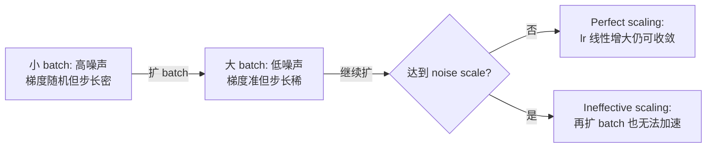
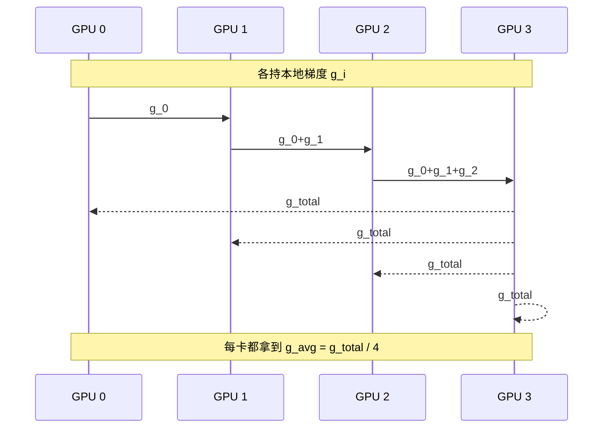
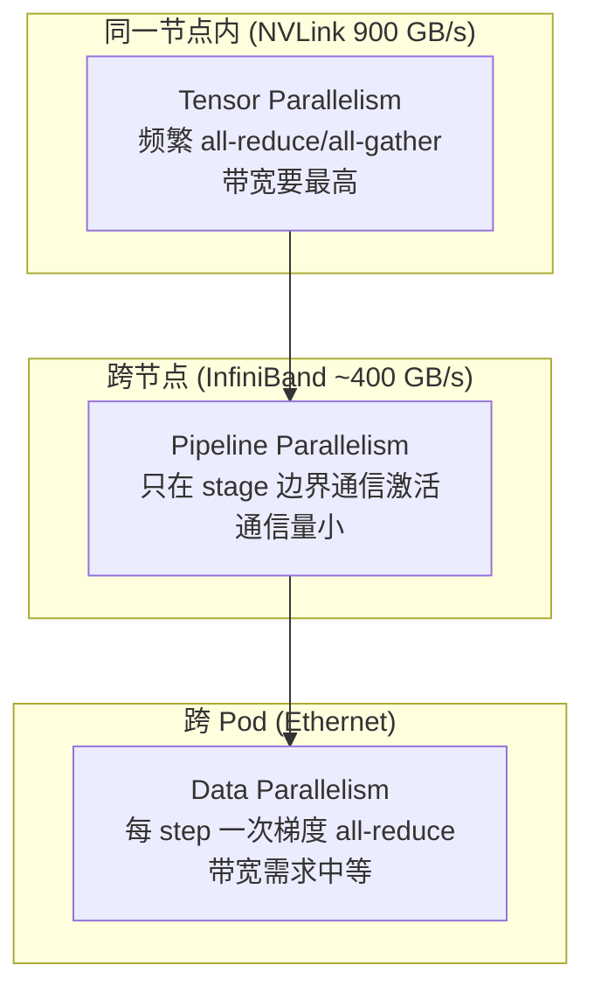

# Training extremely large neural networks across thousands of GPUs

# Training extremely large neural networks across thousands of GPUs

> [!info] TL;DR
> **核心思想**：当模型规模大到「单卡装不下、单卡跑不完」时，要在**两条轴**上做并行——**数据轴**（同一个模型复制到 N 张卡、各自跑不同 batch）和**模型轴**（把模型本身切碎，层间是 **pipeline**、层内是 **tensor**）。三种并行按 **NVLink > InfiniBand > Ethernet** 的网络拓扑分层叠加，是 Llama 3.1 405B 跑在 16K H100 上的根本方式。
> **最大收获**：并行不是「GPU 越多越快」——**通信原语**（all-reduce / all-gather / reduce-scatter）和 **gradient noise scale** 才是决定 scaling 能不能继续的两道坎。
> **为什么重要**：做 LLM 训练系统的同学必须搞清这三种并行的「同步点在哪、通信量多大、适合放在节点内还是跨节点」，否则写出来的并行策略不是慢就是 bubble 满天飞。

## 笔记地图

- [x] 为什么必须并行（Llama 3.1 405B 算力账）
- [x] 基础：mini-batch + gradient descent
- [x] Scaling 到更大 batch 的极限：gradient noise scale
- [x] 单机内存瓶颈 + 三招（grad accum / activation ckpt / CPU offload）
- [x] Data parallelism + all-reduce
- [x] Pipeline parallelism + bubble + GPipe / PipeDream
- [x] Tensor parallelism + column/row + Megatron 优化
- [x] 整合：拓扑感知 + Llama 3.1 实际配置

---

## §1 为什么必须并行

> [!quote] Llama 3.1 405B 算力账
> 405B 模型用了 $3.8 \times 10^{25}$ FLOPs……单卡 H100 训练要 **~609 年**。Meta 用 16,000 张 H100（价值几亿美元）压到 **54 天**。

直觉：单卡再强也是 O(few×10¹²) FLOPs/s 量级，模型 + 优化器状态一上 T 级就 OOM，训练步数又随数据线性涨 → 必须**分数据**和**分模型**两个方向同时打。

---

## §2 基础回顾：mini-batch gradient descent

- 神经网络 = 一堆参数化的数据变换；训练 = 沿 loss 梯度方向更新参数（$\theta \leftarrow \theta - \eta \nabla L$）
- mini-batch：在每个 step 用一小批样本算梯度，是噪声和稳定性的折中

> [!note] 核心观察
> **batch 越大 → 梯度估计越准、噪声越低 → 同等 learning rate 下走得越稳**。
> 但 batch 不是越大越好——见下节。

---

## §3 扩 batch 的极限：gradient noise scale

*图 1：batch 越大 → 单步噪声越低、轨迹越直。来源：An Empirical Model of Large-Batch Training*

*图 2：横轴 = batch / noise scale，纵轴 = predicted speed。虚线左边是 **perfect scaling**（速度按 batch 线性增长），右边是 **ineffective scaling**（边际收益趋零）。来源：同篇论文*

**关键概念**：**gradient noise scale** $\mathcal{B}_\star$ —— 把 batch 扩到这个量级后，再扩 batch 也几乎不能加速训练。LLM 实践中常用「按 token 数动态加倍 batch」：

> [!example]+ Llama 3.1 的 batch 调度
> 初始 4M tokens → 252M tokens 后翻到 8M（8192 序列 ×8）→ 2.87T tokens 后再翻到 16M。
> 同步按 $\text{lr} \propto \sqrt{B}$ 调整学习率。

---

## §4 单卡放不下：三招节省内存

*图 3：小 Transformer 跑 5 步的内存 footprint。绿=参数、黄=优化器状态、红=激活、蓝=梯度。activation 是前向时的尖峰。*

内存账：

| 组件 | 量级 |
|---|---|
| 模型参数 $W$ | $N \times 4\text{B}$（fp32） |
| 优化器状态（AdamW） | $2 \times N \times 4\text{B}$（一阶 + 二阶动量） |
| 梯度 | $N \times 4\text{B}$ |
| 激活 | 随 batch × 层数 × 隐藏维平方涨，可达参数量的 10× |

三招省内存（都是**用算力换内存**）：

> [!tip] 三招一览
> 1. **Gradient accumulation**：把「大 batch」拆成 N 个小 micro-batch 串行跑，梯度累加后再 update。等效大 batch 但单步激活内存不涨。
> 2. **Activation checkpointing**：前向时只保留几个 checkpoint 的激活，其余丢掉；反向到该层再 recompute。典型 trade-off：激活内存降到 $\sqrt{N}$ 量级，重计算增加 ~30% 训练时间。
> 3. **CPU offloading**：把暂时不用的 optimizer state / 梯度 swap 到 CPU RAM，靠 PCIe/NVLink 带宽救场。慢但能救大模型。

---

## §5 两条并行轴

| 轴 | 切什么 | 同步代价 |
|---|---|---|
| **Data parallelism** | 切 batch，每个 GPU 跑完整模型 | 每个 step 一次跨卡梯度聚合 |
| **Model parallelism** | 切模型本身：按层切 = pipeline；按层内张量切 = tensor | forward/backward 多次通信 |

---

## §6 Data parallelism + All-Reduce

每张卡存一份完整模型，各跑自己那份数据，靠 **all-reduce** 把梯度聚合。

**通信原语速查**：

> [!info] Collective Ops 一览
> - **scatter** / **gather** / **broadcast**：1→N 数据分发或 N→1 收集
> - **reduce**：N→1 做归约（sum/max/avg）
> - **all-reduce**：N→N，每个 rank 都拿到归约结果（data parallel 的核心）
> - **all-gather**：N→N，每个 rank 拼出完整数据
> - **reduce-scatter**：reduce + scatter，每个 rank 只拿归约结果的一个分片（FSDP 用）

实际工程上 **Ring all-reduce** 最常见——每张卡只跟左右邻居通信，把数据切成 chunk 在环上走两圈，总通信量与 GPU 数无关。

---

## §7 Model parallelism

### §7.1 Pipeline parallelism：按层切

把 16 层模型切成 4 段，每张 GPU 持 4 层。前向串行：F0→F1→F2→F3；反向从尾到头 B3→B2→B1→B0。

**问题**：串行导致**流水线气泡（pipeline bubble）**——前向起步阶段只有最后一张卡在跑，反向结束时只有第一张卡在跑，中间 GPU 大量空转。

*图 4：naive pipeline 只有一个 micro-batch，所有 GPU 串行工作，气泡巨大。来源：GPipe 论文*

**GPipe 的解法**：把 batch 切成多个 micro-batch，前向一波流过所有 stage（填满 pipeline），再反向一波流回来——气泡占比从 O(stages) 降到 O(stages/microbatches)。

*图 5：micro-batch 流水线，气泡比例 = stages / (stages + microbatches)。来源：GPipe 论文*

**PipeDream 的进一步优化——1F1B (one-forward-one-backward)**：

*图 6：1F1B 调度——先做一段 startup（warmup 所有 stage 的输入），再进入 steady state，每个 GPU 一个时间槽内做一个 forward + 一个 backward。气泡只集中在 startup。来源：PipeDream 论文*

| 方案 | 同步策略 | 优点 | 缺点 |
|---|---|---|---|
| Naive pipeline | 严格同步 | 简单 | bubble 巨大 |
| GPipe | micro-batch + 同步反向 | bubble 缩小 | 仍需等所有 micro-batch 反向完才能 update |
| PipeDream 1F1B | startup + 异步 weight update | bubble 只在 warmup | 异步 update 引入**stale gradient**（多个版本的权重被混用） |

### §7.2 Tensor parallelism：按层内切

把一个线性层 $Y = XW$ 的**权重 $W$** 切成多份，分到不同 GPU 上各自算自己那份再拼回去。

**Column partitioning**（按输出维切）：
- 前向：$X$ broadcast，每卡算 $Y_i = XW_i$，再 **all-gather** 拼出完整 $Y$
- 反向：每卡收到 $\partial L / \partial Y_i$，算 $\partial L / \partial W_i$，**all-reduce** 求出 $\partial L / \partial X$

**Row partitioning**（按输入维切）：
- 前向：每卡只拿 $X$ 的自己那份，乘 $W_i$，**all-reduce** 求和得 $Y$
- 反向：全量 $\partial L / \partial Y$ broadcast，每卡算 $\partial L / \partial W_i$ 和 $\partial L / \partial X_i$，**all-gather** 拼 $\partial L / \partial X$

*图 7：Transformer MLP block $Y = GELU(XA) \cdot B$ 中，$A$ 按列切、$B$ 按行切，两个层之间**自然衔接**——$XA$ 的输出本来就被 all-gather 成 $Y$，正好喂给下一层。同步点减半。来源：Megatron-LM 论文*

> [!tip] Megatron 的精妙之处
> Transformer MLP 是 $GELU(XA) \cdot B$。如果 $A$ 用 column partition、$B$ 用 row partition，中间 $GELU(\cdot)$ 的输出**不需要额外通信**——前一层 all-gather 的结果天然就是下一层的输入。比起两个层都 naive partition，同步点减少 **50%**。

---

## §8 整合：按网络拓扑分层

**Llama 3.1 405B 实际配置**：

> [!quote] Meta 的 3D 并行策略
> - **Tensor parallelism = 8**（卡数 = 单节点 GPU 数，对齐 NVLink）
> - **Pipeline parallelism = 16**（沿 NVLink 域横跨节点）
> - **Data parallelism = 8 ~ 128**（最外层，靠 InfiniBand/Ethernet）
> - 总计 **16,384 张 H100**，硬件：8 卡 NVLink 一组 → 192 rack = 一个 pod（3072 卡）→ 8 pod = 24K 卡集群。

**选型口诀**：

| 并行 | 通信模式 | 适合位置 |
|---|---|---|
| Tensor | 每层多次 collective | **节点内**（NVLink 必须顶住） |
| Pipeline | 只在 stage 边界传激活 | **跨节点**（通信量小、可以慢） |
| Data | 每 step 一次 all-reduce | **任意位置**（用层级 all-reduce 折中） |

---

## §9 文章没讲但值得追的方向

> [!question] 进阶话题（未在文中展开）
> - **ZeRO / FSDP**：把 optimizer state + gradient + parameter 都切分到各卡，每卡只持 1/N → 比纯 DDP 更省内存，是 Deepspeed 的核心。
> - **Context parallelism**：把 sequence length 维度也切走，feed-forward 时通过 ring-attention 把 K/V 段在卡间循环。
> - **Expert parallelism**：MoE 模型专用——experts 切到不同卡，gate 路由。
> - **异步训练 / 流水线气泡的极端处理**：如零气泡流水线（ZB-H1 / ZB-H2）。

---

## 我的批注

- ⚡ **核心 takeaway**：三种并行的「同步点频率」递减（tensor > data > pipeline），所以带宽需求也递减，对应 NVLink → IB → Ethernet 是天然分层。
- ⚡ Megatron 用 col+row 交替切，把 $GELU(\cdot)$ 当成「天然通信屏障」——这是工程上的精巧设计，不是算法本身要求。
- ❓ PipeDream 的 stale gradient 如何控制？stale-ness 上限是多少？1F1B 之后是不是又被同步方案追回来了？
- ❓ ZeRO-3 / FSDP 跟纯 TP+PP+DP 相比，实际硬件效率（MFU）差异有多大？
- 🔗 延伸阅读：[[LLM Training/Pretraining]]（训练流程全貌）、[[LLM Inference]]（推理时的并行策略不同）

## 行动项

- [ ] 读 ZeRO / FSDP 原文，弄清和 3D 并行的内存 trade-off
- [ ] 跑一遍 NanoGPT speedrun 的 DDP 配置，对照本文 all-reduce 步骤
- [ ] 跟 [[Megatron-LM Paper Reading]] 做交叉笔记
- [ ] 调研 ring-attention 实现细节

## 引用与原文

> [!quote] 原文作者 Jeremy Jordan, 2025-02-26
> "Data, pipeline, and tensor parallelism have enabled researchers and engineers to push the limits of model training to an incredible scale."
>
> 译文：数据、流水线、张量三种并行让模型训练的规模上限被推到了不可思议的程度。

**核心参考文献**：

| 主题 | 论文 / 资源 |
|---|---|
| PyTorch DDP 实践 | [PyTorch Distributed: Experiences on Accelerating Data Parallel Training](https://arxiv.org/abs/2306.01240) |
| Pipeline | [GPipe](https://arxiv.org/abs/1811.06965) · [PipeDream](https://proceedings.neurips.cc/paper/2019/hash/093f65e080a295b807962134c4c6b0ae-Abstract.html) |
| Tensor | [Megatron-LM](https://arxiv.org/abs/1909.08053) · [Megatron-LM on GPU Clusters](https://arxiv.org/abs/2204.09989) |
| 集群实战 | [The Ultra-Scale Playbook](https://huggingface.co/spaces/HuggingFaceFW/ultra-scale-playbook) · [The Llama 3 Herd of Models](https://arxiv.org/abs/2407.21783) |
| 视频 | Mark Saroufim 讲 model vs data parallelism · Stanford CS231N 2025 Lec 11 |
