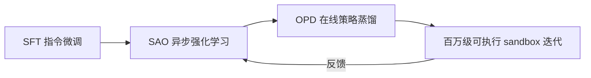
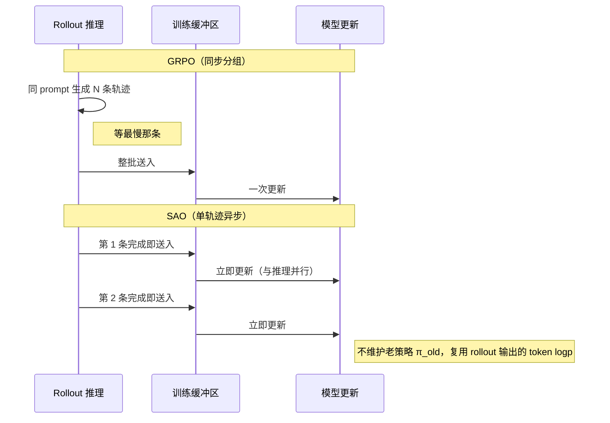
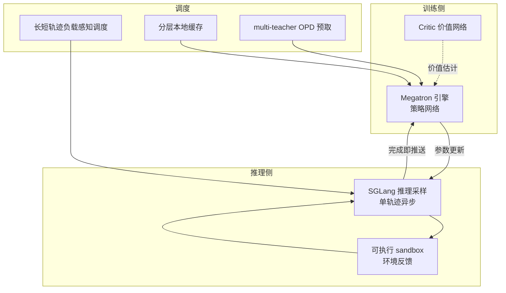

# GLM-5.3 阅读笔记 — 后训练 scaling、SAO 算法与 Slime 框架


# GLM-5.3 — 后训练 scaling 与 SAO 算法

> [!info] TL;DR
> **核心思想**：复用基座，把资源堆到**后训练**上。GLM-5.3 的全部提升（自研 Z.ai Code Bench +50%）来自后训练 pipeline 的三处扩展——**算法**（SAO 单轨迹异步 RL 替代 GRPO）、**框架**（Slime 异步训练框架）、**环境**（百万级可执行 sandbox）。
>
> **最大收获**：SAO 解决了 GRPO 在长程 Agent 任务上的三个致命短板——算力空转、策略坍塌、训练-推理不一致。技术栈对齐 [[LLM Training/RLHF/GRPO训练排查：策略坍塌 vs 训练崩溃]] 的问题描述。
>
> **为什么重要**：长程 Agent RL 是当前 LLM 在代码、渗透、SWE 任务上的核心瓶颈。SAO + Skip-Observation GAE 给出了一套"训练与线上采样同形态"的方案。

## 笔记地图

> [!tip]- 阅读状态（点击展开 Meta Bind 按钮）
>
> ```meta-bind
> button
> type: cycle
> id: read-status
> cycle: [todo, in-progress, done]
> ```
>
> ```meta-bind
> button
> type: cycle
> id: confidence
> cycle: [low, mid, high]
> action: cycle
> style: primary
> ```
>
> 按章节打钩：
> - [x] §1 后训练 pipeline 总览
> - [x] §2 GRPO 三大致命短板（问题定义）
> - [x] §3 SAO 核心设计
> - [ ] §4 SAO 四大模块（细读）
> - [ ] §5 Slime 框架
> - [ ] §6 仿真环境扩展
> - [ ] §7 分层 RL 训练策略

---

## §1 背景：复用 GLM-5.2，提升来自后训练 scaling

GLM-5.3 沿用 GLM-5.2 同款 **743B MoE 基座**（单次激活 40B 参数），不做基座重训，把算力全压到后训练 pipeline：



> [!note]+ IndexShare（一句话说明：1M 上下文、128K 单轮输出的长程存储底座）
> 超长上下文高效存储，支撑 **1M 上下文 / 128K 单轮输出**，让多轮长程 Agent 任务不再被 context 截断。本文后续讨论的"长程任务"都建立在这个存储底座之上。

主线增益集中在**后训练**——环境扩展、任务多样性扩展、RL Infra 优化。

---

## §2 GRPO 三大致命短板（SAO 要解决的问题）

主流 GRPO 是 **无 Critic + 分组同步** 训练：同一个 prompt 生成 N 条轨迹，**必须等组内最慢那条跑完** 才更新模型。短问答没问题，但 Agent 任务轨迹长短差距巨大，问题集中爆发：

1. **算力大量空转**：长尾任务让 GPU 集群等最慢那条；快轨迹已经返回的 GPU 闲着没事干。
2. **训练上限极低**：同步分组放大离策略偏差，长轨迹 Agent-GRPO 容易**策略坍塌** + 信用分配困难。
3. **线上不兼容**：真实沙箱、在线业务单次交互只返回**单条**轨迹，分组逻辑和线上推理天然割裂。

> 这三点刚好对应 [[LLM Training/RLHF/GRPO训练排查：策略坍塌 vs 训练崩溃]] 提到的症状。

---

## §3 SAO：长程 Agent RL 核心算法

**SAO = Single-Rollout Asynchronous Optimization**（单轨迹异步优化）。

### 一句话核心

> **每条轨迹生成完毕就立即送入训练缓冲区**，推理采样与模型训练完全解耦，消除"等最慢样本"的算力浪费。

代价是**梯度方差升高**，所以 SAO **重新引入 Actor-Critic 价值网络** 补偿单轨迹的高方差——这跟传统认知的"GRPO 摒弃 Critic"路线相反。

### SAO vs GRPO：单次展开对比



> [!quote] 作者观察（关键论断）
> 对于 SAO 而言，每条轨迹一旦生成完毕，即可立即用于训练；相比之下，GRPO 必须等到同一组内的所有轨迹均生成完毕后，才能开始训练。

---

## §4 SAO 四大核心模块

### 4.1 摒弃分组采样，单轨迹即时更新

- **移除** GRPO 同一 prompt 生成多条样本的分组范式
- 每条轨迹生成完毕 → **直接送入训练缓冲区**
- 推理采样与训练完全**解耦**
- 副作用：梯度方差升高 → **重新引入 Actor-Critic**

### 4.2 DIS：双向 Token-Level 重要性采样

异步训练下，推理侧与训练侧模型版本**持续错位**，极易产生离策略偏差。

| 维度 | GRPO | SAO |
|------|------|-----|
| 行为策略 | 维护老策略 $\pi_{\theta_{old}}$ | **复用 rollout 阶段输出的 token logp** |
| 约束粒度 | sequence-level | **token-level** |
| 信任域 | 通常对称区间 | **非对称区间** $[1-\epsilon_l,\ 1+\epsilon_h]$ |
| 越界处理 | clip / KL penalty | **直接从梯度计算中剔除越界 token** |

> **关键意义**：token 粒度的双向约束从根源缓解异步训练震荡，是 SAO **千步稳定训练**的关键。

### 4.3 面向单轨迹的价值模型优化

单轨迹缺组内对比基线，价值模型估计精度直接决定训练效果。三层约束：

1. **Critic 更新频次 = 策略网络 × 2**：让价值估计快速跟进策略迭代
2. **冻结注意力层，仅微调 MoE 专家投影**：复用预训练语义能力，规避梯度爆炸（与 [[LLM Architecture/basic/MoE]] 的稀疏激活设计呼应）
3. **扩充价值模型预训练数据集**：改善冷启动阶段价值预估不准

### 4.4 Skip-Observation GAE

Agent 轨迹是 **模型动作 → 环境观测 → 模型动作** 交替形态，**环境观测 Token 由外部沙箱生成**，不属于模型输出。

传统 GAE 跨观测边界计算优势值 → 引入外部噪声。

**Skip-Observation GAE** 跳过全部环境观测 Token，仅在模型自身生成的动作 Token 之间计算时序优势——长代码、渗透攻防这类长轨迹的训练精度显著提升。在 SAO 之上，**CompactionRL** 进一步把上下文压缩逻辑纳入 RL 训练流程，让增益不局限于短样本场景。

---

## §5 Slime：长程 RL 大规模训练框架

工程层面在 **Megatron 训练引擎 + SGLang 推理采样** 之上做打通，新增 sandbox / tool 无需改动主训练循环。



### GLM-5.3 阶段两大工程升级

**升级一：OPD 在线策略蒸馏全维度扩展**（解决多轮 SAO 训练后的灾难性遗忘）

- 新增 **top-k / top-p / 全词表** 粒度 OPD
- 将 **SFT、推理 RL、Agent RL** 不同训练阶段模型作为**多教师**，统一复习巩固对话、代码、工具能力
- **缩小训练与线上采样行为差距**：训推 log 概率差值控制到 **1e-7**（相比旧版本降低 99.99%）

**升级二：调度与缓存优化，吞吐量 +2.3×**

- 分层本地缓存：模型快照、轨迹数据 → 减少主机内存占用
- 长短轨迹**负载感知调度** → 均衡推理节点压力
- multi-teacher OPD **预取机制** → 无需为每个教师常驻推理服务，硬件开销下降
- **长时序代码 RL 场景整体训练吞吐量提升 2.3 倍**

---

## §6 仿真环境扩展

不再用简单习题数据集，搭建海量 **可执行、可验证、贴近真实工程师工作** 的长周期 sandbox（任务复杂度 = 资深工程师数日工作量）：

- **Research Agent 提取任务模式**：从真实工程、安全工作流收集模式 → 带多步依赖和隐藏状态的可运行长时序环境
- **Judge Agent 验证可解性**：专门的评判 agent 尝试完成每个任务，确认可解
- **验证器独立构建**：不访问参考解答，避免奖励泄露；用求解器轨迹发现并关闭奖励捷径
- **三重校验**：oracle / no-op / unsolved-state 三层检查 → 产出可直接训练的**二元奖励**

---

## §7 分层 RL 训练策略

| 层级 | 任务类型 | 奖励信号 | 目标 |
|------|---------|---------|------|
| **推理 RL** | 数学竞赛、算法题 | 对错二元 | 强化链式推导 |
| **Agent RL** | SWE、终端、漏洞挖掘 | 测试通过率、完整任务闭环 | 沙箱内"编写-运行-报错回滚-修复" |
| **通用对话 RL** | 对话 | 偏好/质量信号 | 平衡专项训练带来的基础对话能力遗忘 |

**关键 trick**：**SAO with compaction**（带上下文压缩的 SAO），让能力增益能稳定作用于长时序任务，而不限于短样本场景——这是长代码、长渗透任务能持续提升的原因之一。

---

## 实测结果速览

| 模型 | 输出 token | 准确率 |
|------|-----------|--------|
| **GLM-5.3** | 50K | **≈32%**（超过 Claude Opus 4.8 同精度档） |
| **GLM-5.3**（最高算力档） | **75K** | **34.5%** |
| GLM-5.2 | 96K | 23.4% |
| Claude Opus 4.8 | 120K | ≈33% |

> 原文要点：**同等任务完成精度下，GLM-5.3 输出 token 更少**——
> - 高难度任务仅需 **50K** 输出 token，精度超过 Claude Opus 4.8（120K token）
> - 最高算力档位 **75K token 即可达 34.5%**，前代 GLM-5.2 需要 **96K token 仅 23.4%**

**涌现现象**：仅在训练集中**增加漏洞审计类环境**，未专门针对攻防做定向优化，但模型长程推理能力同步催生出**完整漏洞利用链规划能力**。

---

## 我的批注

- ⚡ **核心洞察**：SAO 的本质是用"工程异步 + Critic 补偿"换"GRPO 分组同步"，把训练节奏拉齐到线上推理节奏，训练-推理一致性大幅提升。
- ⚡ **Skip-Observation GAE** 是个非常优雅的小 trick——把环境观测 Token 当作"不可微的外部信号"从优势估计里隔离，避免信用分配被污染。
- ❓ **Critic 仅微调 MoE 专家投影层**——这是不是意味着 Critic 的输入表征沿用策略网络？两个网络怎么共享底层 embedding？
- ❓ **DIS 的 $\epsilon_l$ 与 $\epsilon_h$** 是否对称？长程任务下非对称的物理意义？
- 🔗 与 [[LLM Training/RLHF/GRPO训练排查：策略坍塌 vs 训练崩溃]] 形成对照阅读：那是"GRPO 失败模式排查"，这篇是"GRPO 替代方案"。
- 🔗 与 [[LLM Training/RLHF/SFT、RL 与 OPD：分布视角]] 串联：OPD 在 SLIME 里被作为"防止多阶段训练灾难性遗忘"的关键。

---

## 行动项

- [ ] 阅读 arxiv 原文 [2607.07508](https://link.zhihu.com/?target=https://www.arxiv.org/pdf/2607.07508) 中关于 Skip-Observation GAE 的数学推导
- [ ] 在 `slime` 仓库 ([THUDM/slime](https://github.com/THUDM/slime)) 中查找 SAO 的开源实现
- [ ] 对照 [[LLM Training/RLHF/GRPO训练排查：策略坍塌 vs 训练崩溃]]，整理一份 "GRPO → SAO 迁移 checklist"
- [ ] 调研 CompactionRL 的实现细节——上下文压缩作为可微操作纳入 RL

---

## 参考

- [z.ai/blog/glm-5.3](https://link.zhihu.com/?target=https%3A//z.ai/blog/glm-5.3)
- [arxiv.org/pdf/2607.0750](https://link.zhihu.com/?target=https%3A//www.arxiv.org/pdf/2607.07508)
- 原文章配图（知乎）：
  - 
  - 
  - 
  - 
  - 
  - 
