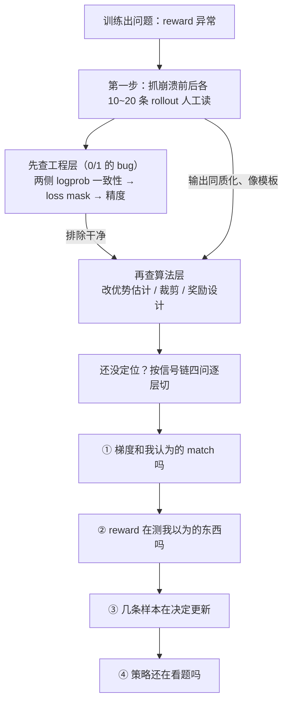
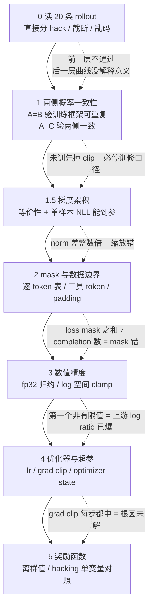
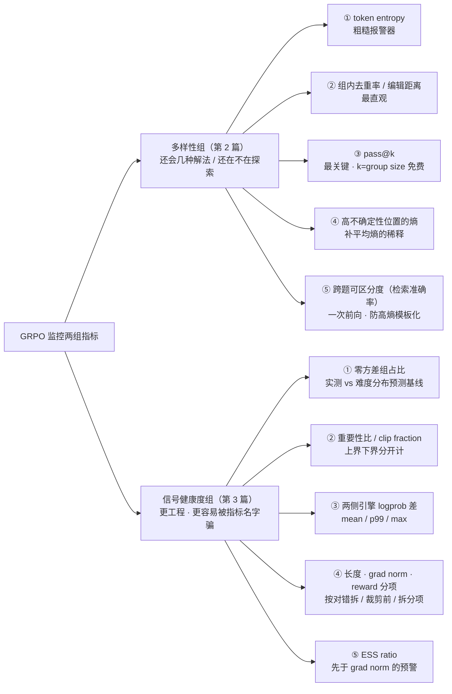

# GRPO训练排查：策略坍塌 vs 训练崩溃


# GRPO 训练排查：策略坍塌 vs 训练崩溃

> [!info] TL;DR
> **核心思想**：GRPO 训出问题先分类——**策略坍塌**（policy collapse，算法层：GRPO 目标函数的内在倾向，什么都没做错也会往那个方向走）和**训练崩溃**（training crash，工程层：两侧概率不一致、loss mask 写错、bf16 精度不够，是 bug 不是超参问题）是两种病，排查路径完全不同，混着查等于两边都查不干净。
> **最大收获**：排查顺序是固定的——**先排工程层**（bug 是 0/1 的，能被穷尽排除），排干净再动算法层；且二分法按时间尺度切并不严谨，复杂情况要按**信号链四问**（前提关系）来切。
> **一句话方法论**：抓崩溃前后各 10~20 条 rollout **人工读**——3 分钟完成的分类，读曲线要半小时还可能分错。
> **监控补篇（第 2 篇，09-01 并入）**：GRPO 无 critic，唯一信号来自组内相对优势——**信号健康度可直接观测、必须观测**。平均熵只是报警器；pass@k 取 k=group size 免费算但有四个缺口，且必须配各自调优的 temperature；**题内多样性与跨题可区分度是能反向走的两个量**，只测前者会漏掉最典型的"高熵模板化"坍塌——补一个一次前向的检索准确率即可堵上。
> **信号健康度补篇（第 3 篇，09-02 并入）**：50% 零方差报警线是错的——占比是 G 与题集难度的函数，要比对预测基线；clip 上界下界分开计、按 advantage 符号解读；两侧引擎 logprob 差 mean<0.001 健康、>0.01 停训（阈值只适用 mean 不适用 max）；长度爆涨先按对错拆再定性；**预警看 ESS ratio，确认看 grad norm**。
> **策略坍塌五条 root cause（第 4 篇，09-02 并入）**：σ 归一化不是 bug 也不该一刀切关——**单样本权重主要由组内稀罕度而非信号可靠性决定**；少数派 advantage 上界 ≈ (G-1)/√G（G=16 时 3.75，不是无限）；Dr. GRPO 去 σ 是按各自 σ 缩放不是乘常数（因此同 lr A/B 会误判"方法无效"）；DAPO 动态采样和 Dr. GRPO 去 σ **处理不同区间**（p=0/1 vs 极端但非零方差），先拆零方差构成（全对/全错）再决定。
>
> **clip 的不对称与稀有 token（第 5 篇，09-08 并入）**：默认 [0.8, 1.2] 在 log 空间**不对称**——下侧 (`log 0.8 ≈ -0.223`) 比上侧 (`log 1.2 ≈ +0.182`) 多 ~22%，先撞下界；几何对称点 ε = √(1−ε_low)/(1+ε_high) ≈ 0.236（DAPO 用 0.28 是工程近似）；**低概率 token 撞上界是 softmax 局部几何的必然**（`log r ≈ (1−p)·Δ` 一阶近似，p=0.05 时 19× 灵敏）；稀有 token 需要约 7.3 次有效更新才能从 0.05 升到 0.3，普通 token 不到 1 次；**clip 命中梯度归零要 ratio 与 advantage 同号**才会发生（异号时梯度本身就小）；调 clip 不是"开紧/松"，是**调几何**（5.1 几何对称 / 5.2 控制熵 / 5.3 扫描看 clip_frac_by_sign 与有效 step 比）；**熵下降不能单独作为调 clip 的依据**——必须配随机 reward 基线对照（系统下降才归因于 clip，组间下降是熵的自然衰减）；截断样本（loss mask）与 clip 是两件事——前者控制样本层（不鼓励长答），后者控制 token 层（防止大更新），统计要分开。
>
> **训练崩溃的分层排查（第 6 篇，09-15 并入）**：崩溃的诊断与策略坍塌正交——后者是算法层内在倾向，前者是工程层 0/1 bug（概率口径不一致、mask 写错、数值精度不够、optimizer state 不匹配），**没有"更合适的学习率"只有写对和写错**。核心原则**"前一层不通过，后一层曲线没有解释意义"**——按"读 20 条 rollout → 概率一致性 → 梯度累积 → mask → 数值精度 → 优化器与超参 → 奖励"顺序查。**第 1 步锁第一个出错 step**（最后正常 / 首个异常 / 异常后一步三态保存，比单看崩溃后曲线截图价值大）。**1 步最小一致性测试**：冻结权重、关 dropout、固定 RNG，**同一批 token 跑 A（训练侧）/ B（同侧再跑）/ C（推理侧）**——A=B 验训练框架可重复、A=C 验两侧概率一致；硬判据是**未训先大面积撞 clip**（权重没动就报策略更新）= 必须停训修口径。**1.5 步梯度累积等价性**：N 条一次反向 vs 1 条累积 N 次比，方向不同或 norm 差 accumulation/world size 整数倍 = 缩放错。**2 步 mask 要打逐 token 表**（position / token 文本 / 来源 / attention mask / loss mask / 是否有 reward），运行时断言 loss mask 之和 = completion token 数。**3 步沿数值路径找第一个 NaN/Inf**——bf16 下两 logprob 相减会量化成 0；**log-ratio clamp 必须在 exp 之前**（先 exp 后 clamp 反向 0 × Inf = NaN，clamp 不是 PPO clip 替代品）。**4 步前 4 层通过后才动 optimizer 和 reward**——同时记裁剪前/后 grad norm、|Δθ|/|θ|、ratio P95/P99、upper/lower clip fraction，按形状分流（grad clip 每步都中 = 根因未解；checkpoint 恢复即崩 = 回到更早且匹配的 checkpoint 重放）。面试信号：候选人说"先要最后正常 step / 第一异常 batch / 原始 rollout / ratio / mask"才像真排过；上来就读 lr 和 KL 是看板习惯。

原文：刘明（LLMCat，亚马逊高级数据科学家）"LLM 面试官笔记"系列。本笔记覆盖第 1 篇《如何排查 GRPO 训练问题》（[公众号](https://mp.weixin.qq.com/s/4rUkZ02-nTbydwhzy8wAuw) ｜ [知乎](https://zhuanlan.zhihu.com/p/2077405199711334949)）+ 第 2 篇《如何监控模型的多样性》（[知乎](https://zhuanlan.zhihu.com/p/2077475761078924748)）+ 第 3 篇《怎么监控训练信号的健康度》（2026-08-31 发布，知乎未索引到独立链接）+ 第 4 篇《策略坍塌五条 root cause：除以 σ》（2026-09-02 发布，知乎未索引到独立链接）+ 第 5 篇《clip 的不对称与稀有 token》（2026-09-04 发布，知乎未索引到独立链接）+ 第 6 篇《训练崩溃：分层排查》（2026-09-07 发布，知乎未索引到独立链接；"两侧引擎概率不一致的量级"待发布，见 [[#系列追踪]]）。

## 笔记地图

- [ ] [[#排查流程全景|排查流程全景]]
- [ ] [[#排查前的三个基础要求|排查前的三个基础要求]]
- [ ] [[#二分法：策略坍塌 vs 训练崩溃|二分法]]
- [ ] [[#二分法的边界：转化与信号链|二分法的边界（转化 & 信号链四问）]]
- [ ] [[#最常见的错误排查：降 lr|降 lr 陷阱]]
- [ ] [[#快速判断：读 rollout 原文|读 rollout 原文]]
- [ ] [[#四条原则（总结）|四条原则]]
- [ ] [[#策略坍塌的五条 root cause（系列第 4 篇）：除以 σ|策略坍塌 root cause（第 4 篇）]]
- [ ] [[#一、先确定问题发生在哪一步|五条 root cause 全景]]
- [ ] [[#二、从一组具体分数看 σ 到底改变了什么|σ 归一化的代价（少数派放大）]]
- [ ] [[#三、去掉 σ 的本质|去掉 σ（Dr. GRPO）的本质]]
- [ ] [[#四、过滤零方差组的目的|过滤零方差组（DAPO 动态采样）]]
- [ ] [[#五、去掉 σ 和过滤零方差组怎么配合|两者怎么配合（不同区间）]]
- [ ] [[#六、脱敏实验记录|脱敏实验记录]]
- [ ] [[#clip 的不对称与稀有 token（系列第 5 篇）：为什么低概率 token 更容易撞上界|clip 不对称与稀有 token（第 5 篇）]]
- [ ] [[#一、clip 到底在裁什么|clip 到底在裁什么]]
- [ ] [[#1.1 log-ratio 的几何不对称|① log-ratio 几何不对称（22% 偏置）]]
- [ ] [[#1.2 0.25 几何对称点|② 几何对称点 ε 表]]
- [ ] [[#二、低概率 token 为什么更容易撞上界|低概率 token 撞上界的必然性]]
- [ ] [[#2.1 真实更新计算|① softmax 真实更新计算]]
- [ ] [[#2.2 被上界裁掉的 token 概率低，能说明什么|② 撞上界的 token 是稀有 + 想增]]
- [ ] [[#三、稀有 token 的问题|稀有 token 的学习路径（7.3 次有效更新）]]
- [ ] [[#四、命中 clip 后，什么梯度被丢掉了|clip 真正截断的是同号极端]]
- [ ] [[#五、如何调整上下界|调 clip 是调几何（5.1 / 5.2 / 5.3）]]
- [ ] [[#六、为什么"熵在下降"不能单独作为调参依据|熵降不能单独调 clip（随机 reward 基线）]]
- [ ] [[#七、截断样本 vs clip|截断样本 vs clip（mask 与 clip 统计分开）]]
- [ ] [[#训练崩溃的分层排查（系列第 6 篇）：从便宜的 0/1 检查开始|训练崩溃分层排查（第 6 篇）]]
- [ ] [[#零、先锁定"第一个出问题的 step"|零、锁定首个异常 step（三态保存）]]
- [ ] [[#一、第 1 步：先证明新旧概率可以比较|第 1 步 概率一致性（A/B/C 三次计算）]]
- [ ] [[#1.1 最小一致性测试|① 最小一致性测试（未训先撞 clip 必停训）]]
- [ ] [[#1.2 权重同步不能只看"调用成功"|② 权重同步三类检查]]
- [ ] [[#二、第 1.5 步：验证梯度加工流水线|第 1.5 步 梯度累积等价性]]
- [ ] [[#2.1 梯度累积等价性测试|① 累积 vs 一次反向]]
- [ ] [[#2.2 用简单目标测试"梯度能否到达参数"|② 普通 NLL 能到参的底线测试]]
- [ ] [[#三、第 2 步：逐 token 检查 mask 和数据边界|第 2 步 逐 token mask 检查]]
- [ ] [[#3.1 不要只看 mask 的 shape|① 逐 token 表]]
- [ ] [[#3.2 多轮和工具调用最容易静默出错|② 多轮/工具 mask 易错]]
- [ ] [[#3.3 截断样本要同时检查三处|③ 截断样本的三处开关]]
- [ ] [[#四、第 3 步：沿着数值路径找第一个 NaN/Inf|第 3 步 数值路径查 NaN/Inf]]
- [ ] [[#4.1 关键差值和指数运算使用 fp32|① fp32 归约/相减/指数]]
- [ ] [[#4.2 先限制 log-ratio，再取指数|② clamp 必须在 exp 之前]]
- [ ] [[#4.3 几种"限制"不要混在一起|③ 四种 clip/clamp 不能凭数值猜]]
- [ ] [[#4.4 不要用 log(softmax(x) + eps) 掩盖问题|④ 不用 log(softmax+eps) 掩盖问题]]
- [ ] [[#五、前四层通过后，才进入优化器和 reward|第 4 步 优化器与 reward]]
- [ ] [[#5.1 第 4 步：判断是不是更新步子太大|① 更新步子形状分流]]
- [ ] [[#5.2 回滚时把故障证据一起留下|② 回滚留证据]]
- [ ] [[#5.3 第 5 步：沿 reward 到 advantage 的路径检查|③ reward→advantage 路径]]
- [ ] [[#5.4 reward hacking 不能只靠一条曲线确诊|④ hacking 单变量对照]]
- [ ] [[#六、把整套排查压缩成一张决策表|六、决策表（避免跨层解释）]]
- [ ] [[#监控看板（系列第 2 篇）：信号健康度可直接观测|监控看板（第 2 篇）]]
- [ ] [[#1. token entropy：只是个粗糙报警器|① token entropy（报警器）]]
- [ ] [[#2. 组内去重率：熵坍塌最直观的表现|② 组内去重率]]
- [ ] [[#3. pass@k：最关键，但有四个缺口|③ pass@k（四缺口 + temperature 陷阱）]]
- [ ] [[#4. 高不确定性位置的熵：补救平均熵的稀释|④ 条件熵（补稀释）]]
- [ ] [[#5. 跨输入可区分度：本篇最重要的一节|⑤ 跨题可区分度（检索准确率）]]
- [ ] [[#多样性组小结：五组指标|多样性组小结]]
- [ ] [[#信号健康度组（系列第 3 篇）：更工程，也更容易被指标名字骗|信号健康度组（第 3 篇）]]
- [ ] [[#1. 零方差 group 占比：50% 报警线是错的|⑥ 零方差组占比（50% 阈值是错的）]]
- [ ] [[#2. 重要性比与 clip fraction：别把两个方向合并成一个人|⑦ 重要性比 / clip fraction]]
- [ ] [[#3. 两侧引擎的 logprob 差：最容易被忽略，也最致命|⑧ 两侧引擎 logprob 差]]
- [ ] [[#4. 长度、grad norm、reward 分项：已经表现出来的结果|⑨ 长度 / grad norm / reward 分项]]
- [ ] [[#5. ESS：batch 里有多少样本真正起了作用|⑩ ESS（预警）]]
- [ ] [[#信号健康度组小结：按一条顺序看|观看顺序小结]]
- [ ] [[#我的批注|批注 & 行动项]]
- [ ] [[#系列追踪|系列追踪]]

## 排查流程全景



> [!note]- 为什么顺序是"先工程、后算法"？
> 工程层问题**要么有要么没有**（0/1），适合快速穷尽排除；策略坍塌是 GRPO 目标函数的内在倾向——"你什么都没做错，它也会往那个方向走"，不存在"修好"一说，只能设计上缓解。混着查 = 两边都查不干净。

## 排查前的三个基础要求

不管从哪个角度切入排查，真正要关心的是三件事：

1. **先分类再动手**。策略坍塌和训练崩溃解决方式差异很大，不可混为一谈。
2. **要有 observability 意识**。你有没有监控、监控了什么？更关键的：改了某配置指标动了，怎么知道是配置起了作用，还是恰好这批数据不一样？
3. **分析每个方案的代价**。直接叠各种 PO（DAPO / XXPO）不是专业做法——每个 trick 都有适用前提，叠在一起用，连哪个在起作用都分不出来。

## 二分法：策略坍塌 vs 训练崩溃

|            | 策略坍塌（算法层）                         | 训练崩溃（工程层）                        |
| ---------- | --------------------------------- | -------------------------------- |
| 典型现象       | reward 还在缓慢涨，输出越来越像模板             | 某个 step 之后 reward 断崖到 0          |
| 曲线特征       | entropy 单调下降；pass@1 微涨、pass@k 明显掉 | grad norm 突然 10x 尖刺              |
| 输出特征       | 同一 prompt 采 16 条几乎一模一样            | 复读、乱码、中英混杂、`!!!!!!`              |
| 发生时间       | 训练中后期，渐进                          | 突发，往往能定位到具体 step                 |
| root cause | 优化目标 / 信号设计                       | 工程一致性（概率不一致、mask 覆盖写错、bf16 精度不够） |
| 解决方式       | 改优势估计、改裁剪、改奖励                     | 查 logprob 一致性、查 mask、查精度         |

训练崩溃这类问题**调超参永远调不好**——它压根不是超参问题，而是 bug。

## 二分法的边界：转化与信号链

现实世界是复杂的，二分法只是粗略总结、不严谨，**不能只看表格定位问题**。

### 两类问题会互相转化

一个常见链路：

```
熵先一路掉到底 → 每个位置只剩一个答案 → 输出退化成复读 → reward 断崖式暴跌
```

最后一步看到的结果很容易被归因为训练崩溃，但病根在第一步的策略坍塌。反过来，坍塌的成因里往往混着 reward 设计、一批数据被反复用多轮——这些也不是纯算法问题。

所以排查姿态要变：不是"确定它是哪类"，而是**先按训练崩溃去查工程，排除干净之后才轮到策略坍塌类**。面试中能主动指出这两类会互相转化，是很大的加分项。

### 时间尺度 ≠ root cause

"渐进 vs 突发"和"算法层 vs 工程层"**并不一一对应**：

> [!example]- 两个反例（表象与病根错位）
> **反例 1：有效样本数退化**——渐进式（几十步的过程），符合策略坍塌"渐进 + 中后期"的表象，但病根在工程/系统层（异步、数据陈旧）。要查的是工程层，不是优化目标。
>
> **反例 2：多轮工具调用崩溃**——属于训练崩溃，表现为突发 grad norm 爆炸，但病根在信号设计：工具返回的内容把分布带偏、逐轮复合。不是 mask 或精度问题。

### 进阶切法：信号链四问

按**信号链**区分，四层之间是**前提关系**，不是并列关系：

| 层 | 问题 | 查什么 | 不通过的后果 |
|---|------|--------|-------------|
| ① | 梯度和我认为的 match 吗 | 两侧 logprob 一致性、loss mask 覆盖范围、梯度累积等价性 | 后面三层的所有观测都没有意义 |
| ② | reward 在测我以为的东西吗 | 分项拆解、验证器的 false negative、与训练不同源的 held-out | ③④ 在精确地优化一个错的东西 |
| ③ | 这一步的更新由几条样本决定 | 有效样本数、零方差组占比 | —— |
| ④ | 策略还在看题吗 | 组内去重、跨输入的可区分度、pass@k | —— |

这个切分给出了二分法给不出的**依赖结构**——因为"渐进和突发"之间没有前提关系。多数情况二分法够用；复杂情况按四问切。

## 最常见的错误排查：降 lr

缺经验的候选人标准回答："训练崩溃之后，把 lr 从 xxx 降到 yyy 就好了。"

- 降 lr 确实"有效"：它把**所有事情**都拖慢了，包括 bug 本身——原来几百 step 就爆，现在几千 step 才爆。
- 如果训练本来只跑几千 step，你会**以为问题解决了**。这不是修好，是把爆炸推迟到了你的视野之外。
- 同类回答：加大 grad clip 力度、拉长 warmup、翻倍 batch size——都能让曲线变好看，因为都在降低单步实际更新量。

> [!warning] 判断标准
> 修复手段是「让每一个 step 走得更小」→ 大概率没定位到根因，只是把它**稀释**了。
>
> 但降 lr 当**诊断手段**完全没问题：这是个合理的二分实验——信任域问题随 lr 线性缓解，bug 不会。

## 快速判断：读 rollout 原文

抓崩溃前后各 10~20 条 rollout，人工一条条读。三类问题在原文里一眼可见：

1. **reward hacking**：结构完整、格式漂亮，但内容在绕开真正的任务——该解题的地方在复述题干、该给答案的地方给了模板化的推理过程。
2. **大量截断**：回答在句子中间断掉、JSON 没闭合、推理写到一半没了。
3. **乱码 / 复读**：`!!!!!!`、同一个短语重复几十遍、中英混杂到读不通。

而这三类在 reward 曲线上可能都只表现为"掉到 0"。**从曲线上看，不如直接看原文。**

## 四条原则（总结）

1. **先分类，再动手**。坍塌和崩溃的排查路径完全不同；顺序固定：先排工程层（0/1），排干净再动算法层。
2. **分类法本身要能被质疑**。二分是按时间尺度切的，有用但不严谨；按信号链切（梯度对不对 → reward 在测什么 → 几条样本在决定 → 还看不看题）更严格，因为四层之间是前提关系。
3. **降 lr 是诊断，不是解释**。任何「让每一步走得更小」的手段，都只是在稀释根因。
4. **读原文在读曲线之前**。3 分钟人工阅读能完成的分类，曲线上要花半小时，还可能分错。

## 策略坍塌的五条 root cause（系列第 4 篇）：除以 σ

> [!info] 第 4 篇核心
> 上一篇里"训练 reward 涨、pass@1 涨但 pass@16 跌破 base"——这是策略坍塌的典型现象。本篇追其中一个具体问题：**一组回答已经打完分，这些分数是怎么变成更新权重的？** 主线分析 σ 归一化（GRPO 默认 advantage 公式里的除以 σ）具体改变了什么、代价是什么。
>
> 五条 root cause 对应训练流程的不同环节、破坏不同东西：**不要看到坍塌就直接上 clip-higher**——改错地方等于白改。

### 一、先确定问题发生在哪一步

| 信号链环节 | 可能的问题 | 破坏了什么 |
|---|---|---|
| 给回答打分 | reward 太粗 | 大量 group 全对/全错，组内无可比信息 |
| reward → advantage | **除以 σ** | 接近全对/全错时少数派获大单样本权重 |
| advantage → 参数更新 | clip 不对称 | 低概率、探索的 token 更易被裁（第 5 篇） |
| 限制策略漂移 | KL 配置 | 太强学不动；实现错误时无真实约束 |
| 重复使用 rollout | 数据变旧 | 当前策略已变，却反复学旧策略的产物 |

reward 已让多数 group 没方差时问题在 clip 之前；ratio 混进陈旧数据时单改 σ 也解决不了。本篇主线是第二行：reward 已有高低之分，但**经过组内标准化后，更新权重是否符合我们对信号可靠性的判断**。σ 归一化不是坍塌的唯一原因，也不是看到坍塌就该关闭的开关。

标准 GRPO advantage：

$$\hat{A}_i = \frac{r_i - \mu}{\sigma}$$

直觉：正数提高该回答 token 的概率，负数压低；绝对值越大对本次更新影响越大。**减均值**负责"谁比同组平均更好"，**除以 σ**负责"这组差异按多大音量进入训练"——但 σ 只知道分数有多分散，**不知道这些分差究竟代表可靠能力，还是偶然采样和 reward 噪声**。

### 二、从一组具体分数看 σ 到底改变了什么

二值 reward（对=1、错=0）最能说明问题。设组内 10 条：9 对 1 错，μ=0.9，σ=0.3。

仅减均值：每条正确回答分差 = +0.1；唯一错误 = −0.9。少数派离均值最远，单样本权重已经更大；正负和仍为 0。

除以 σ 后整体放大：每条正确 = +0.1/0.3 ≈ +0.33；唯一错误 = −0.9/0.3 = −3.00。少数派拿到最大绝对权重。

不同 p 下的放大（用总体 σ，便于观察）：

| 组内正确率 p | 正确回答 A | 错误回答 A | 被重点放大的样本 |
|---|---|---|---|
| 0.5 | +1.00 | −1.00 | 平衡 |
| 0.9 | +0.33 | −3.00 | 少数的错误回答 |
| 0.1 | +3.00 | −0.33 | 少数的正确回答 |


**核心洞察：单样本权重主要由"在组内有多稀少"决定，而不是由"我们对其有多确信"决定**。难题里唯一答对的可能是真探索、也可能只是猜中；简单题里唯一答错可能暴露稳定缺陷、也可能只是采样失误——σ 归一化无法区分，只按组内分数的位置分配权重。

#### 2.1 通用公式

二值 reward 下 σ = √[p(1−p)]，所以：

$$A_{对} = \frac{1-p}{\sqrt{p(1-p)}} = \sqrt{\frac{1-p}{p}}, \qquad A_{错} = -\sqrt{\frac{p}{1-p}}$$

结论：p 越接近 0，正确回答 A 越大；p 越接近 1，错误回答 A 越大；p≈0.5 时两侧平衡。

少数派绝对权重也可写成 $\sqrt{(1-p)/p}$（错误 $-\sqrt{p/(1-p)}$）。同一标准化两个观察角度：

- **题与题之间**：接近全对/全错的 group σ 越小，原始分差被换算到更大尺度。
- **一道题内部**：少数派离均值最远，单样本绝对权重最大。

最终风险取决于这些少数派样本是否可靠：reward 准确时大权重可能有用；reward 有噪声时它会把偶然胜出推得很重。

#### 2.2 上限由 group size 决定，不是无限

公式在 p→0/1 时看似发散，但 group size G 有限。极端是 1 少数派 + (G−1) 多数派：

- **无偏 std**（主流框架）：少数派上界 $|A_{min}| \le (G-1)/\sqrt{G}$——**G=16 → 3.75，G=8 → 2.47**。
- **总体 std**：少数派上界约 $\sqrt{G-1}$。

放大明显但不是无限大——G 决定的硬上限；ε 只会把数值压小，**不能突破它**。

这条上界对**连续 reward 同样成立**（均值和 σ 来自同一组，无论 reward 是连续值还是分项加权和，单样本权重仍受 G 限制）。

**连续 reward 的额外风险**：σ 归一化**抹掉了原始分差的绝对大小**。一组回答总分都在 0.5000、唯一一条 0.5001——差异可能是打分器噪声，但 σ 同样很小时除以之后仍可能得到接近 3 的 advantage。多个 reward 加权后，正确性得分全相同时，**最后一点方差可能只来自标点/长度/某个弱 reward 分项**——σ 归一化仍把它扩展成正常强度信号。

> [!warning] 真正该监控的两件事
> ① 标准化后的 advantage 有多大；
> ② 标准化**之前**的 reward range、σ、以及各 reward 分项的方差。
>
> 只看前者，看不出模型正在追逐一丁点分数噪声。

### 三、去掉 σ 的本质（Dr. GRPO）

Dr. GRPO：advantage 只减组均值、不除以 σ——$A_i = r_i - \mu$，落在 $[r_{min}-\mu,\ r_{max}-\mu]$ 内，二值 reward 下即 $[-1, +1]$。在 9 对 1 错的例子里：$A_{对} = +0.1$，$A_{错} = -0.9$，权重从 ±0.33 / ±3.00 回到 +0.1 / −0.9。

**去掉 σ 并不会让正负权重相等，也不会消除少数派效应**（少数派仍离均值最远）。它真正改变的是：**这道题不再因为 σ 小而被强行拉到统一尺度**。但同时改变了两件事：

1. 不同 prompt 不再各自被强行缩放到相近方差，原始 reward 分差重新决定更新强度；
2. 二值 reward 下接近全对/全错的 group 会明显变弱，**整体有效更新幅度通常也下降**。

不考虑 ε 时，同一个 group 的两种 advantage 满足：

$$\hat{A}_{去\sigma} = \sigma \cdot \hat{A}_{原}$$

也就是说，**去掉 σ 不是给所有样本乘一个常数，而是按各自 σ 缩放**——σ 小的 group 被压得更多，σ 大的被压得较少。

这造成容易误判的 A/B：

- 保留 σ 的 run 学得快，但可能更容易放大少数派噪声；
- 去掉 σ 的 run 学得慢，看上去像方法无效，**其实一部分只是整体更新变弱了**。

> [!tip] 至少跑三条对照曲线
> 1. 原始 σ 归一化；
> 2. 去掉 σ，保持原 lr；
> 3. 去掉 σ，**同时按观测到的平均 σ 适当补偿 lr**。
>
> 第三条不是机械地乘常数——全局 lr 无法完全抵消每个 group 不同的 σ。这条对照只帮**分离"权重结构变了"与"整体步子变小了"**两个效应；具体补多少仍要结合 grad norm、KL、实际参数更新量判断。

#### 3.1 σ 归一化的价值

归一化在做**逐 prompt 的自适应缩放**：不管原始分差是 0.001 还是 1，都尽量换算到相近尺度，让不同 prompt 给出接近强度的训练信号。

但 reward 方差小有**两种完全不同的含义**：

- 分差小但排序可靠 → 值得学；
- 分差小是因为大家几乎一样，剩下只是 reward 噪声或次要分项。

σ 归一化**无法区分两者**。去掉它会降低第二类噪声的影响，但也会让"差距小却可靠"的偏好信号变弱。**这是 trade-off，不是一次没代价的 bug 修复**。

#### 3.2 σ 和长度归一化的区别

Dr. GRPO 还删了回答长度归一化 $1/\lvert o_i \rvert$。两项对应不同偏置：

- **除以 σ**：改变不同难度题和组内少数派的权重 → difficulty bias。
- **除以回答长度**：让长回答的单位 token 惩罚更轻，尤其减弱长错误回答的负 advantage → length bias。

论文把长度失控归因于 $1/\lvert o_i \rvert$ 而**不是 σ**，两项一起删除但没单独消融。遇到错误回答越来越长时，**先检查 loss 是否按回答长度做了归一化**。

### 四、过滤零方差组的目的（DAPO 动态采样）

一组 G 条全对或全错时 σ=0，无论是否除以 σ advantage 都是 0——**去掉 σ 只能处理"仍有方差但正确率极端"的 group，处理不了严格的全对/全错**。

DAPO dynamic sampling 走另一条路：丢掉零方差 group、继续采样直到凑够指定数量的有效 group，让 batch 里每个 group 都至少含两种 reward。提升了训练数据利用率，**但不是没有成本**。

#### 4.1 代价一：生成开销取决于数据难度

零方差少时，重采样可被流水线隐藏；**六七成 group 都是全对或全错**时，补齐 batch 要生成大量额外回答。所以不要直接照搬论文时间开销结论——需要同时记录：零方差组比例、为补齐 batch 实际生成了多少 group、生成能否与训练并行。

#### 4.2 代价二：训练目标的权重变了

零方差 group 本来就没任务梯度，问题不在"删掉了什么信号"，而在"删掉后用什么补进来"。例：普通采样一次得 10 个 group，只有 4 个有高低分；动态采样补到 10 个有效 group → 每 step 看到的有效比较更多、更新通常更强。

但**不同 prompt 被保留的概率并不相同**：

- 中等难度题更易同时采到对和错 → 更频繁进入 batch；
- 几乎全对/全错的题要反复重采样 → 一直进不来。

训练数据因此被**重新加权**。至于零梯度 token 是否仍占 loss 归一化分母，要看框架 reduce 方式——这影响动态采样把更新放大多少，**但不改变核心事实：每步训练的 prompt 分布已经变了**。

#### 4.3 代价三：已掌握的能力更容易被看不见

常见说法"全对题被过滤、模型没梯度、最后遗忘"因果不准确——全对 group 在原始 GRPO 里 advantage 也是 0，本就没任务梯度。

真正的变化是：**补满有效 group 后，中等题/难题在每步更新中占比提高**。模型持续沿这些题的方向移动，可能**逐渐离开已掌握的能力区域**。

更麻烦的是：动态采样让 batch 表面一直满着，**看不出底层有效 prompt 池正在缩小**。需要单独保留一个**已掌握题目的回归集**，定期检查简单能力是否退化。

> [!note]- 作者自承
> "我个人通过机制推断，我自己其实没有复现出来过'训练 reward 上涨、简单集准确率同步下降'的完整曲线。正是因为训练 batch 看不见被过滤的简单题，所以我们才需要额外回归集来验证，而不是直接把退化当成既定事实。"
>
> 几十道题的小回归集只能做报警器，不能做精确量尺——样本太少时几个点的上下波动未必有意义。

#### 4.4 零方差很多时，先分清是全对还是全错

相同零方差占比，处理方向可能完全相反：

- **全对为主**：数据对当前模型太简单 → 应增难度/区分度。
- **全错为主**：可能是验证器过严 / false negative，或题目超出模型能力 → 应先检查判题，再考虑 SFT/课程/中间难度。

只看到"零方差占 70%"不能决定换不换数据，关键是**这 70% 由全对还是全错组成**。给全错 group 注入一条可信的满分参考回答可以人为制造组内比较，但**改变了采样分布和训练目标，不能当作无偏修复**。全对 group 需要反方向的对照样本，不能注入同样的满分。

### 五、去掉 σ 和过滤零方差组怎么配合

两个方法常被说成同一问题的两种解法，**其实处理不同区域**：

| group 状态 | 去掉 σ | 过滤零方差组 |
|---|---|---|
| 全对或全错（p=0/1） | 无作用（分子=0） | 有作用：移出重采样 |
| 接近全对/全错但仍有方差 | 有作用：压低少数派极端权重 | 不命中 |
| 正确率接近 0.5 | 主要改变整体尺度 | 通常不命中 |


两个例子记住：

- p=1：所有回答都对，advantage 分子全是 0 → 去不去 σ 都没区别，只有过滤/换题/引入对照才能得到比较信号。
- p=0.9：仍有错误回答，过滤不处理；二值 reward 下，去掉 σ 把错误回答权重从 −3.00 降回 −0.9。

DAPO 选动态采样、Dr. GRPO 选去掉 σ——**不是对同一个开关意见相反，而是瞄准两个不同的失效区间**。

> [!tip] 实践落地顺序
> 1. 先统计零方差 group 的构成：全对多少、全错多少；
> 2. 再看非零方差 group 的正确率分布，是否大量集中在 0.1、0.9 两端；
> 3. 全对多 → 优先调数据难度；全错多 → 先检查验证器和 base 能力；
> 4. 两端但非零方差的 group 多 → A/B 去掉 σ，并同时做 lr 补偿对照；
> 5. 确实需要动态采样时，同时监控额外生成成本和简单题回归集。
>
> 面试追问这个组合很常见——能说清"p=0/1 时去掉 σ 没用、p≈1 时过滤没用"，比背方法名更能说明候选人理解了实现。

### 六、脱敏实验记录

> "我有一次观察到明显的坍塌。下一轮同时做了三项修改：刷新参考策略、减小 KL 系数、把训练题型混得更杂。第二轮没有再次出现同样的坍塌。"

这个结果**只能说明**：换了一整套配方以后现象消失了。**不能说明**三项里哪一项有效，更不能证明三项都有效——**没有做单变量消融**。

如果要提假设，作者更怀疑**题型混合度**起了主要作用：题型更杂 → 更多 group 能产生 reward 方差 → 有效信号不再只集中在少数题型。但仍是机制推测。

刷新参考策略和减小 KL 都会**放松对策略漂移的限制**，从直觉上甚至未必有利于保留多样性。因此**不能因为第二轮没塌就把这两项写成"抗坍塌配方"**——验证原因仍需分别 A/B。

### 总结

策略坍塌不只是"熵变低"——是训练把概率越来越集中到少数路径，同时丢掉原本存在的其他解法。要修它，先判断是哪一环让比较信号失真。

- **σ 归一化**把每个 prompt 的 reward 分差重新缩放。接近全对/全错时，少数派离均值最远 → 拿到最大单样本权重。**权重不是无限的**：无偏 std、极端比例下上界 ≈ (G−1)/√G（G=16 → 3.75）。该上限对连续 reward 同样成立。
- **连续 reward 的额外风险**：标准化抹掉原始分差的绝对大小——一点打分器噪声或无关 reward 分项的细小差别也会被扩展成正常强度 advantage。监控**必须同时看标准化前**的 reward range / σ / 各分项。
- **去掉 σ**（Dr. GRPO）的本质是保留原始 reward 分差：分差小的 group 少更新，分差大的多更新。能压低难度两端 group 的极端权重，但通常也会降低总体更新幅度——A/B 时需把"权重结构变了"和"整体步子变小了"分开观察。
- **过滤零方差 group**（DAPO 动态采样）解决另一件事：全对/全错时根本没有比较信号。能提高有效 batch 比例，却增加生成开销、重新加权 prompt 分布、并让有效题池的收缩更难被看见。
- 实际不是"去 σ 和动态采样二选一"，**而是先看 group 落在哪个区间**：严格零方差、接近零方差但仍有少数派，还是中间难度。不同区间不同修法、不同代价。

## clip 的不对称与稀有 token（系列第 5 篇）：为什么低概率 token 更容易撞上界

> [!info] 第 5 篇核心
> 默认 clip 区间 [0.8, 1.2] 在数值上看似对称，在 log 空间却**不对称**——下侧宽度 (`log 0.8 ≈ -0.223`) 比上侧 (`log 1.2 ≈ +0.182`) 多 ~22%；更要紧的是这与**低概率 token 的几何形态**叠加在一起：低概率 token 对更新更敏感，先撞的不是"对称侧"而是 softmax 局部几何规定的那一侧。修法不是"开紧/松"，是**调几何**。同时提醒：**熵在下降本身不能作为调 clip 的依据**——必须配随机 reward 基线对照，否则容易把熵的自然衰减误判为 clip 过紧。

### 一、clip 到底在裁什么

GRPO 的重要性比 $r_t(\theta)=\frac{\pi_\theta(a_t|s_t)}{\pi_{\theta_{\text{old}}}(a_t|s_t)}$，clip 的标准实现是 PPO-style：

$$L^{\text{CLIP}}(\theta) = \mathbb{E}_t\Big[\min\big(r_t(\theta)\cdot A_t,\; \text{clip}(r_t(\theta),\, 1-\varepsilon_{\text{low}},\, 1+\varepsilon_{\text{high}})\cdot A_t\big)\Big]$$

$\min$ 把**两个量**取小：

- **未裁剪项**：$r_t \cdot A_t$，梯度无限制
- **裁剪项**：$\text{clip}(r_t, 1{-}\varepsilon_{\text{low}}, 1{+}\varepsilon_{\text{high}}) \cdot A_t$，超出区间后用区间端点代替

`min` 在不同符号下的行为如下表（默认 $[\varepsilon_{\text{low}}, \varepsilon_{\text{high}}] = [0.2, 0.2]$，即 clip 区间 $[0.8, 1.2]$）：

| $r_t$ 位置 | $A_t$ 符号 | 未裁剪项 | 裁剪项 | `min` 取谁 | 梯度 |
|---|---|---|---|---|---|
| $r_t < 0.8$ | $A_t > 0$（想增） | $0.8 \cdot A_t$ | $r_t \cdot A_t < 0.8 A_t$ | 裁剪项（$r_t A_t$） | 仍计算 |
| $r_t < 0.8$ | $A_t < 0$（想减） | $r_t \cdot A_t > 0.8 A_t$（$A_t$ 负、$r_t$ 小 → 乘积偏 0） | $0.8 \cdot A_t$ | 裁剪项（$0.8 A_t$） | 仍计算 |
| $r_t > 1.2$ | $A_t > 0$ | $r_t \cdot A_t > 1.2 A_t$ | $1.2 \cdot A_t$ | 裁剪项（$1.2 A_t$） | 仍计算 |
| $r_t > 1.2$ | $A_t < 0$（想降） | $1.2 \cdot A_t$（负得更大） | $r_t \cdot A_t < 1.2 A_t$（负得更小） | 未裁剪项（$r_t A_t$） | 仍计算 |
| $0.8 \le r_t \le 1.2$ | 任意 | 未裁剪项与裁剪项相等 | — | 未裁剪项 | 无 clip 干扰 |

> [!warning] 关键修正
> **clip 命中梯度不会归零**——只是上限用区间端点代替。真正梯度归零要 `min` 取到的项**作为常数**对待——这只在 $r_t$ 落在区间**外**且**与 $A_t$ 同号**时发生（表中第 1、3 行）。
>
> - $A_t > 0$、$r_t < 0.8$：想增但增不动 → **真被截断**，梯度为 0
> - $A_t < 0$、$r_t > 1.2$：想减但减不动 → **真被截断**，梯度为 0
> - $A_t < 0$、$r_t < 0.8$（第 2 行）：未裁剪项已经很小，clip 后只是用 $0.8 A_t$ 替代，**梯度照算**
> - $A_t > 0$、$r_t > 1.2$（第 4 行）：未裁剪项更大，"clip 限制"被绕开，**梯度照算**

把"上界/下界被裁"理解为"概率被绑死"是错的——`min` 的非对称性意味着 clip 实际只在**期望方向与运动方向相反**时起作用。这也是为什么很多实现报告 `clip_frac` 很高、loss 仍在下降：因为命中里很大一部分是第 2/4 行（梯度照算）。

#### 1.1 log-ratio 的几何不对称

]

> 图 1：默认 [0.8, 1.2] 在 ratio 空间看起来对称，**转到 log 空间并不对称**——下侧宽度比上侧多 ~22%。

数值 0.8 和 1.2 距 1 的"距离"相同（都差 0.2），但 `log(0.8) ≈ -0.223`、`log(1.2) ≈ +0.182`：

- 下界宽度：$|\log 0.8| \approx 0.223$
- 上界宽度：$|\log 1.2| \approx 0.182$
- 比例：$0.223 / 0.182 \approx 1.225$ ——下界宽度比上界**多 ~22.5%**

更一般的，若区间为 $[1{-}\varepsilon_{\text{low}},\; 1{+}\varepsilon_{\text{high}}]$：

$$\frac{\log(1/(1-\varepsilon_{\text{low}}))}{\log(1+\varepsilon_{\text{high}})} = \frac{-\log(1-\varepsilon_{\text{low}})}{\log(1+\varepsilon_{\text{high}})}$$

Taylor 展开：$-\log(1-x) \approx x + x^2/2 + x^3/3 + \cdots$，$\log(1+x) \approx x - x^2/2 + x^3/3 - \cdots$。当 $\varepsilon_{\text{low}} = \varepsilon_{\text{high}} = \varepsilon$ 时，比值 $\approx 1 + \varepsilon + O(\varepsilon^2)$——**总是略大于 1**。即默认设置在 log 空间就是"下宽上窄"，下界更难命中（ratio 需下降 22% 才到下界，上升 18% 就到上界）。

#### 1.2 0.25 几何对称点

真正的几何对称是两侧 log 距离相等：

$$-\log(1-\varepsilon_{\text{low}}) = \log(1+\varepsilon_{\text{high}})$$

$$\Rightarrow \varepsilon_{\text{high}} = \frac{\varepsilon_{\text{low}}}{1-\varepsilon_{\text{low}}}$$

| $\varepsilon_{\text{low}}$ | 对称所需 $\varepsilon_{\text{high}}$ | 区间 |
|---|---|---|
| 0.20 | 0.25 | [0.80, 1.25] |
| 0.25 | 0.333... | [0.75, 1.333] |
| 0.28（DAPO） | 0.389 | [0.72, 1.389] |
| 0.32 | 0.471 | [0.68, 1.471] |

DAPO 的 [0.72, 1.389] 不是 0.28 对称点而是**经验选**——作者说"为防止熵坍塌扩了上界"，是有意保留的几何不对称。

### 二、低概率 token 为什么更容易撞上界

重要性比的灵敏度随 token 概率下降而放大。一阶近似：

设参数更新 $\theta \to \theta + \eta \nabla_\theta \log \pi_\theta(a_t|s_t)$，对数概率增量

$$\Delta \log \pi_\theta(a_t|s_t) \approx \eta \cdot \|\nabla\|^2 \cdot (1 - p_t)$$

其中 $p_t = \pi_{\theta_{\text{old}}}(a_t|s_t)$。因此重要性比变化

$$\log r_t \approx \log \pi_\theta(a_t|s_t) - \log \pi_{\theta_{\text{old}}}(a_t|s_t) \approx (1-p_t) \cdot \eta \cdot \|\nabla\|^2$$

| $p_t$ | 一阶近似系数 $(1-p_t)$ | 含义 |
|---|---|---|
| 0.05 | 0.95 | 灵敏度近满 |
| 0.30 | 0.70 | 仍高 |
| 0.60 | 0.40 | 中等 |
| 0.90 | 0.10 | 已稳定 |

**直觉**：softmax 概率低的 token 对 logits 变化**敏感**——一个微小梯度就能把它推过 clip 边界。概率高的 token 已经接近饱和，**几乎不可能被同幅度更新撞出上界**。

#### 2.1 真实更新计算

实际更新受 $\text{softmax}(z)$ 局部几何约束。设 logits $z$ 对应目标 token $a$，$z_a$ 上升 $\delta$，其他 logits 不变：

$$\pi_\theta(a|s) = \frac{e^{z_a + \delta}}{e^{z_a + \delta} + \sum_{j \ne a} e^{z_j}} = \frac{e^\delta}{e^\delta + (1-p)/p}$$

因此

$$r = \frac{\pi_\theta(a)}{\pi_{\theta_{\text{old}}}(a)} = \frac{p\, e^\delta}{p\, e^\delta + (1-p)} = \frac{p}{p + (1-p)\,e^{-\delta}}$$

这个函数在 $p$ 小、$\delta > 0$ 时迅速超过 1.2：

| $p$ | $\delta = 0.5$ | $\delta = 1.0$ | $\delta = 2.0$ |
|---|---|---|---|
| 0.05 | $r \approx 1.27$（**撞上界**） | $r \approx 1.59$ | $r \approx 2.41$ |
| 0.30 | $r \approx 1.15$ | $r \approx 1.34$ | $r \approx 1.81$ |
| 0.60 | $r \approx 1.06$ | $r \approx 1.15$ | $r \approx 1.34$ |
| 0.90 | $r \approx 1.01$ | $r \approx 1.02$ | $r \approx 1.05$ |

> [!tip] 一句话总结
> **clip 上界被撞 = 低概率 token + 正 advantage + 同号更新**——三个条件都要满足。前两个是数据/算法给的，第三个由 logits 局部曲率决定。低概率 token + 正 advantage 在 GRPO 中**系统性频繁**（少数派 token 通常是新出现的解法），所以"撞上界"几乎是个**结构性现象**，不是偶发。

#### 2.2 被上界裁掉的 token 概率低，能说明什么

被上界裁掉意味着：

1. **该 token 在老策略下是小概率事件**——它本来出现就少
2. **新策略想把它推上去**——大概率是新出现的有效解法
3. **被 clip 阻止继续推**——意味着这个方向**学不到更多**

后果是**稀有但可能正确的 token 学不动**。但这未必是 bug——多数时候稀有 token 稀有是有原因的（拼写错、句法奇怪、对解题无用），clip 阻止它们过度放大反而是想要的。

### 三、稀有 token 的问题

稀有 token 想从概率 0.05 长到 0.3，假设每次有效更新提升对数概率 0.3（合理估计）：

$$\Delta p \approx (1-p) \cdot \Delta \log p \approx (1-0.05) \cdot 0.3 = 0.285$$

一次有效更新 p 从 0.05 到 0.33——但这是**理想情况**，实际还要 clip 介入、还要 advantage 不为 0。**保守估计**每次有效更新提升 $p$ 约 0.03~0.04，要 7~10 次。

更现实的估计是反过来想：0.05 → 0.3 需要 $p$ 增长 6 倍，即 $\log p$ 增长 $\log 6 \approx 1.79$。按一次有效更新给 0.25 计，**约 7.3 次有效更新**。

对比：0.6 → 0.9，$\log p$ 增长 $\log 1.5 \approx 0.405$——不到 2 次有效更新。**频次 token 撞上界只是单步误差，稀有 token 撞上界是断它整个学习路径**。

### 四、命中 clip 后，什么梯度被丢掉了

回到 PPO min 公式：

$$L^{\text{CLIP}} = \min\big(r_t A_t,\; \text{clip}(r_t, 1{-}\varepsilon, 1{+}\varepsilon) A_t\big)$$

梯度

$$\frac{\partial L^{\text{CLIP}}}{\partial \theta} = \begin{cases} A_t \cdot \frac{\partial r_t}{\partial \theta} & \text{若} \min \text{取未裁剪项} \\ 0 & \text{若} \min \text{取裁剪项且裁剪项常数化} \\ \text{端点梯度} & \text{若} \min \text{取裁剪项且端点代入} \end{cases}$$

**真正梯度归零**只在第 2 种情况——"裁剪项常数化"。这要求 `min` **取裁剪项**（即 $r_t$ 在区间外 + $r_t A_t$ **大于**裁剪后的 $A_t$ 端点值），**且**梯度对 $r_t$ 求导后常数化。

由 §一表分析：

- $A_t > 0$、$r_t > 1.2$：第 4 行——`min` 取未裁剪项（$1.2 A_t$），**梯度照算**！
- $A_t < 0$、$r_t < 0.8$：第 2 行——`min` 取裁剪项（$0.8 A_t$），**梯度照算**（$0.8 A_t$ 仍是 $A_t$ 的常数倍）
- $A_t > 0$、$r_t < 0.8$：第 1 行——`min` 取未裁剪项（$r_t A_t$），**梯度照算**（被允许继续减）
- $A_t < 0$、$r_t > 1.2$：第 3 行——`min` 取未裁剪项（$r_t A_t$），**梯度照算**（被允许继续加）

**修正**：

- 真正的"截断"只发生在 $A_t > 0$ 且 $r_t > 1.2$（想增但截断）——上界
- 真正的"截断"只发生在 $A_t < 0$ 且 $r_t < 0.8$（想减但截断）——下界

也就是说 clip **真正阻止的是 ratio 往 advantage 同方向走过头**，**不会阻止 ratio 往 advantage 反方向走**（反方向走本身对 loss 是有利的——`min` 取更小的 $r_t A_t$，未裁剪项本来就更小，clip 不会更小）。

> [!warning] clip 命中方向
> 简化为：**clip 截断与 $A_t$ 同号的 ratio 极端**——想涨不让涨太多，想跌不让跌太多。不会截断 ratio 与 $A_t$ 异号的极端（那是 loss 主动选的小项）。

### 五、如何调整上下界

调整 clip 不是"开紧"或"松"，是**调几何**：

#### 5.1 调成几何对称

把 [0.8, 1.2] 换成 [0.84, 1.16]——`log 0.84 ≈ -0.174`，`log 1.16 ≈ +0.148`，**比值 1.18**（原 1.22）。想要完全对称，按 §1.2 表换 [0.75, 1.25] 或 [0.8, 1.25]。

适合场景：怀疑 clip 下界比上界更限制某些 token 类别；想消除"先撞下界"的不对称。

#### 5.2 控制熵

若想**鼓励探索**（避免熵坍塌），放宽上界（如 DAPO 的 [0.72, 1.389]，把上界调到 ~1.4），让概率上升更自由；**鼓励利用**（已坍塌想回拉），压紧上下界，让所有大幅更新都被截断——但代价是有效 step 比例降低。

#### 5.3 扫描时看什么

调完 clip 不要只看 reward 曲线——看：

- **`clip_frac_by_sign`**：上界被裁次数 / 下界被裁次数 / 总裁次数，分开计
- **有效 step 比例**（`unclipped_step / total_step`）：clip 命中后还有多少 step 在更新
- **`A_t > 0` 时 clip_frac 与 `A_t < 0` 时 clip_frac**——两者都高说明 clip 在限制学习；一边高说明单边过紧

不是看 `clip_frac` 一个数——一个聚合数把上下界合并就把诊断信息丢了。

### 六、为什么"熵在下降"不能单独作为调参依据

]

> 图 2：random reward baseline 控制实验——熵下降必须和随机 reward 基线比较才能归因于 clip。

直觉：**训练过程中熵本来就在下降**——softmax 概率越来越集中在高 reward 路径上，是 RL 训练的固有倾向。clip 只影响"熵下降的速度"，不影响"熵是否下降"。

所以：

- 看到熵在下降 → **不能**断定"clip 过紧限制了探索"
- 看到熵稳定 → **不能**断定"clip 设置完美"
- 看到熵暴涨 → 反而可能是真问题（policy 远离 reference、KL 失控）

判断 clip 对熵的实际影响：**配随机 reward 基线**——同一份 rollout 数据，reward 随机打乱（破掉相关性但保留分布），看熵下降曲线。如果随机 reward 下熵也在类似速率下降，说明熵下降**不归因于 clip 设置**；只有"真 reward 下熵降速明显更快"才有调 clip 的依据。

> [!tip] 实战做法
> 在训练脚本里同时跑一组 `random_reward_baseline`——同一个 prompt 同一组回答，reward 随机打乱。两条熵曲线对比：差距 = clip 与 reward 的耦合效应；平行 = 熵下降是熵本身的演化。

### 七、截断样本 vs clip

容易混淆的两个机制：

- **截断样本（loss mask）**：训练样本层，把超长/不合规的回答整个 mask 掉（不参与 loss 计算）
- **clip**：token 层，对单个 token 的更新做幅度限制

#### 7.1 mask 不会鼓励长回答

loss mask 的语义是"这个回答不参与训练"——**不是"截断到某长度"**。如果用 mask 把超过 4096 token 的回答 mask 掉，模型**不会学到**"回答短一点就能拿到 reward"——只会学到"长回答不进入 loss 也不被鼓励"。

要让模型学短答，奖励设计里需要**显式惩罚长度**（如 Dr. GRPO 的长度归一化），而不是靠 mask。

#### 7.2 mask vs advantage 的统计口径

mask 后留在 batch 里的样本：

- **比例变了**：原本 100 条 mask 掉 20 条 → 有效 batch 80 → 有效样本减少
- **样本分布变了**：被 mask 掉的可能恰好是"答得长但对了"的样本 → 留下"短答"的比例上升 → **统计意义上"短答更受鼓励"**——这是 mask 的副作用，不是设计意图
- **advantage 计算未变**：GRPO 在 prompt 内归一化——同一 prompt 内 mask 与否不影响 advantage

统计时要分开：

- **截断率**：被 mask 掉的样本 / 总样本 → 监控 mask 副作用
- **clip_frac**：clip 命中的 token / 总 token → 监控 clip 副作用
- **两件事不要合并**——它们影响的是不同环节（数据层 vs 优化层）

### 总结

- 默认 [0.8, 1.2] **数值对称、log 不对称**，下侧宽 ~22%——任何调参前先意识到这个偏置。
- **低概率 token 撞上界是 softmax 几何必然**——`(1-p)` 系数放大灵敏度，不是偶发；要判断"是不是 bug"看 token 是否稀有且正确。
- **clip 真正截断的是 ratio 与 advantage 同号的极端**——异号时 clip 被绕开（未裁剪项更小）。`clip_frac` 高但 loss 仍在降，多半命中的是异号情形。
- 调 clip 是**调几何**：5.1 几何对称 / 5.2 控制熵（宽上界鼓励探索，紧上下界鼓励利用）/ 5.3 扫描看 `clip_frac_by_sign` 与有效 step 比。
- **熵下降本身不能作为调 clip 的依据**——配随机 reward 基线对照：差距 = clip 与 reward 耦合效应；平行 = 熵自然衰减。
- **截断样本（mask）与 clip 是两件事**——前者样本层（不鼓励长答是 mask 副作用而非设计意图），后者 token 层；统计分开计，不要合并。

## 训练崩溃的分层排查（系列第 6 篇）：从便宜的 0/1 检查开始

> [!info] 第 6 篇核心
> 前面几篇（1、4、5）讲**策略坍塌**——reward 可能还在涨，但回答逐渐变单一，是算法层"目标函数的内在倾向"，什么都没做错也会往那个方向走。这一篇讲**训练崩溃**——另一种更突然的故障，是工程层 0/1 的 bug（概率口径不一致、mask 写错、数值精度不够、optimizer state 不匹配），**没有"更合适的学习率"，只有写对和写错**。常见表现：reward 断崖 → 0；KL/grad norm/ratio 突然跳高；输出变复读/乱码/截断；loss/梯度出 NaN/Inf；从某 checkpoint 继续训练又在相似位置崩。**最浪费时间的做法是立刻扫学习率**——崩溃的根因通常在概率、mask、数值路径上。

]

> 图 1：训练崩溃的分层排查顺序——从读 rollout、概率一致性、梯度累积开始，再查 mask、精度、超参和奖励。判断标准简单：**"前一层不通过，后一层的曲线就没有解释意义"**——例如 ratio 分子分母不是同一套概率口径时，clip fraction / KL / lr 扫描全部失去原义。因此**先做便宜、结论接近"通过/不通过"的检查**，最后才讨论需要权衡的超参和 reward。



### 零、先锁定"第一个出问题的 step"

**不要只保存崩溃后的曲线截图**——真正有价值的是三份状态：

1. **最后一个正常 step**（baseline）
2. **第一个出现异常的 step**（事发点）
3. **异常之后的一个 step**（确认是否持续）

把这三个 step 的以下信息**全部落盘**：

- prompt、完整 rollout 和截断标记
- reward 总分及**每个分项**
- old/current logprob、log-ratio 和 ratio **分位数**（P50/P95/P99/max）
- attention mask、loss mask 和有效 token 数
- clip fraction、KL、**裁剪前和裁剪后**的 grad norm
- batch ID、随机种子、checkpoint 和 optimizer state

然后**先读二十条左右的原始输出**，不要急着看均值。直接现象到优先排查点的快速映射：

| 直接看到的现象 | 优先跳到哪 |
|---|---|
| 复读 / 乱码 / 语言突然变化 | 概率一致性或数值精度（第 1 / 3 步） |
| 大量回答同时撞 max length | mask、长度处理和 reward（第 2 / 5 步） |
| 回答看起来正常，但 reward 全变成 0 | verifier 或 reward 数据（第 5 步） |
| 只有少数固定样本触发异常 | 脏数据、异常 reward 或 mask（第 2 / 5 步） |
| 没有异常文本，但参数更新突然放大 | 梯度管线、精度或优化器（第 1.5 / 3 / 4 步） |

如果可以复现，再做一次最重要的区分：

- **同一个 batch 每次都在同一位置失败** → 优先查数据、mask、reward、确定性数值错误
- **换 batch 也总在相近 global step 失败** → 优先查学习率调度、optimizer state、数据陈旧、累计漂移
- **失败位置完全随机** → 再考虑异步权重同步、未初始化值、非确定 kernel 或硬件问题

> [!tip] 这一步的目标
> 不是马上找到根因，而是把"整个训练坏了"**缩小成一个可以反复重放的最小故障窗口**——有了这个窗口，才能做控制变量实验（改一个变量、重放、比较），否则每跑一次都是噪音。

### 一、第 1 步：先证明新旧概率可以比较

GRPO/PPO 的重要性比

$$r_t(\theta) = \frac{\pi_\theta(a_t|q, o_{<t})}{\pi_{\theta_{\text{old}}}(a_t|q, o_{<t})}$$

分子是**当前训练策略**的概率，分母是**生成 rollout 时旧策略**的概率。这个比值有一个基本前提：**两边除了参数版本，其他计算口径必须一致**。

需要对齐或明确记录：

- token IDs、chat template、特殊 token
- prompt 与 completion 的边界
- position IDs 和 attention mask
- 推理引擎返回的是**原始模型 logprob**，还是经过 temperature / top-p / 重复惩罚等采样处理后的 logprob
- 权重版本、LoRA 合并方式、tied embeddings
- 量化、MoE router、推理 / 训练 kernel 的实现差异

如果两边口径不同，ratio 中混入的就不只是"策略更新"，还包含**两套实现造成的额外 policy mismatch**。对训练者来说像测量误差；但从算法上说，真正生成 token 的行为分布已经和训练侧假定的 $\pi_{\text{old}}$ 不同——**无论怎么命名，都不能把它静默当成一次正常的参数更新**。

#### 1.1 最小一致性测试

**冻结权重**，不做 optimizer step，关闭 dropout、固定 batch 组织；如有随机算子，每次前向恢复到同一 RNG state。然后对**同一批完整 token 序列**做三次计算：

1. 在**训练框架**中前向一次，得到 logprob A
2. 不改权重，再在**训练框架**中前向一次，得到 logprob B
3. 用**生成 rollout 的推理引擎**计算同一批 token，得到 logprob C（**尽量读取采样处理之前的原始 logprob**；接口只能返回处理后值时，必须单独记下这些处理，不能和训练侧直接混比）

分别比较：

- **A vs B**：检查训练框架自身是否可重复
- **A vs C**：检查推理侧和训练侧是否一致

至少记录 `mean` / `P99` / `max` 的 $|\Delta \log p|$，并按 token 位置、序列长度、常见/低频 token 拆分。**不要只看平均值**——少数异常 token 才可能是 ratio 和梯度爆炸的起点。

> [!warning] 不要照抄全行业阈值
> 先在确认干净的配置上量出 baseline，再看故障 run 是否明显偏离。这里有两个**不同**的判据：
>
> - **A vs B**：参数和实现都没变，$\exp(A - B)$ 应非常接近 1；不接近 1 → 查随机性、输入、训练框架自身的可重复性
> - **A vs C**：两套实现可以有小的数值差，但差异应接近干净 baseline，且**不应让大量 token 的 ratio 在尚未更新时就撞到 PPO clip**
>
> **真正的硬判据**不是要求两套后端逐 bit 相同，而是——
>
> > 权重完全没变时，实现差异不能被训练目标误认为一次明显的策略更新；**如果尚未训练，ratio 就已经大面积撞 clip，应先停止调参并修正概率口径**。

#### 1.2 权重同步不能只看"调用成功"

很多同步问题不会报错。建议至少增加三类检查：

- 同步完成后**随机抽几层参数**，比较训练侧源权重和推理侧目标权重的 checksum 或数值摘要
- 固定一个 prompt，先保存训练侧当前权重的**首 token logits**，再检查同步后的推理侧是否接近
- 把生成时的 **policy version 写进 rollout 元数据**，训练时确认 old logprob 确实来自该版本，并限制数据陈旧程度

> [!warning] 不要走极端
> 不能"只要版本不同就拒绝"——PPO/GRPO 本来就允许当前策略和生成数据的旧策略不同，否则也不需要 importance ratio。真正要拒绝的是**版本来源不明、old logprob 与生成权重对不上、或者超过系统允许陈旧范围**的数据。

**LoRA merge、共享输入输出 embedding、分片参数、量化副本**尤其容易出现"流程执行了，但某部分权重没更新"的情况。

### 二、第 1.5 步：验证梯度加工流水线

**logprob 算对了，并不代表参数最终收到了正确梯度**。逐 token loss 还要经过：

1. token/sequence 聚合
2. micro-batch 缩放
3. gradient accumulation
4. data-parallel rank 间归约
5. grad clip 和 optimizer step

任意一层**多除或少除一次 batch size、漏掉一个 micro-batch**，都会改变实际更新幅度。曲线可能看起来"只是学习率不合适"，但怎么扫都不稳定。

#### 2.1 梯度累积等价性测试

固定同一批 $N$ 条样本和相同参数，关闭 dropout 或固定每次前向的随机数，并保持样本顺序、mask、有效 token 完全一致。然后比较两种执行方式：

- 一次把 $N$ 条样本作为一个 batch 反向
- 每次放 1 条，累积 $N$ 次后再更新

比较时**不要只盯某个参数的绝对误差**。更有用的是：

- 两次 loss 是否采用同一种 denominator（如都除以有效 token 总数，而不是一边按样本求均值、另一边按全部 token 求均值）
- 梯度总 norm 的**相对差**
- 梯度向量 **cosine similarity**
- 一次 optimizer step 后**参数 delta**的相对差

fp32 单卡下应非常接近；bf16、分布式归约、不同 kernel 会带来更大舍入误差，不适合机械规定"必须小于 $10^{-6}$"。**如果方向明显不同、或 norm 恰好差 accumulation steps / world size / 有效 token 数这类整数倍，通常就是缩放或归约写错了**。

#### 2.2 用简单目标测试"梯度能否到达参数"

> [!warning] 常用但不稳妥的测试
> "拿几条 RL 样本，要求 PPO loss 降到 0"——**不是稳妥的通用测试**，因为 clip 本来就会让一部分样本提前进入零梯度区。

更干净的办法是**暂时绕开 reward、ratio 和 clip**，用一个小的确定性监督目标：

- 固定 4~8 条 prompt-completion
- 只对 completion token 计算普通 NLL
- 使用 fp32、小模型或少量可训练参数
- 重复训练，确认 loss 能稳定下降并接近过拟合

如果这个测试都失败，**优先检查参数冻结、loss mask、梯度累积、分布式归约、学习率和 optimizer step**——此时没必要继续检查 GRPO 特有的超参。

但**这个测试只证明"普通监督 loss 的梯度能到达参数"，不能证明 GRPO 特有的 advantage、ratio、clip、policy loss 都写对了**。基础链路通过以后，还要分别为这些模块做小规模数值对照。

### 三、第 2 步：逐 token 检查 mask 和数据边界

这里至少有两种 mask：

- **attention mask**：模型在前向时能不能看见这个位置
- **loss mask**：这个位置是否作为训练目标产生梯度

模型可以"看见但不学习"某些 token。例如在纯 policy loss 中，工具返回、环境 observation、用户输入都需要**作为上下文被看见**，但**不应作为模型生成的目标**。如果额外混入了 SFT 等辅助目标，则要为不同目标分别定义 mask，不能共用一张表含糊带过。

#### 3.1 不要只看 mask 的 shape

最有效的检查方式，是把一条真实样本**逐 token 打印成表**：

| position | token 文本 | 来源 | attention mask | loss mask | 是否有 reward/advantage |
|---|---|---|---|---|---|
| 0…prompt 末尾 | system/user | 输入 | 1 | 0 | 0 |
| completion | assistant | 模型生成 | 1 | 1 | 1 |
| tool result | environment | 环境返回 | 1 | 0 | 0 |
| padding | pad | 补齐 | 0 | 0 | 0 |

再加几条**运行时断言**：

- `loss_mask.sum() == 真正参与训练的 completion token 数`
- 纯 policy loss 中，padding、prompt、environment token 的 loss mask 必须为 0
- EOS 是否训练，要和生成停止规则一致
- 每个被 mask 的样本都要有明确原因和计数

#### 3.2 多轮和工具调用最容易静默出错

在最常见的 agent 训练设置中，工具返回的 token 通常应满足：

- attention mask = 1（模型要读取工具结果继续决策）
- loss mask = 0（不应学习"假装自己是工具"）

**自定义 rollout 时，不能假设通用 attention mask 会自动推导出正确的 loss mask**——必须沿着 loss 构造代码确认最终使用的布尔 mask。

#### 3.3 截断样本要同时检查三处

回答撞到 max length 后，至少要明确：

1. 它的 reward 如何定义
2. 它是否参与组内 reward mean/std
3. 它的 token 是否进入 policy loss

这三个开关**不是一回事**。只在 loss 中 mask 掉样本、却仍让它的 0 reward 参与 advantage 统计，会**继续改变同组其他回答的权重**。反过来，如果在统计前排除，**有效 group size 和零方差比例也会变化**。

### 四、第 3 步：沿着数值路径找第一个 NaN/Inf

**不要只在 optimizer step 后检查参数**。应该沿计算顺序**逐层加 finite assertion**——哪个张量最先出现非有限值，根因通常就在它之前一两步。

#### 4.1 关键差值和指数运算使用 fp32

bf16 适合大矩阵乘法，但**有效位数有限**。GRPO 中最敏感的往往不是单个大数，而是**两个接近的 logprob 相减**：

$$\Delta \log p = \log \pi_\theta(a_t) - \log \pi_{\theta_{\text{old}}}(a_t)$$

如果两边先以低精度存储，小差异可能被量化成 0，或出现明显相对误差。实践中至少应确保：

- log-softmax 的**归约**使用 fp32
- gather 出来的 selected-token logprob 在做差前**转成 fp32**
- log-ratio、KL 估计和 exp 前的保护逻辑在 fp32 中执行

**不等于**要求整个模型的 logits 永久以 fp32 保存——重点是把精度放在**归约、相减、指数**这些敏感环节。

#### 4.2 先限制 log-ratio，再取指数

ratio 的计算是

$$r = \exp(\Delta \log p)$$

如果 $\Delta \log p$ 已经大到让 exp 溢出，ratio 会先变成 Inf。**之后再 clamp ratio，前向结果看似回到有限值，反向仍可能遇到**：

- 0 × Inf = NaN
- 或 clamp 的局部梯度为 0 配合 exp 的反向乘以 Inf

**正确顺序是：先在 log 空间 clamp，再取 exp**。

]

> 图 2：先 exp 后 clamp → 反向 0 × Inf = NaN，**数值拉回来了，梯度已经坏了**；先 clamp log 空间再 exp → 梯度仍有限。**这个 clamp 是防止异常值把计算图炸掉的保险丝，不是 PPO clip 的替代品**。还要记录它的命中率——正常训练如果频繁撞到保险丝，应该回头查概率一致性和数据陈旧，而不是继续收紧它。

#### 4.3 几种"限制"不要混在一起

不同代码库里可能出现下面几类限制，**作用位置和目的完全不同**：

| 机制 | 作用位置 | 目的 | 命中是否应该常见 |
|---|---|---|---|
| log-ratio numerical clamp | exp 之前 | 防止溢出和非有限值 | 正常应**极少** |
| PPO ratio clip | objective 内的 $(1-\varepsilon_{\text{low}}, 1+\varepsilon_{\text{high}})$ | 根据 advantage 符号，限制 ratio 继续向有利方向变化所带来的收益 | 训练中**可正常命中** |
| importance-weight cap | importance weight | 直接限制过大权重对估计的影响 | 取决于算法设计 |
| Dual-Clip PPO | 负 advantage 样本的 surrogate objective | 给负 advantage 下的极端目标值增加额外下界 | 仅采用该算法时出现 |

标准 PPO/GRPO 不一定包含后两项；看到配置名时，应**先确认公式和作用位置，不能只根据名字猜实现**。

> [!warning] 数值"长得像"不能判断是哪一种
> 不能通过"参数值看起来像 0.2、2 或 20"来判断它属于哪一种，**必须看它作用在计算图的哪个位置**。
>
> 举例：把 numerical clamp 误设成 $\Delta \log p \in [-0.2, 0.2]$，**等价于提前把 ratio 压进 $[\exp(-0.2), \exp(0.2)] \approx [0.819, 1.221]$**——几乎贴着默认 PPO clip 区间，而且**不看 advantage 符号**。这样会在 PPO objective 之前先切一遍梯度，**改变算法本身**。
>
> 相比之下，$[-20, 20]$ 这类较宽范围更像异常兜底。这里的 20 也不是 fp32 指数溢出边界，更不是需要全行业统一遵守的常数——**选择多宽要结合 dtype、实现、正常 log-ratio 分布和监控**；关键是它不应成为日常限制策略更新的主要机制。

#### 4.4 不要用 `log(softmax(x) + eps)` 掩盖问题

在正常数值范围内，数值稳定的 log-softmax 会**直接计算 logprob**，不需要先把极小概率显式算出来。**如果先做 softmax**，极小概率可能在有限精度下变成 0，再取 log 就会得到 $\log 0 = -\infty$。**极端 logits、输入中原本存在的 $\pm\infty$、以及用于 padding 的哨兵值仍需单独检查**——不能因为用了 log-softmax 就默认一定安全。

因此**正确顺序是直接使用数值稳定的 log-softmax**，而不是给概率统一加 eps。后者会：

- 人为抬高极小概率对应的 logprob
- 让新旧策略的 ratio 产生系统偏差
- 把本来可以定位的概率不一致**隐藏成错误梯度**

padding 和无效位置如果使用 $-\infty$ 作为哨兵值，**必须在做 logprob 差、KL、reduce 之前用布尔 mask 排除**。不要让无效位置先参与算术，再指望最后乘 0 消掉——$\infty \times 0$ 仍可能得到 NaN。

### 五、前四层通过后，才进入优化器和 reward

走到这里，至少已经确认：**概率口径可比较、梯度能正确累积、mask 对齐、数值路径有限**。现在才适合讨论"更新是否太激进"和"reward 是否把模型带错了"。

#### 5.1 第 4 步：判断是不是更新步子太大

**不要先背一个学习率数量级**——相同 learning rate 在不同模型规模、有效 token batch、gradient accumulation、优化器、advantage 尺度下，**实际参数更新可以差很多**。

每个 step 建议**同时记录**：

- 裁剪前 grad norm
- 裁剪后 grad norm，以及 grad clip 命中比例
- 参数相对更新量 $|\Delta\theta| / |\theta|$
- KL、ratio 的 P50 / P95 / P99 / max
- upper / lower clip fraction
- rollout 被重复训练了多少个 epoch

几种常见形状及下一步：

| 现象 | 更像什么 | 下一步 |
|---|---|---|
| grad norm、KL 和 ratio 分位数连续数十步一起抬升 | 学习率、数据复用或 KL 约束不合适 | 单独减小一个变量做复现 |
| 只在一个固定 batch 突然尖刺 | reward 离群、异常序列或 mask | 重放该 batch，逐样本拆梯度 |
| grad clip 几乎每步都命中 | 更新长期依赖保险丝 | 查 advantage 尺度、loss denominator、学习率 |
| grad norm 正常但参数 delta 异常 | optimizer state、混合精度缩放或分片更新 | 比较 optimizer 前后的参数与 state |
| checkpoint 恢复后立刻再次崩溃 | 故障状态、数据或恢复流程仍在 | 回到更早且**相互匹配**的 model + optimizer checkpoint，重放相同数据 |

> [!tip] grad clip 的定位
> 通常可以把 grad clip 作为最后一道保护，但**它不是算法成立的必要条件，也不能保证更新方向正确**。**如果每一步都靠 grad clip 才不爆，说明根因还没有解决**。

#### 5.2 回滚时把故障证据一起留下

更稳妥的回滚流程是：

1. 保存触发故障的 batch IDs、rollout、reward、随机种子
2. 保存崩溃前 checkpoint 与 optimizer state
3. 从更早 checkpoint 重放同一 batch
4. 修改一个变量，再次重放比较

**临时 skip 一个 batch 可以让训练继续，但不能作为长期修复**。若总是跳过梯度最大的 batch，训练数据会被系统性地重新加权；分布式训练中，各 rank 还必须对 skip 决策保持一致。

#### 5.3 第 5 步：沿 reward 到 advantage 的路径检查

**不要只看 reward 总分曲线**。对第一个异常 batch，按样本打印：

| 样本 | reward 分项 | 总 reward | group mean/std | advantage | 有效 token 数 |
|---|---|---|---|---|---|

重点检查：

- NaN / Inf / 解析失败 / verifier timeout 如何记分
- 各 reward 分项的量纲是否一致
- 是否有单个分项突然改变范围
- group 内 reward range / std 是否突然异常
- 截断、格式失败、真正答错是否被混成同一个分数
- 极高 / 极低 reward 对应的原始回答是否合理

如果 advantage 使用**组内标准差归一化**，那么在缩放系数为正、整组统一缩放、且归一化中的 eps 可以忽略时，**把整个 group 的 reward 乘一个常数会在标准化中抵消**——但实际实现通常带有 eps，标准差很小时不一定完全抵消；如果乘的是**负数**，advantage 的方向还会反转。

单个异常 reward 则**不会**被这种机制自动消掉——它会改变组内 mean，通常也会改变 std，因此**整组 advantage 都需要重新计算**；如果分数跨过了其他样本，还会改变排序。**如果没有除以标准差**，reward 量纲变化会更直接地改变梯度尺度。排查时**必须先确认代码实际使用的是哪种 advantage**，而不能只凭"做了 GRPO"来猜。

#### 5.4 reward hacking 不能只靠一条曲线确诊

总 reward 上涨、正确性不动，值得怀疑，但**还不是确诊**——训练早期模型可能先学会格式，正确性暂时没变化。

更可靠的检查组合是：

1. 人工阅读 reward 最高和增长最快的样本
2. 分开画 correctness、format、length 等分项
3. 使用**独立 verifier**或 held-out 规则复判
4. 看某个分项上涨时，任务准确率是否同步变化
5. 将可疑分项关闭或打乱，**做单变量对照**

**只有模型只学会触发某个打分规则、而独立正确率和人工判断没有改善**，才能更有把握地叫 reward hacking。

### 六、把整套排查压缩成一张决策表

拿到一个崩溃 run 时，可以按下面的结果直接分流：

| 检查结果 | 暂时结论 | 下一步 |
|---|---|---|
| 在关闭随机性的复现测试中，**权重没变但 ratio 已明显偏离 1** | 概率口径或权重同步错误 | **停止训练**，修第 1 层 |
| 大 batch 与梯度累积结果方向不同 | loss 缩放或梯度归约错误 | 修第 1.5 层 |
| token 表中本应排除的 prompt/tool/padding 进入 loss | mask 错误 | 修第 2 层 |
| 第一个非有限值出现在 logprob / log-ratio / exp | 数值路径有问题，或上游已产生异常大的 log-ratio | 先修第 3 层，再追查异常值来源 |
| 前四层通过，KL 与参数 delta 持续增长 | 更新过激或 rollout 过旧 | 做单变量超参实验 |
| 只在固定样本或 reward 分项上尖刺 | 数据、verifier 或 reward 错误 | 重放并拆样本 |

> [!tip] 决策表不是为了让 debug 整齐
> 这张表的目的是**避免跨层解释**——概率计算没通过时，不解释 entropy；mask 没通过时，不解释 reward hacking；数值已出现 Inf 时，也不靠降低学习率把它暂时压住。

**面试信号**：作者会让候选人面对"reward 突然归零"的案例，**只说最先要看的几项原始数据**。如果回答从学习率和 KL 开始，通常说明他习惯读看板；如果**先要最后正常 step / 第一异常 batch / 原始 rollout / ratio / mask**，才更像真正做过训练排查。

### 总结

训练崩溃的排查可以归结为一句话：

> **先找到第一个错误的张量，再讨论最后一条异常的曲线。**

实践顺序是：锁定首个异常 step → 验证新旧概率 → 验证梯度累积 → 逐 token 检查 mask → 沿数值路径寻找第一个 NaN/Inf；**这些都通过以后，才调整 optimizer、clip、KL 和 reward**。

这样做的价值不是"顺序更优雅"，而是**每一层都有明确的通过条件**。只有前一层成立，后一层指标才保留原来的解释意义。

> [!note]- 预告：第 7 篇
> 第 1 步的展开——**两侧引擎概率不一致的量级到底有多大、怎么诊断**，以及 **MoE 上为什么这个问题天然更严重**。

## 监控看板（系列第 2 篇）：信号健康度可直接观测

> [!info] 第 2 篇核心
> 网上分享 GRPO 优化时通常直接分析 clip-higher、dynamic sampling 的价值，但更该问的是前一步：**作者当时看到了什么，才决定用这个的？** GRPO 没有 critic，唯一的学习信号来自同一个 prompt 采出的一组回答间的相对优势——所以**信号本身的健康度可以直接观测，也必须观测**。一组里所有回答 reward 都一样 = 这组压根没有信号，这件事在曲线上看得见，不需要猜。
>
> 指标分两组：**多样性组**（模型还会几种解法、还在不在探索，本篇）+ **信号健康度组**（第 3 篇，见下文）。多样性组有个共同的陷阱：**它们看起来在测同一件事，其实漏掉了一整个维度**（跨题可区分度，见第 5 节）。



### 1. token entropy：只是个粗糙报警器

每个生成位置模型对整个词表输出一个概率分布，该分布的熵就是 token entropy（可对整条回答取平均）。

- **含义**：熵高 = 还在犹豫，好几个候选词概率都不低；熵低 = 已经确定。
- **正常**：训练中**缓慢下降**——模型本来就在变得更确定，这是策略锐化该做的事。
- **危险信号**：**下降速度快且一路趋近 0**——每个位置只剩一个答案，采 16 条得 16 条一样的，探索彻底停止。

但它没有大家理解的那么有价值，三个原因：

1. **平均熵稳住了什么都证明不了**——被格式 token 稀释（第 4 节展开）。
2. **熵下降本身不是问题**。任何一次有效的 RL 都会让熵下降，这就是策略在锐化；拿"熵在降"当坍塌证据是**不可证伪的**——它同时描述了健康训练。真正看的是**下降速率** + 同期 **pass@k 有没有跟着掉**。
3. **掉到接近 0 也不能直接确诊坍塌**。熵低但对不同题还给不同推理 = 在**压缩**不是坍塌，模型可能反而非常稳定；而最坏情况——对所有题写类似话术——熵反而是**高**的（第 5 节展开）。

> [!warning] 熵不是越高越好
> 熵过高时答案不稳定、难收敛，连输出格式都保不住。要维持的是一个**目标区间**，不是一个方向。

定位：每 step 都有、好观测，但**顶多算粗糙报警器，不是判据**。

### 2. 组内去重率：熵坍塌最直观的表现

- **做法**：GRPO 每个 prompt 采一组（如 16 条），组内去重看剩几条。
- **为什么比平均熵好**：平均熵把上万个 token 位置糊成一个数，很不敏感；"16 条去重只剩 2 条"一眼看懂。
- **危险信号**：去重条数**持续下降**；降到 2~3 条基本就是坍塌——GRPO 的梯度来自组内比较，组内全一样就没有任何可比的东西。
- **更灵敏的版本**：**编辑距离的分布 / 中位数**。完全字符相同其实不多，更常见的是"结构一模一样、只有几个数字不同"，编辑距离中位数比去重条数更灵敏。

### 3. pass@k：最关键，但有四个缺口

**定义与为什么最关键**：

- pass@1 = 采一条就对的比例 = 最擅长的路走得多准；pass@k = k 条里至少一条对 = **总共还会几种解法**。
- RL 很容易把前者提上去、同时把后者压下去——它做的事就是把已有某条路径的概率推高，代价是别的路径被压没。
- **危险信号**：pass@1 在涨、pass@k 在跌，尤其**跌破 base model** → 这轮 RL 没教新东西，只是把模型变窄了。
- **曲线形状**：两条线都随 k 上升，区别在**形状**——RL 那条很快见顶（只会一条路，采再多也是同一条）；base 那条一直往上爬（还留着好几种解法）。两线存在**交叉点**，位置取决于任务和模型，交叉点之后 base 反而更高。

**k 怎么取**：

- **k = group size**（如 16）：训练本来就要采，pass@16 从 rollout 免费算出，每 step 都有——最常看的曲线。
- 评测集另跑到 32 封顶：论文里 k 到几百上千是把曲线画完整，日常没必要、成本线性涨。代价是**只能看见比较严重的坍塌**。
- 反超可以出现在 pass@16：作者见过一次——16 条去重只剩 2 条、pass@1 涨几个点、pass@16 低于 base、交叉点落在 8~16 之间。坍塌够狠时小 k 就能看出来；**反之不成立**：pass@16 看不出差别 ≠ 没问题，只是没严重到这个预算能看见。

**四个 gap（免费曲线的坑）**：

| # | 缺口 | 后果 / 对策 |
|---|------|------------|
| 1 | base 侧要额外跑 | "免费"只是 RL 侧 |
| 2 | 训练 prompt ≠ 评测集 | rollout 上的 pass@k 天然被污染、通常偏高 |
| 3 | 每个 step 的题不一样 | 抖动大半来自**题目难度组成**而非策略变化；跨 step 不可直接比，除非固定 probe 集 |
| 4 | 开了零方差组过滤会被系统性压低 | 全对组被剔掉 → 剩余子集正确率天然更低，且随全对组占比上升**持续下漂** → **自己造出一条"像坍塌"的曲线**。要算就在**过滤之前**算 |

**实操**：rollout 曲线只当**同 batch 内的相对信号**看趋势；要和 base 比，固定一个几十道题的 probe 集，隔段时间两个模型各按**自己调好的 temperature** 各跑一次。

> [!warning] temperature 陷阱
> 两个模型的最优 temperature 不一样，**哪边更高没有普适规律**（机制上：RL 锐化后熵更低，要恢复同等有效熵得给 RL 加温度，base 本来就散；但作者也遇到过反例，给不出原因）。
> 经验：**只比 pass@k 不扫 temperature = 没比**；两边各自扫一遍、各取最优点再比。用训练时的温度同时评两个模型，比较**天然偏向 RL**——那个温度是 RL 训出来的工作点。

### 4. 高不确定性位置的熵：补救平均熵的稀释

- **为什么平均熵弱**：长回答里绝大多数 token 是语法、连接词、格式符号，这些位置熵天然不低且基本不变；真正决定解题路径的是少数**分叉 token**（选哪种方法、要不要回头验算、用哪个公式）。这几个 token 全部确定化，对平均熵的影响可能**不到 1%**，但**序列级多样性已经死了**。
- **改法**：只统计 **top-1 概率低于阈值**位置的熵，绕开格式 token 的稀释。
- **新问题**：条件集随策略锐化不断收缩（策略越确定，"高不确定性"位置越少，极端时集合变空）→ **跨 step 不可直接比较**。
- **三个解法**：① 固定位置集（冻结参考模型一次性选定，之后一直用）；② 集合大小和数值**一起报**；③ **分位数替代绝对阈值**（每个 batch 取熵最高的 20% 位置，集合大小恒定）——最简单，很多框架已内置。

### 5. 跨输入可区分度：本篇最重要的一节

前四个指标都只看"**同一道题**"，没看"**换一道题**"。**"答案不重复" ≠ "答案贴合题目"**。

- **模型 A**：同题采 16 次答案几乎一样；但题一换，立刻换公式、换推理路径 → 可能只是更确定、更简洁，**不一定坍塌**。
- **模型 B**：同题采 16 次措辞都不一样，看似很多样；但无论数学、代码还是逻辑题，都是同一套开场、自查、收尾 → **看似热闹，实际已模板化**。

平均熵、组内去重、pass@k、条件熵都**区分不了 A 和 B**——它们缺了另一个问题：**换一道题，推理会不会跟着换？**

**两个维度（互不替代）**：

- 题内多样性 = $H(Z \mid X)$：固定一道题重复采样，能得到多少种不同答案
- 跨题可区分度 = $I(Z;X)$：换题之后，推理内容是否明显不同

$$H(Z) = H(Z \mid X) + I(Z;X)$$

（原文公式渲染丢失，按信息论恒等式补全。）总体变化既可能来自"同题多解"，也可能来自"不同题触发不同推理"；只盯前一部分，就会漏掉"所有题套同一模板"的坍塌。**最反直觉的是高熵也会坍塌**——每次都换几个词（熵不低、去重正常），但所有题沿用同一个推理骨架。

**怎么测：检索准确率（让回答"找回自己的题目"）**

1. batch 里有 P 道题，每题都有已生成的回答；
2. 对每条回答分别计算：放回**自己题目**后的 logprob vs 放到**其他 P-1 道题**后的 logprob；
3. 模型若真的看题组织推理，"回答 A + 题目 A"匹配分数应最高 → 统计每条回答能否找回自己的题目 = **检索准确率**。

- 准确率高：输入依赖还在；
- 接近 $1/P$（随机猜题水平）：模板化严重。
- 成本：**复用训练 rollout，只补一次前向**，不需重新采样。

**为什么零方差组会加剧模板化**：一组 reward 全一样时，任务本身不给"这道题应该怎么改"的方向，但 **KL、entropy bonus 等正则项仍然产生更新**——而且这些更新**对所有输入通用**。这一步模型收到的不是"题 A 这样答、题 B 那样答"，而是"不管什么题，统一往这个方向调一点"。零方差组多，这种输入无关更新反复累积，题目间原有差异被慢慢抹平。

**两个反常组合**（必须放一起看）：

| 组合 | 诊断 |
|------|------|
| 熵低 + 检索准确率高 | **健康压缩**：更确定了，但仍看题下菜 |
| 熵高 + 检索准确率 ≈ 随机 | **隐蔽的模板坍塌**：用词多变，但所有题同一骨架 |

平均熵有时**连报警方向都可能是反的**。

### 多样性组小结：五组指标

| 指标 | 测什么 | 危险信号 | 主要缺口 |
|------|--------|----------|----------|
| 平均 token entropy | 还有多少不确定性 | 快速下降趋近 0 | 稳住≠没事；下降≠生病；≈0≠确诊；被格式 token 稀释 |
| 组内去重率（/编辑距离） | 16 条里实际几条不一样 | 持续降到 2~3 条 | 严格去重不灵敏，看编辑距离中位数 |
| pass@k | 能力上限有没有变窄 | pass@1 涨、pass@k 跌破 base | 污染 / 跨 step 不可比 / 零方差过滤压低 / base 要另跑；必须配各自调优的 temperature |
| 高不确定性位置的熵 | 分叉 token 还活没活 | 条件集收缩变空 | 跨 step 不可比 → 用分位数（top 20%） |
| 检索准确率 | 换题推理跟着换吗 | ≈ 1/P | 只补一次前向；**与题内多样性可能反向** |

第 2 篇收官四条：

1. 平均熵成本最低也最弱——稳住什么都证明不了、掉到 0 也不能确诊，只值得当随手报警线。
2. pass@k 的 k 取 group size（免费），但要清楚免费曲线的四个缺口。
3. 报 pass@k 必须报 temperature，两边各自调优后再比。
4. 题内多样性和跨题可区分度是**两个能反向走的量**；只测前者的看板测不到"输出像模板"这个最典型的坍塌，补上只需一次前向。

## 信号健康度组（系列第 3 篇）：更工程，也更容易被指标名字骗

> [!info] 第 3 篇核心
> 这一组比多样性组**更工程、更容易被指标名字骗**。全篇只回答五个问题：
>
> 1. 这一批 rollout 里，有多少组根本没提供学习信号？（零方差组占比）
> 2. 模型更新后，离生成这些数据时的旧策略有多远？（重要性比 / clip fraction）
> 3. 采样引擎和训练框架算出来的概率是不是同一回事？（两侧 logprob 差）
> 4. 长度、梯度和总 reward 的异常，分别该怎么拆？（结果类指标）
> 5. 表面上有几百条样本时，真正决定梯度的到底有几条？（ESS）
>
> 前四个是在**找故障**，最后一个是在找**故障出现前的预警**。

### 1. 零方差 group 占比：50% 报警线是错的

零方差 group：同一 prompt 采出的那组回答 reward 完全一样（全对或全错）。

> [!warning] 错误观点：「超过 50% 就报警」
> 零方差组占比会**随 group size $G$ 自动变化**。给定题集解题率分布，占比的期望是
> $$\mathbb{E}_{x}\left[p^{G} + (1-p)^{G}\right]$$
> 例：某类题单条 50% 做对，采 4 条时全对/全错并不稀奇；采 32 条时极难发生。题没变，只是 $G$ 变了，自然占比就大幅变化 → 固定 50% 这条线在小 G 下**一直报警**，在大 G 下**一直沉默**。

**正确判据**：实测占比对比**题集难度分布预测出来的基线**——把上面的期望算出来当基准，实测显著超出才叫异常。


如果实测和预测**吻合** → 问题不在训练动力学，而在**题集难度分布**：该换数据，不是该开过滤。这个指标有的框架已内置：`frac_reward_zero_std`，不用自己写。

**危害深入（比"没信号"更糟）**：

1. **稀释有效梯度**：DAPO 式 token 级归一化把整个 batch 的 loss 除以 **token 总数**——零 advantage token 对分子贡献为 0，却留在分母里。1000 个 token 里 500 个来自零方差组 → 有效梯度整体稀释，**效果上像同时减小了 batch size 和 lr**。注意压低系数是**零 advantage token 占比**不是 group 占比（全对组通常偏短、全错组通常偏长甚至撞截断），要估准得量 token 级比例。
2. **只剩回退正则**：开了 KL loss / entropy bonus 时，这些组不是完全没梯度，而是**只剩一个把模型往参考策略拉回去的正则项**，一点 reward 信号都没有——比单纯无效更糟：在用算力做纯回退，且方向与输入无关，会持续抹平题目间差异（第 2 篇 §5 模板化机制的实锤）。
3. （第 1 篇视角）组内无可比对象 → 没有学习信号。

### 2. 重要性比与 clip fraction：别把两个方向合并成一个人

GRPO 先采一批数据、再拿这批数据更新模型；做到第二、第三个更新 step 时模型已经变了，回答却还是旧模型生成的。ratio 量的是**现在的模型和生成这条数据时的模型差了多少**：

$$\text{ratio} = \frac{\pi_{\theta}(\text{token})}{\pi_{old}(\text{token})}$$

可以当成概率涨跌倍数读：1 = 没变，1.05 = 涨 5%，0.8 = 降 20%。健康训练里大多数 token 的 ratio 应接近 1。

- **clip 在做什么**：PPO/GRPO 把 ratio 强限在 $[1-\epsilon,\ 1+\epsilon]$（典型 $\epsilon=0.2$），超出部分梯度不再生效，防一步走太远；**clip fraction = 撞边界的 token 比例**。
- **危险信号 ①**：clip fraction 突然涨到 **20% 以上** → 更新步子普遍太大，或数据已经太旧。
- **危险信号 ②**：ratio 出现极端离群值（个别 token 到 $e^5$ 量级）——**均值会完全藏住**，要看分位数和最大值。

> [!warning] 上界和下界必须分开看
> 把两侧合成一个总 clip fraction，像只报"今天一共进出 100 万人"却不说是流入还是流出——总量一样，方向可能完全相反。
> **典型坍塌前兆：上界几乎不命中、下界大量命中**——许多 token 概率在往下掉，很少有 token 能往上探索；一合并，这个结构就消失了。（作者个人总结，多数框架不内置，要自己写代码。）

**读数前提**：这两个计数在所有框架的实现里都**按 advantage 符号门控**，且结构上必然如此——PPO 的 $min$ 决定了上界只在 $\hat{A}>0$ 时可能命中、下界只在 $\hat{A}<0$ 时可能命中。"下界命中很多"可能是策略真在大面积压概率，也可能只是这个 batch 里负 advantage 本来就更多——**看上下界必须把正负 advantage 的数量一起分析**。

### 3. 两侧引擎的 logprob 差：最容易被忽略，也最致命

现代 RL 训练两套系统配合：推理引擎（vLLM / SGLang）生成，训练框架（FSDP / Megatron）算梯度。**同一条序列、同一份权重，两套东西算出的 token 概率并不完全一样**（kernel、batch 组织、量化方式不同）——像两把刻度略有偏差的尺子：一把量"旧概率"、一把量"新概率"，读数一除，以为看到的是模型变化，其实混着尺子本身的误差。

**为什么致命**：直接拿推理引擎返回的 logprob 当 $\pi_{old}$ → ratio 的分子分母来自**两个不同的实现** → **即使模型参数一个字没变，ratio 也不等于 1**，算法把这个偏差误读成策略已经漂移很远，并据此调整梯度。（第 1 篇"训练崩溃"类的经典 root cause，这里给出量化手段。）

**怎么量**：同一批 token 分别送进两套引擎，算每个 token 的 $\lvert \Delta \log p \rvert$，至少看三个数：

| 统计量 | 看什么 | 判据 |
|--------|--------|------|
| mean | 整体误差是否普遍变大 | **< 0.001 通常健康；接近/超过 0.01 应停下检查**；先用确认正常的配置跑出自己的 baseline。**是否停训主要看它** |
| p99 / p99.9 | 最异常的 1% / 0.1% token 是否越来越多、越来越重 | 比单独看 max 稳定 |
| max | 最极端的单个 token 差多少 | 定位具体异常样本；**0.01 这条线只适用 mean 不适用 max**——健康训练也会偶发极端值，按它报警几乎每个 batch 都响 |

均值为什么不够：一万个 token 里 9990 个差 0.001、10 个差异巨大，均值仍可能很小、看似正常，但那 10 个 token 仍可能撞 clip 边界、产生异常梯度——"整体是否一致"和"有没有少数危险 token"要分开检查。

### 4. 长度、grad norm、reward 分项：已经表现出来的结果

#### 4.1 长度爆涨别直接判 hack

看均值、p99，加上截断率。长度单调爆涨时，**先把长度按对错拆开**，分别画 $\mathbb{E}[\lvert o \rvert \mid \text{答对}]$ 和 $\mathbb{E}[\lvert o \rvert \mid \text{答错}]$：

- **两条一起涨、且答对那条涨得更快** → 这才是长度 hack → 查 reward 里哪个分项和篇幅正相关，**改 reward**。
- **只有答错那条在涨** → 不是 hack，是 $1/\lvert o_i \rvert$ 长度归一化的机械后果：错误样本的负 advantage 被长度摊薄，写长一点能少罚一点 → **改 loss 聚合**（token-level loss，或干掉 $1/\lvert o_i \rvert$——DAPO 的小 trick 就是这种场景才需要）。

两种情况的解决方式**相反**。此时去加长度惩罚是错的方向，且不只是无效：组归一化下给错误答案加连续长度惩罚容易产生**发散的 advantage**，结构上就容易把 reward 训崩。「单调爆涨就是长度 hack」把现象和机制搞混了——爆涨只说明长度这个维度上有压力失衡，压力从哪来要拆开才知道。

- 长度**塌缩到几十个 token**：反方向，模型学到「别说长话」，通常是截断样本的处理方式出了问题。
- **截断率飙升**要警惕：大量样本在撞 max_len，这些样本的 reward 通常是废的。

#### 4.2 grad norm 要看裁剪前的

主流框架默认记的基本都是裁剪前的（裁剪函数的返回值本来就是缩放前那个 norm）：wandb 上 `grad_norm: 8.3` 而配置 `max_grad_norm=1.0` **不是 bug**，是这一步梯度被整体缩小了 8.3 倍。自己写的时候**先 log 再剪裁**，否则从曲线上看不到尖刺到底有多大。**危险信号：突然出现 10 倍以上的尖刺。**

#### 4.3 reward 必须按分项拆开

总 reward 是最容易骗人的指标：格式分、长度分能单独把它顶上去，而真正在意的正确性分项可能一动不动——只看总分，会把「学会了排版」当成「学会了解题」。

但别把训练早期误判成 hacking：模型**先学格式、后学正确性**，「格式分涨、正确性平」是正常形状。真正要看的是这个状态**持续了多久**，以及正确性分项到 plateau 之后有没有开始**下滑**。

### 5. ESS：batch 里有多少样本真正起了作用

batch size 只表示放进了多少样本，不保证每条对梯度的影响差不多。若少数几条的重要性权重特别大、其余几乎可忽略，名义上用了 512 条，实际主要由那几条决定：

$$ESS = \frac{\left(\sum_i w_i\right)^{2}}{\sum_i w_i^{2}}, \qquad \mathrm{Var}(\hat{g}) \approx \frac{\mathrm{Var}(g)}{ESS}$$

$w_i$ 是重要性权重。公式不用死记，抓两种情况：权重均匀 → ESS 接近真实 batch size；权重集中在少数样本 → ESS 明显偏低。ESS = 8（batch 512）**不是说只剩 8 条有非零梯度**，而是从梯度估计稳定性看，这一步大致只相当于 8 条权重均匀的样本。实操更常看 **ESS ratio = ESS / batch_size**，换 batch size 曲线仍可比。

#### 5.1 为什么它比 grad norm 更早

训练失稳通常有积累过程：**重要性权重越来越集中 → KL 和 grad norm 开始异常 → 最后才反映到 reward 上**。


ESS ratio 的优势是**逐步下降**，往往能在 grad norm 尖刺之前给出信号；grad norm 尖刺更像一次明确的异常事件——看到它时，训练通常已进入需要止损定位的阶段。不必把图中先后顺序理解成每次严格成立，更准确的说法：**ESS 观察的是风险如何集中，grad norm 观察的是这种集中是否已经产生了剧烈更新**——前者适合预警，后者适合确认不稳。

#### 5.2 ESS 下降后，先判断是哪种偏差

ratio 变得不均匀至少有两种来源，处理方式完全不同：

- **策略陈旧**：生成回答后模型又更新了多次，当前策略与旧策略真实拉开距离 → 从更新次数、异步延迟、`ppo_epochs` 入手。
- **两侧引擎不一致**：权重没变，只是采样引擎和训练框架算的 logprob 不同 → 回到第 3 节检查。

两种偏差最终都进 ratio、都拖低 ESS。只看一条合并后的曲线，很容易把引擎误差当成"数据太旧"，**错误地去调 ppo_epochs**。

### 信号健康度组小结：按一条顺序看

这篇不适合背固定阈值，实用的是**按顺序**看训练信号：

1. **group 里有没有可比较的 reward**——零方差组没有任务梯度，但正常占比取决于 G 和题集难度，不能用固定 50% 判断；
2. **ratio 本身是否可信**——两侧引擎可能给出不同 logprob；整体一致性看 mean，少数异常 token 看 p99 / p99.9 / max；
3. **梯度是否开始被少数样本控制**——ESS ratio 持续下降通常先于 grad norm 尖刺；解释之前先排除两侧引擎不一致；
4. **长度、grad norm、reward 分项**——更接近已表现出来的结果：长度按对错拆、grad norm 看裁剪前、reward 拆成分项。

整套监控回答的其实是同一个问题：**这一批数据提供了多少可信的比较信号，这些信号有没有被少数样本或工程误差带偏，最后又以什么形式反映到模型更新上。**

> [!note]- 预告：第 4 篇
> 策略坍塌的具体排查：五条 root cause，以及为什么「去掉 std 归一化」这个改动的代价被普遍低估。见 [[#系列追踪]]。

## 我的批注

- ⚡ "工程层 0/1、算法层内在倾向"这个排序依据很锋利：bug 可以被穷尽排除，目标函数的倾向只能设计缓解——所以顺序天然是先 bug 后倾向。
- ⚡ 信号链四问的本质是把"静态分类"换成"依赖链"：第 1 层不过关，后面观测全部作废。这比二分法抗混淆得多，也解释了为什么"渐进/突发"表象会骗人。
- ⚡ 面试考察逻辑值得学习：不问八股，从"问题怎么发现的 → 哪条曲线看到征兆 → 怎么决定改哪个 → 改完遇到什么新问题"逐层 dive deep，编造的经历答不了追问。
- ✅ 上面的 ❓ 已解决（09-01 并入第 2 篇，见上文监控看板）：组内去重率（直观数条数 / 编辑距离中位数）、pass@k（k = group size 免费）、跨题可区分度 = 检索准确率（复用 rollout 补一次前向，随机线为 1/P）。
- ⚡ 零方差组有两条独立的危害路径：① 组内无可比 → 没有学习信号（第 1 篇视角）；② 正则项（KL / entropy bonus）的输入无关更新反复累积 → 模板化（第 2 篇视角）。DAPO 的 dynamic sampling 冲着 ① 去，检索准确率监控防 ②。
- ⚡ "高熵坍塌"修正了我对坍塌的直觉：熵和去重率都正常、看板全绿，但所有题同一骨架——题内分布根本不变，所以只看题内分布的指标对它全盲。监控要防的是"指标都绿但模型已死"。
- ⚡ temperature 是被评模型自身的属性，不是实验常量：用训练温度评 base 是系统性偏向 RL 的不公平比较。推广：任何对比实验里，一侧调优过的工作点参数必须对两侧各自重调。
- ⚡ "50% 零方差报警线"是固定阈值思维的反面教材：占比是 G 和题集难度分布的函数（$\mathbb{E}[p^G+(1-p)^G]$），阈值必须换成"实测 vs 预测基线"；实测吻合基线 → 该换数据，不是开过滤。
- ⚡ 合并/平均是监控指标的头号敌人，第 3 篇连给三例：合并 clip fraction 藏住"上界不命中 + 下界大量命中"的坍塌前兆；mean |Δlogp| 藏住少数危险 token；总 reward 把"学会了排版"顶成"学会了解题"。对策统一：拆流向、看分位数、拆分项。
- ⚡ 零方差组的危害集齐三层：① 组内无可比 → 无学习信号（第 1 篇）；② token 级归一化下稀释有效梯度 ≈ 同时减小 batch size 和 lr（注意是 token 占比不是组占比）；③ 开 KL/entropy bonus 时只剩输入无关的回退正则，持续抹平题目差异（第 2 篇模板化机制的实锤）。
- ⚡ 长度按对错拆是"先分类再动手"的又一实例：同是长度爆涨，答对涨更快是 hack（改 reward），只有答错涨是 $1/\lvert o_i \rvert$ 归一化的机械后果（改 loss 聚合）——解法相反，此时加长度惩罚还会因发散 advantage 把训练弄崩。
- ⚡ ESS 与 grad norm 的分工一句话："ESS 看风险怎么集中，grad norm 看集中是否已产生剧烈更新"——预警看前者，确认看后者。
- 🔗 token-level loss / 干掉 $1/\lvert o_i \rvert$ → [[dapo]] 的 loss 聚合方式
- ⚡ σ 归一化的核心机制是"**单样本权重主要由组内稀罕度决定，不由信号可靠性决定**"——这反转了通常直觉："大权重 = 重要信号"。在 GRPO σ 归一化下，"大权重 = 组内位置极端"，含义完全不同。所以看到优势大不要默认它是好信号，要先问"它在组内有多孤立"。
- ⚡ (G−1)/√G 这个**硬上限**回答了一个反直觉直觉：advantage 看起来能无限放大但其实是有限博弈；理解这条上界能一眼判断实验里出现的 A=5/10 是不是超界——超界几乎一定是数据或 reward bug，不是训练动力学。
- ⚡ **"去掉 σ 不是乘常数"** 是 Dr. GRPO A/B 实验最常被误读的地方：表面看 lr 没变，实际每个 group 的等效 lr 都按自身 σ 缩放了——σ 小的被压更多、σ 大的被压更少。"同 lr 上去跑一遍"看到的"方法无效"，一部分就是这层结构性变化，不是权重本身错了。
- ⚡ **动态采样的最大盲点不在训练曲线，而在底层 prompt 池缩小**——batch 表面永远满着，看不出哪些题已经被悄悄排挤出去。唯一可靠的探测方式是单独的"已掌握回归集"，且必须明白这只是报警器不是精确量尺。
- ⚡ σ 与 $1/\lvert o_i \rvert$ 是两条**正交的偏置**——difficulty bias vs length bias。Dr. GRPO 一起删了两个但没单独消融，所以"长度失控归因 1/|o|"这件事的证据强度并不高。看到长度爆涨时排错顺序应是：length norm → σ → reward hack（按数据出现先后排，不是按怀疑程度）。
- 🔗 动态采样 → [[dapo]]；Dr. GRPO 的去掉 σ → 第三方实现/讨论见 [[grpo]] 笔记
- ⚡ **"clip 命中梯度归零"是个常见误传**——PPO min 在 $r_t$ 与 $A_t$ 异号时根本不截断（`min` 取到的是更小的未裁剪项，clip 端点只是备选）。**真正梯度归零只在 $r_t$ 与 $A_t$ 同号且 $r_t$ 越界时**——上界只在 $\hat A>0$、$r_t>1.2$ 时真截断；下界只在 $\hat A<0$、$r_t<0.8$ 时真截断。框架报告的 `clip_frac` 高、loss 仍在降的常见解释：命中里很多是异号情形（梯度照算）。
- ⚡ 默认 [0.8, 1.2] 是**数值对称、log 不对称**：`log 0.8 ≈ -0.223` 比 `log 1.2 ≈ +0.182` 宽 ~22%。这个偏置平时不显，但叠加低概率 token 灵敏度放大（`log r ≈ (1-p)·Δ`），**先撞下界**几乎是必然——除非主动调成几何对称（[0.8, 1.25] 或 [0.75, 1.25]）。
- ⚡ 几何对称点公式 `ε_high = ε_low/(1-ε_low)` 给了一个直接参考：DAPO 的 [0.72, 1.389] 不是 0.28 对称点（那是 0.389）而是经验选——作者承认"有意保留不对称防止熵坍塌"，意味着 clip 设计不是数学游戏而是经验偏置。
- ⚡ "稀有 token 学不动"是被低估的副作用——0.05 → 0.3 需要 ~7.3 次有效更新（`log 6 / 0.25`），但 clip 会把多数更新截断在它**刚刚冒头**的瞬间。**频次 token 撞上界是单步误差，稀有 token 撞上界是断整个学习路径**——遇到"某 token 出现频次始终涨不上去"时优先怀疑 clip，而非数据。
- ⚡ **"熵在下降"是 RL 训练的固有倾向，不是 clip 的判据**。把熵下降归因于 clip 设置过紧是监控偷懒——必须配随机 reward 基线（同一份 rollout，reward 打乱），两条曲线平行下降 = 熵自然衰减（clip 无责）；差距 = clip 与 reward 的耦合效应（clip 有责）。这条控制变量思路应该推广到所有"调 X 后看指标 Y"的实验。
- ⚡ **mask ≠ clip**：loss mask 是样本层（不参与 loss 也不是"截短到某长度"），不会让模型学到"答短点有奖励"——那是 mask 的副作用而非设计意图。要短答奖励要显式长度惩罚（Dr. GRPO 的 `1/|o|` 是 reward 设计，不是 mask）。统计时截断率与 clip_frac 必须分开计，不要合并。
- ⚡ 调 clip 不是"开紧/松"——是**调几何**：5.1 几何对称（消除下界偏置）；5.2 控制熵（宽上界鼓励探索，紧上下界鼓励利用）；5.3 扫描看 `clip_frac_by_sign` 与有效 step 比，而不是看 `clip_frac` 一个数。合并 clip_frac 又是第 3 篇"合并是监控头号敌人"的第 N 个例子。
- ⚡ "**训练崩溃没有更合适的学习率，只有写对和写错**"——一句话定性策略坍塌与训练崩溃的边界：前者是算法层倾向（可调缓解），后者是工程层 0/1 bug（只能穷尽排除）。**立刻扫学习率是训练崩溃排查最浪费时间的反应**——因为根因通常在概率/mask/数值路径上，与 lr 无关。
- ⚡ **"前一层不通过，后一层曲线没有解释意义"是第 6 篇最锋利的诊断原则**——同一句在多处复用：ratio 口径不一致时 clip fraction / KL / lr 扫描全部失效；mask 不对时 advantage 解读失效；数值已 Inf 时优化器调整失效。**这套分层在每条具体排查动作前都要默念一次**——避免"曲线绿就当没事，曲线红就当超参"的看板习惯。
- ⚡ **最小一致性测试 A/B/C 是排查的硬起手**——冻结权重、关 dropout、固定 RNG，**同一批 token 在训练侧跑两次 + 推理侧跑一次**。**A=B 验训练框架可重复；A=C 验两侧概率一致**。**未训先大面积撞 PPO clip**（权重没动就报策略更新）是真正的硬判据——比任何阈值都直接：训练目标把实现差异误读为一次明显策略更新时，必须停训修口径。
- ⚡ **log-ratio clamp 必须在 exp 之前**——先 exp 后 clamp → 反向 0 × Inf = NaN，**数值拉回来了梯度已经坏了**。这个错误在 bf16 下尤其隐蔽（前向 clamp 出来有限值，反向时才炸）。**clamp 是异常保险丝不是 PPO clip 替代品**；频繁撞到保险丝应该回头查概率一致性和数据陈旧，不是继续收紧它。
- ⚡ **"四种 clip/clamp 不能凭数值猜作用位置"是第 6 篇的另一把手术刀**——numerical clamp（exp 前，防溢出）、PPO ratio clip（objective 内，按 advantage 符号限制 ratio 继续向有利方向）、importance-weight cap（限制权重本身）、Dual-Clip PPO（负 advantage 样本的额外下界）。**数值"长得像 0.2/2/20"完全不能判断是哪一种**——错把 `clamp(±0.2)` 当作 numerical clamp 实际就在 PPO 之前先切一遍梯度，**改变算法本身**。
- ⚡ **"checkpoint 恢复即崩 = 回到更早且相互匹配的 model+optimizer checkpoint 重放"**——这是回滚原则里最容易被忽略的一句：optimizer state（Adam 的 m/v）必须和 model state 同步回滚，**只回滚 model 不回滚 optimizer 会留下更隐蔽的次生 bug**。"更早且匹配"是关键词，不是"更早"就够。
- ⚡ **"先要最后正常 step / 第一异常 batch / 原始 rollout / ratio / mask 才像真排过"**——面试信号：上来就读 lr 和 KL 是看板习惯。**三态保存**（最后正常 / 首个异常 / 异常后一步）比单看崩溃后曲线截图价值大得多——有了这个最小故障窗口才能做控制变量实验（改一个变量、重放、比较），否则每跑一次都是噪音。
- 🔗 零方差组 / 有效样本数 → [[dapo]] 的动态采样就是冲着这个去的
- 🔗 熵坍塌 → [[entropy(reasoning)]]、[[CURE：Critical-Token-Guided Re-concatenation for Entropy-collapse Prevention]]
- 🔗 多轮工具调用崩溃 → [[SimpleTIR：End-to-End Reinforcement Learning for Multi-Turn Tool-Integrated Reasoning]]、[[RAGEN：Understanding Self-Evolution in LLM Agents via Multi-Turn Reinforcement Learning]]
- 🔗 GRPO 本体与实现 → [[grpo]]、两侧概率不一致的分布视角 → [[SFT、RL 与 OPD：分布视角]]

### 自测：面试官的追问链

> [!question]- "分享一个训练出问题的案例"——之后会被怎么追问？
> **追问链**：遇到的是策略坍塌还是训练崩溃？→ 当时看到的情况是什么、查到了什么？→ 在哪条曲线上看到征兆？→ 当时怎么决定改哪个？→ 改完之后又遇到了什么新问题？
>
> **红灯回答**："我用 DAPO / XXPO 里某个优化解决了某个问题"，但答不上具体怎么发现的。
>
> **绿灯回答**：讲具体案例，最后落到"组内 reward 没有方差 / 两侧算出来的概率对不上 / 某个指标看着正常但其实没有意义"这类只有亲手排过才知道的细节。

> [!question]- 第 2 篇补充：怎么确认候选人真的自己搭过看板？
> 作者几乎不直接问跨题可区分度这一节。但如果候选人讲完监控后**自己主动提到"同一题内的多样性"和"跨题的可区分度"不是一回事**，基本可以确认他真的搭过看板。同类细节还有："pass@k 要在零方差过滤之前算""对比 base 必须各扫 temperature""熵下降要结合 pass@k 一起看"——都是亲手踩过坑才说得出的。

> [!question]- 第 3 篇补充：ESS 的两连追问
> 作者面 ESS 不听公式，听两件事：① **为什么它比 batch size 更接近"真正参与梯度的样本数"**——权重集中时 $\mathrm{Var}(\hat{g}) \approx \mathrm{Var}(g)/ESS$，梯度估计的稳定性只等效于 ESS 条权重均匀的样本；② **ESS 下降后如何区分策略陈旧和两侧引擎不一致**——先查同权重下两侧 logprob 差；把引擎误差误判成数据太旧，会错误地去调 ppo_epochs。

> [!question]- 第 4 篇补充：σ 归一化与动态采样的作用范围
> 面试追问两个方法时最常听到的两种背法——背"Dr. GRPO 去掉 σ"和"DAPO 动态采样"，但说不出各自瞄的区域。能讲清**"p=0/1 时去掉 σ 没用（分子本来就是 0），p≈1 时过滤零方差没用（条件不命中）"** 通常比背方法名更能说明理解了实现；进一步能说出**"去掉 σ 是按各自 σ 缩放不是乘常数"**也基本能确认动手做过 A/B。

> [!question]- 第 5 篇补充：clip 真的截断了什么
> 面试追问 clip 的两面镜子：① **"clip 命中梯度归零"的常见误解**——能讲清 PPO `min` 在 ratio 与 advantage 异号时根本不截断（取的是更小的未裁剪项），真正归零只在同号越界时（`A>0, r>1.2` 上界 / `A<0, r<0.8` 下界）——基本能确认读过 PPO 论文且不只背公式；② **"熵在下降"作为调 clip 的依据**——能主动说"必须配随机 reward 基线对照，否则是把熵的自然衰减误判为 clip 过紧"，说明理解了控制变量思路；③ **mask 与 clip 的边界**——能区分"截断样本（数据层）"与"clip（token 层）"是两件事、统计分开、且 mask 不会让模型学到"答短点有奖励"，比背 DAPO/Dr. GRPO 的 trick 更能说明理解了实现。

> [!question]- 第 6 篇补充：训练崩溃排查的硬起手
> 面试信号比方法更重要：候选人说"先要**最后正常 step / 第一异常 batch / 原始 rollout / ratio / mask**"才像真排过；上来就读 lr 和 KL 是看板习惯。具体方法层面能讲清三件事基本能确认动手做过：① **A/B/C 最小一致性测试**——冻结权重、关 dropout、固定 RNG，**同一批 token 在训练侧跑两次 + 推理侧跑一次**，**未训先大面积撞 PPO clip = 必停训修口径**（硬判据不是阈值）；② **log-ratio clamp 必须在 exp 之前**——能讲出"先 exp 后 clamp 反向 0 × Inf = NaN，数值拉回来了梯度已经坏了"，且区分"clamp 是异常保险丝不是 PPO clip 替代品"；③ **四种 clip/clamp 不能凭数值猜作用位置**——numerical clamp / PPO clip / importance-weight cap / Dual-Clip PPO，**数值长得像 0.2 / 2 / 20 都不能判断是哪一种**，必须看作用图位置，错把 `clamp(±0.2)` 当 numerical clamp 实际在 PPO 之前先切一遍梯度改变算法本身。

## 行动项

- [ ] 对照 [[metrics总结]] 检查当前训练监控是否覆盖信号链四问：logprob 一致性 / reward 分项 / 零方差组占比 / pass@k
- [ ] 补两个便宜指标：组内去重率（升级为编辑距离中位数）+ 检索准确率（复用 rollout、补一次前向，对照 1/P 随机线）
- [ ] pass@k 固定 k = group size，在零方差过滤**之前**算；跨 step 只看同 batch 相对趋势；跨模型对比用固定 probe 集 + 各自扫 temperature
- [ ] 信号健康度组四件套：零方差组实测 vs 难度分布预测基线（`frac_reward_zero_std`）；两侧引擎 |Δlogp| 的 mean / p99 / max；上界下界 clip 分开计数（按 advantage 符号解读）；ESS ratio
- [ ] 确认框架 grad norm 记录的是裁剪前数值，且先 log 再 clip
- [ ] **σ 归一化双指标**：标准化的 A 有多大 + 标准化之前的 reward range / σ / 各 reward 分项（连续 reward 的关键）
- [ ] A/B 去掉 σ 时跑三条曲线（保留 / 去 σ 同 lr / 去 σ 补偿 lr），分离"权重结构变了"和"整体步子变小了"两个效应
- [ ] 零方差 group 拆解：全对多少 / 全错多少（比例相同但处理方向相反）；比例高时分别看是数据太简单还是验证器过严
- [ ] 设"已掌握题目"回归集，定期检查简单能力是否退化（动态采样的代价；只能是报警器，不是精确量尺）
- [ ] 出现长度失控时**先查** loss 是否按回答长度归一化（$1/\lvert o_i \rvert$），再去怀疑 σ
- [ ] 给 rollout 加定期落盘 + 人工抽读流程（读原文在读曲线之前）
- [ ] 面试准备：整理一个自己经手的排查案例，按"追问链"自问自答一遍
- [ ] clip 上下界分开计：`clip_frac_upper` / `clip_frac_lower` / `unclipped_step_ratio`，且按 advantage 符号门控解读（PPO min 决定的）
- [ ] 跑一组 **random reward baseline**：同一份 rollout、reward 打乱；对照真 reward 的熵曲线——平行 = 熵自然衰减（clip 无责），差距 = 耦合效应（可调 clip）
- [ ] clip 调参前**单独扫一侧**：先固定上界 1.2 扫下界 [0.6, 0.7, 0.8, 0.84, 0.88]，再固定下界扫上界；不要同时调两侧
- [ ] 截断率与 clip_frac 严格分两个指标：截断率（样本层 / 监控 mask 副作用）/ clip_frac（token 层 / 监控 clip 副作用），不要合并
- [ ] 稀有 token 监控：每个 prompt 记录**有效 step 数**（`unclipped_step_count`）——token 概率涨不动时优先怀疑 clip 而非数据稀疏
- [ ] 给崩溃 run 跑一次 **A/B/C 最小一致性测试**：冻结权重、关 dropout、固定 RNG，同一批 token 在训练侧跑两次 + 推理侧跑一次；记录 mean / P99 / max |Δlogp|，**未训先撞 PPO clip 必停训修口径**（硬判据）
- [ ] 权重同步加三类检查：随机抽几层 checksum / 保存首 token logits 训练侧 vs 同步后推理侧对比 / rollout 元数据记 policy version 并核对 old logprob 来源
- [ ] 沿计算路径加 finite assertion：logprob 差、log-ratio、exp、KL 估计、ratio 之后 clamp 之前；第一个非有限值之前的张量是定位起点
- [ ] **log-ratio 数值 clamp 必须在 exp 之前**——代码 review 时检查这个顺序；并记录命中率，频繁撞保险丝回头查概率一致性和数据陈旧
- [ ] 回滚时**同时存**崩溃前 checkpoint + optimizer state + 故障 batch ID / rollout / reward / 随机种子；从更早**相互匹配**的 (model, optimizer) checkpoint 重放，改一个变量再重放
- [ ] 给 reward 加分项独立 log（correctness / format / length / verifier 各项）+ 独立 verifier / held-out 复判；只总分上涨不能确诊 hacking
- [ ] 延伸阅读：[[RL面试题2026]]；追系列第 7 篇《两侧引擎概率不一致的量级 + MoE 的特殊性》（见 [[#系列追踪]]）

## 系列追踪

| 篇 | 主题 | 状态 |
|---|------|------|
| 1 | 如何排查 GRPO 训练问题（策略坍塌 vs 训练崩溃） | ✅ 本笔记上半部分 · [知乎](https://zhuanlan.zhihu.com/p/2077405199711334949) |
| 2 | 如何监控模型的多样性 | ✅ 本笔记下半部分 · [知乎](https://zhuanlan.zhihu.com/p/2077475761078924748) |
| 3 | 怎么监控训练信号的健康度 | ✅ 本笔记下半部分（多样性组之后）· 2026-08-31 发布 |
| 4 | 策略坍塌的五条 root cause（除以 σ） | ✅ 本笔记「排查之后、监控之前」· 2026-09-02 发布 |
| 5 | clip 的不对称与稀有 token（默认 [0.8,1.2] log 空间下宽 ~22%，低概率 token 撞上界是 softmax 必然；调几何而非开紧/松；熵降不能单独作为调 clip 依据） | ✅ 本笔记「root cause 之后、监控看板之前」· 2026-09-04 发布 |
| 6 | 训练崩溃的分层排查（前一层不通过后一层没解释意义；最小一致性 A/B/C；log-ratio clamp 必须在 exp 之前；4 种 clip/clamp 不能凭数值猜） | ✅ 本笔记「clip 之后、监控看板之前」· 2026-09-07 发布 |
| 7 | 两侧引擎概率不一致的量级 + MoE 的特殊性 | ⏳ 待发布 |

作者（LLMCat，亚马逊高级数据科学家）其他相关文章：

- 置顶 · GRPO 训练踩坑实录：63% → 96% tool selection（7B SubAgent 替代 Mixtral 8x22B，20+ 版本迭代）
- LLM 算法面试官：怎么看待 GRPO/DAPO 换汤不换药？
- 投标 Agent 训练复盘：2/4 渐进式训练 SFT→DPO→GRPO · 3/4 Reward 设计（二元 → 多维 RM+GenRM）· 4/4 弃权：让模型了解自己的能力边界
- Search-R1 训练运维 Agent 复盘
- 云上事故根因分析 Agent 训练复盘
- 通用 Agent 开发笔记：拆解 Claude Code 与 Cursor 的设计与 prompt

## 相关笔记

```dataview
TABLE date AS 日期, tags
FROM "LLM Training/RLHF"
WHERE file.name != this.file.name
SORT date DESC
LIMIT 8
```

