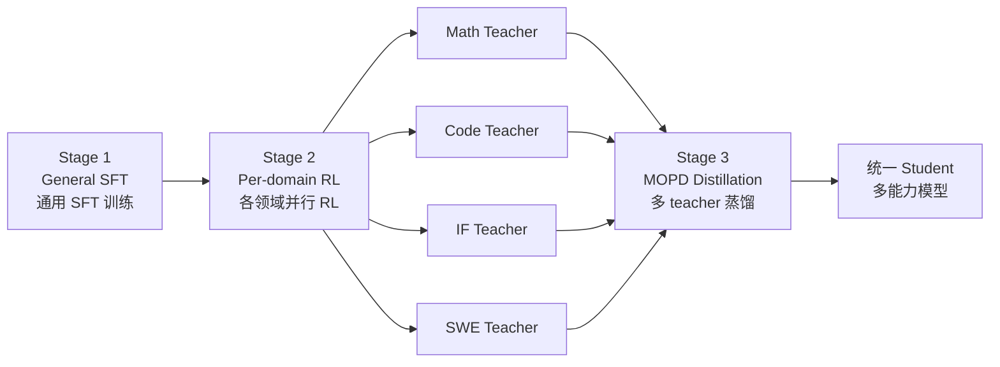

# MOPD：Multi-Teacher On-Policy Distillation for Capability Integration in LLM Post-Training


# MOPD：Multi-Teacher On-Policy Distillation

> [!info] TL;DR
> **核心问题**：经领域 RL 训练后的 LLM 在单领域很强，但如何把多个领域（Math / Code / IF / SWE）专家融合成一个统一模型？
> **核心方法**：Multi-Teacher On-Policy Distillation —— 三阶段流水线（General SFT → 各领域 RL 并行得 teacher → 多 teacher 蒸馏）。学生**自己 rollout**（on-policy），每个 prompt **路由到对应 domain teacher**，teacher prefill 给 per-token log-prob，用 **reverse KL** 让学生模仿。
> **关键结果**：在 Qwen3-30B-A3B 上 normalized score **0.937**（vs RL Teacher 1.000、Mix-RL 0.882、Cascade RL 0.775、Param-Merge 0.328–0.857）。跨 domain 极差仅 0.044，最均匀。已在 **MiMo-V2-Flash (309B)** 生产训练中部署。

## 阅读地图

- [x] §1 问题与动机
- [x] §2 四种已有范式与不足
- [x] §3 MOPD 三阶段流水线
- [x] §4 反向 KL 的两种实现
- [x] §5 关键实验结果
- [x] §6 关键发现：same-origin / PG vs Top-K / 多轮迭代

---

## §1 问题：为什么要融合多领域专家？

经领域 RL 训练后的 LLM 在单领域很强（math、code、instruction-following、SWE 各自 SOTA），但**如何把多个领域的能力合并到一个模型里**，仍然是开放的工业难题。论文一针见血地指出：

> [!quote] 论文核心论点
> Existing paradigms trade off learning efficiency, peak capability, and stability.
> > 现有方法在**学习效率 / 峰值能力 / 训练稳定性**三者间做取舍，没有兼顾的方案。

背后的具体矛盾：领域 RL 让模型在某个 domain 走得很远，但**跨 domain 的优化信号会互相干扰**——简单的"把数据混起来继续 RL"会引发 see-saw effect，某个能力涨了、另一个能力就掉。

## §2 四种已有范式为什么不够？

| 范式 | 做法 | 主要缺点 |
|------|------|---------|
| **Mix-RL** | 把所有 domain 的 prompt 混合到一个数据集联合 RL | 跨 domain 信号互相干扰，**see-saw effect**（顾此失彼） |
| **Cascade RL** | 依次训练各 domain（一个接一个） | 早期能力**灾难性遗忘**，稳定性风险被放大 |
| **Off-Policy SFT** | 在 teacher 的 rollout 上做 SFT | **exposure bias**——学生分布与 teacher 失配，推理时学生走出 teacher 没覆盖的路径就翻车 |
| **Param-Merge** | 权重平均 / Task Arithmetic | 训练不稳定，**通常达不到任一 teacher 的水平** |

> [!warning] 一个具体的失败数字
> 在 Qwen3-30B-A3B 上，**Param-Merge（简单平均）的 normalized score 仅 0.328**，远低于任一 teacher（= 1.0）。即使改进为 Task Arithmetic，也只能到 0.857，仍有 0.143 的 headroom 吃不到。

四种方案覆盖了"数据视角 / 时序视角 / 监督视角 / 参数视角"，但都没做到让一个模型在多 domain 上**同时逼近各自的 teacher**。

## §3 MOPD 流水线（三阶段）



**关键设计**：
- **Stage 1 通用 SFT**：得到一个共享起点，让后续各 domain RL 不至于完全分叉
- **Stage 2 各 domain RL 并行**：recipe 解耦、风险隔离（一个 domain 训崩不影响其他）
- **Stage 3 on-policy 蒸馏**：
  - **学生自己 rollout**（不是用 teacher 的 rollout）→ 没有 exposure bias
  - 每个 prompt **路由到对应 domain teacher** → teacher 用 prefill 给 per-token log-prob
  - 训练目标 = **reverse KL**（学生分布向 teacher 看齐）

> [!note] 为什么 routing + on-policy 重要
> routing 保证**信号归属明确**（math prompt 的 loss 只来自 math teacher，不被 code teacher 干扰）；on-policy 保证**分布匹配**（学生在训练时探索的路径就是推理时会走的路径）。

## §4 反向 KL 的两种实现

### 4.1 通用 reverse-KL 形式

$$\mathcal{L}_{\mathrm{rev\text{-}KL}}=\mathbb{E}_{x,y\sim\pi_{\theta}}\Big[\tfrac{1}{|y|}\sum_{t}\sum_{v}\pi_{\theta}(v)\log\tfrac{\pi_{\theta}(v)}{\pi_{\phi_{d}}(v)}\Big]$$

反向 KL = **teacher 在 student 分布下的期望**。Student 选择哪些 token，teacher 就评估那些 token 的概率比。这与 forward KL（teacher 在 teacher 分布下的期望，mode-covering）相反——reverse KL 是 **mode-seeking**，鼓励 student "**敢于走 teacher 走过的路径**"，但不支持 student 探索 teacher 之外的路。

### 4.2 两种等价实现

> [!example]+ 两种 loss 形式（折叠查看完整推导）
>
> **Policy-Gradient 形式** (Eq. 4) —— 需要完整 teacher 分布
> $$\hat{A}^{\mathrm{clip}}_{\mathrm{MOPD},t}=\mathrm{clip}\big(\log\pi_{\phi_{d}}(y_t)-\log\pi_{\theta}(y_t),\, -A_{\max},\, +A_{\max}\big)$$
> $$\mathcal{L}^{\mathrm{PG}}_{\mathrm{MOPD}}(\theta)=-\mathbb{E}_{x,y}\Big[\tfrac{1}{|y|}\sum_{t}\hat{A}^{\mathrm{clip}}_{\mathrm{MOPD},t}\log\pi_{\theta}(y_t)\Big]$$
>
> **Top-K 形式** (Eq. 5) —— 只用 teacher 的 top-k token
> $$\mathcal{L}^{\mathrm{TopK}}_{\mathrm{MOPD}}(\theta)=\mathbb{E}_{x,y}\Big[\tfrac{1}{|y|}\sum_{t}\sum_{v\in\mathcal{T}^{d}_{t}}\big[\pi_{\theta}(v)\log\tfrac{\pi_{\theta}(v)}{\pi_{\phi_{d}}(v)}-\pi_{\theta}(v)+\pi_{\phi_{d}}(v)\big]\Big]$$
>
> **核心区别**：
> - PG 形式需要完整 $\pi_{\phi_d}(\cdot)$ 分布（显存开销大）
> - Top-K 形式只用 teacher 的 top-k token（$\mathcal{T}^d_t$），加 **bias-correction 项** $\pi_{\phi_d}(v) - \pi_\theta(v)$ 保证 $\pi_\theta = \pi_{\phi_d}$ 时 loss 最小——显存友好
> - 同源 teacher 下两者差距很小（PG 0.937 vs Top-K 0.909）

## §5 关键实验结果（Qwen3-30B-A3B）

| 方法 | Norm. Score | vs RL Teacher | 备注 |
|------|-------------|---------------|------|
| RL Teacher（任一） | **1.000** | — | 各 domain teacher 的参考上界 |
| Mix-RL | 0.882 | −0.118 | see-saw |
| Cascade RL | 0.775 | −0.225 | 遗忘最严重 |
| Off-Policy Finetune | 0.824 | −0.176 | exposure bias |
| Param-Merge (Avg) | 0.328 | −0.672 | 简单权重平均，几乎全废 |
| Param-Merge (Task Arith.) | 0.857 | −0.143 | 线性算术，仍有 headroom |
| **MOPD (本文)** | **0.937** | **−0.063** | **headroom 吃得最多** |

**统一性（uniform profile）**：MOPD 跨 Math / IF / SWE 三个 domain 分数极差仅 **0.044**，而 Cascade RL 极差达 0.41——MOPD 是**唯一跨 domain 均匀**的方案。

**样本效率**：在 IF / SWE 上，MOPD 比 Mix-RL **节省约 5× 样本**。

**大规模验证**：在 **MiMo-V2-Flash (309B)** 上，MOPD 在 Math / Code / IF / SWE / Tool Use 大多数 benchmark 上**持平或超过** teacher。

## §6 关键发现（论文核心 insight）

> [!tip] 关键发现 & 工程优势
> **三大 insight**：
> 1. **必须 same-origin teacher**：把 Math teacher 换成 Qwen3-235B-A22B（5× 初始 KL：0.19 vs 同源 0.04），训练**渐进退化**，Top-K 形式甚至**灾难性发散**。多 teacher 蒸馏对 teacher-student 的"亲缘关系"非常敏感。
> 2. **PG vs Top-K 同源 teacher 下差距很小**：Norm. score 0.937 vs 0.909（4.8 个百分点）。显存允许时优先 PG；Top-K 是省 memory 的等价替代。
> 3. **多轮迭代持续提升**：Iter-2 normalized 到 **0.986**（比 Iter-1 +0.049），说明学生作为新一轮 teacher 还能继续压榨性能。
>
> **论文没说但值得注意的工程优势**：
> - **Dense per-token supervision** → 低方差、高样本效率（解释了 5× sample saving）
> - **Recipe 解耦** → Stage 2 各 domain 独立，故障不会污染其他 domain
> - **可直接 deploy 到生产训练** → MiMo-V2-Flash 309B 已经在用

---

## 我的批注

- ⚡ **亮点**：把"routing + on-policy + reverse KL"三件事打包成一个高度工程化、且**直接 deploy 到 309B 生产训练**的框架；这种"方法 + 系统 + 生产验证"三位一体的论文非常少见
- ❓ **疑问**：Top-K 形式在 cross-origin teacher 下**灾难性发散**——是梯度方向错还是 KL 估计的方差爆炸？需要看附录 §4.4 的稳定性分析
- ❓ **疑问**：Iter-2 把学生当新 teacher 继续蒸馏，会不会引入**能力放大但分布偏移**的问题？论文没有给"为什么会收敛"的理论分析
- 🔗 **相关笔记**：
  - [[Research/Papers/LLM-RL/Group Sequence Policy Optimization]] —— GSPO 也是 on-policy 思路，可与 MOPD 的 on-policy 设计做对比
  - [[Research/Papers/LLM-RL/GVPO：Group Variance Policy Optimization for Large Language Model Post-Training]] —— 同属 post-training 优化
  - [[Research/Papers/tech-report]] —— MiMo-V2-Flash 技术报告（如果有）应该会更详细地介绍 309B 的训练细节

## 行动项

- [ ] 读论文 §4.4.1–4.4.3 关于 same-origin teacher 的消融，理解 cross-origin 退化的根因
- [ ] 查 MiMo-V2-Flash 技术报告，看 production 训练中 MOPD 的具体超参和 scaling 行为
- [ ] 思考：能否把 MOPD 的 routing + on-policy 思路推广到 **pre-train + SFT + RLHF 多源** 的混合蒸馏？
- [ ] 复现：用 Qwen3-30B-A3B + 两个 domain teacher，跑小规模 MOPD 验证 normalized score 的 headroom 收敛

---

## 相关论文（自动聚合）

```dataview
TABLE date, title
FROM #LLM-RL
WHERE !contains(file.name, "MOPD")
SORT date DESC
LIMIT 5
```

---

**元数据**

- arXiv: [2606.30406v1](https://arxiv.org/abs/2606.30406)
- 出版：2026 年 6 月
- 类别：cs.CL, cs.LG
- 作者：Wenhan Ma, Jianyu Wei, Liang Zhao, Hailin Zhang, Bangjun Xiao, Lei Li, Qibin Yang, Bofei Gao, Yudong Wang, Rang Li, Jinhao Dong, Zhifang Sui, Fuli Luo
- 单位：Xiaomi MiMo 团队 + 清华大学
