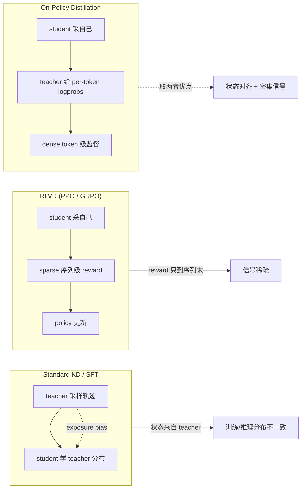
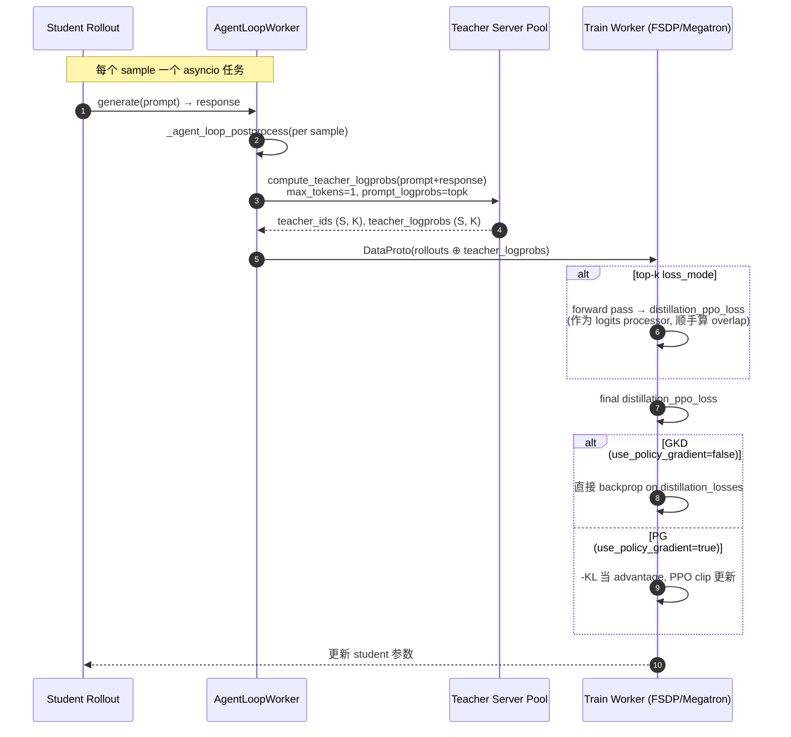

# OPD (On-Policy Distillation)


# OPD (On-Policy Distillation)

> [!info] TL;DR
> **核心思想**：On-Policy Distillation 把 **on-policy RL 的状态对齐**和 **KD 的密集 token 级监督**结合起来。学生用自己的策略采样 rollout，对每个学生访问到的状态，让 teacher 给出 next-token 分布，学生去匹配这个分布。
>
> **最大收获**：解决 KD 的 *exposure bias*（teacher 状态 ≠ student 状态），同时避开 RLVR 的稀疏奖励。
>
> **为什么重要**：把"是否能用大 teacher"这件事从纯离线 SFT/KD 拉到了和 RL 同等地位，是 DeepSeek-V4 / Nemotron-Cascade 2 等 2026 年模型的标配。

## 笔记地图

- [x] §1 背景：为什么需要 OPD（KD vs RLVR）
- [x] §2 OPD 总损失公式与流程
- [x] §3 两种变体：GKD vs PG
- [x] §4 多教师 OPD (MOPD)
- [x] §5 配方速查（quick start / GKD / PG / MOPD）
- [x] §6 配置参数（蒸馏命名空间）
- [x] §7 架构：teacher logprob + student 更新
- [x] §8 指标 / Debug / 关键源码
- [ ] 自己跑一次单 teacher GKD 实验

---

## §1 背景：KD vs RLVR vs OPD

传统训练有三条路线，**OPD 是第三条**：



**Exposure bias 的具体例子**（来自原文）：学生喜欢代数证明、teacher 喜欢几何证明。KD 训练数据全是 teacher 采的几何轨迹，student 在推理时继续走代数路径，结果根本没学到 teacher 在"自己的状态"下会怎么做。

**RLVR 的代价**：reward 通常是 0/1 二元的、在 `</answer>` 处一次性给出。一个 rollout 中所有 token 的梯度都收到同一个 advantage，对长 CoT 任务信息密度太低。

> [!note] 核心 idea
> **用 student 自己采样得到的 state（保证 on-policy）做 teacher 的 KD**，等价于把 RL 的 actor-critic 换成"teacher 监督器"。这样既保留 on-policy 的状态分布一致性，又拿到 token 级密集信号。

---

## §2 OPD 总损失公式

学生用自己策略采样 $y \sim \pi_\theta(\cdot \mid x)$，对每个 state $s_t = (x, y_{<t})$，计算与 teacher 分布 $\nu$ 的某种 divergence $D$：

$$
\mathcal{L}_{\mathrm{OPD}}(\theta)
=
\mathbb{E}_{x,\, y \sim \pi_{\theta}}
\left[
\frac{1}{|y|}
\sum_{t=1}^{|y|}
D\!\left(\pi_{\theta}(\cdot \mid s_t),\ \nu(\cdot \mid s_t),\ y_t\right)
\right]
$$

**采样是固定的**——更新 student 时，$y$ 不重新采样，只是 $D$ 的选择决定了信号怎么传到 student 参数上。这就把 OPD 切成两个子问题：

1. **信号怎么定义**：$D$ 选 forward-KL 还是 reverse-KL？精确计算还是 top-k 近似？单样本 MC 估计用哪个无偏估计？
2. **信号怎么反传**：直接对 student 概率反传（GKD），还是把 $-D$ 当 reward 跑 policy gradient（PG）？

---

## §3 两种变体：GKD vs PG

| 维度 | **GKD OPD** | **PG OPD** |
|---|---|---|
| Divergence | Forward KL $\mathrm{KL}(\nu \,\|\, \pi_\theta)$ | Reverse KL $\mathrm{KL}(\pi_\theta \,\|\, \nu)$ |
| 实现 | teacher top-k logits，**直接反传** student 概率梯度 | 单样本 k1 估计器，**负 reverse KL 当 reward**，PPO 更新 |
| 梯度来源 | $\nabla_\theta \log \pi_\theta$ 对 **teacher top-k 所有 token** | $\nabla_\theta \log \pi_\theta$ 只对 **被采样的 token** |
| 适用 loss_mode | `forward_kl_topk` | `k1` |
| `use_policy_gradient` | `false` | `true` |
| 优点 | 利用完整 teacher 分布信号 | 兼容 PPO clip 体系、易与 RLHF 流程合并 |
| 代价 | 依赖 teacher top-k 实现 | 反传只过采样 token，浪费 distributional 信息 |

### Forward KL (GKD) 的精确形式

$$
D_t = \sum_{v \in V} \nu(v \mid s_t)\, \log\frac{\nu(v \mid s_t)}{\pi_\theta(v \mid s_t)}
$$

实现上只能取 teacher top-k：

$$
\mathcal{L}_{\mathrm{GKD}}^{(k)}(s_t) = \sum_{v \in \mathrm{TopK}(\nu(\cdot \mid s_t))} \nu(v \mid s_t)\bigl[\log\nu(v \mid s_t) - \log\pi_\theta(v \mid s_t)\bigr]
$$

### Reverse KL 的 k1 估计 (PG)

$$
r_t = \mathrm{sg}\!\left(\log \nu(y_t \mid s_t) - \log \pi_\theta(y_t \mid s_t)\right),\quad y_t \sim \pi_\theta(\cdot \mid s_t)
$$

**为什么需要 stop-gradient**：reward 在 policy gradient 目标里，不阻断梯度会对 $\theta$ 求导时让 $\log \nu$ 项消失（teacher 不依赖 $\theta$），结果 loss 跟 teacher 无关。

> [!warning] 别踩这两个坑
> 1. `use_policy_gradient=True` + `loss_mode="forward_kl_topk"`：verl 会发 warning。top-k 损失里 teacher 偏好的 token 多半不是被采样那个，policy gradient 只动 $\log\pi_\theta(y_t)$，top-k 信号基本被丢光。
> 2. `use_policy_gradient=False` + `loss_mode="k1"`：直接 ValueError。k1 没有通向 teacher logprob 的梯度，反传没意义。

---

## §4 多教师 OPD (MOPD)

> [!example]+ MOPD 何时用（点击展开）
> 当学生要跨多个领域（math / code / instruction following）综合能力时，每个领域训一个 domain-specific teacher，路由键选 `data_source`：
>
> ```yaml
> distillation:
>   n_gpus_per_node: 8
>   nnodes: 2
>   teacher_key: data_source
>   teacher_models:
>     gsm8k:
>       key: "openai/gsm8k"
>       model_path: Qwen/Qwen3-32B
>       num_replicas: 2
>       inference: {tensor_model_parallel_size: 2, gpu_memory_utilization: 0.6}
>     geo3k:
>       key: "hiyouga/geometry3k"
>       model_path: Qwen/Qwen3-VL-32B-Instruct
>       num_replicas: 3
>       inference: {tensor_model_parallel_size: 4, gpu_memory_utilization: 0.8}
> ```
>
> **GPU 池约束**：`n_gpus_per_node × nnodes` 必须严格等于 `Σ(num_replicas × per_replica_world_size)`。每个 replica 的 bundle 不能跨 node 边界（例：5-GPU replica 在 8-GPU node 上属于 1 个 node，但若被切成 `[6,7]` + `[8,9,10]` 就会触发 `_validate_replica_node_alignment`）。
>
> **路由坑**：训练数据要 `shuffle: true`。否则拼接的 dataset 会让一个 epoch 内只激活单 teacher 一段。

---

## §5 配方速查

四种开箱即用配置，按需取用：

<details>
<summary><b>单 teacher quick start</b> —— 启用蒸馏、分配 teacher 池、关掉 reference-KL</summary>

```yaml
distillation:
  enabled: true
  n_gpus_per_node: 2
  nnodes: 1
  teacher_models:
    teacher_model:
      model_path: Qwen/Qwen3-32B
      inference: {name: vllm, gpu_memory_utilization: 0.8}

actor_rollout_ref:
  actor: {use_kl_loss: false}
algorithm:
  use_kl_in_reward: false
```

注意 teacher 与 student **必须共享 tokenizer/vocab**（同家族即可，例如 Qwen3-8B ↔ Qwen3-32B）。同时关掉 PPO/GRPO 的 reference-policy KL，避免 student 同时被 reference 和 teacher 拉扯。

</details>

<details>
<summary><b>GKD OPD</b> —— top-k forward KL 直接反传</summary>

```yaml
distillation:
  distillation_loss:
    loss_mode: forward_kl_topk
    topk: 128
    use_policy_gradient: false
```

**不要**叠加 `use_policy_gradient: true`，top-k 的 distributional 信号会被 PG 浪费掉。

</details>

<details>
<summary><b>PG OPD</b> —— k1 单样本估计当 reward 走 PPO</summary>

```yaml
distillation:
  distillation_loss:
    loss_mode: k1
    use_policy_gradient: true
    policy_loss_mode: vanilla
    clip_ratio_low: 0.2
    clip_ratio_high: 0.28
```

当前只支持 `policy_loss_mode=vanilla`，`dppo_tv` 等其他模式 OPD 尚未实现。

</details>

<details>
<summary><b>OPD + 任务奖励</b> —— 同时蒸馏并跑 PPO/GRPO</summary>

```yaml
distillation:
  distillation_loss:
    use_task_rewards: true       # 默认 true
    distillation_loss_coef: 1.5  # 最终 loss = policy_loss + 1.5 × distill_loss
```

`use_task_rewards=false` 时 PPO/GRPO 任务项被清零，只剩 distillation loss。

</details>

---

## §6 配置参数

verl 把蒸馏配置切成 3 个命名空间：

| Namespace | 内容 | 关键字段 |
|---|---|---|
| `distillation.*` | 总开关 + teacher 资源池 | `enabled`, `n_gpus_per_node`, `nnodes`, `teacher_key`, `teacher_models` |
| `distillation.teacher_models.<name>.*` | 每个 teacher 一项 | `key`, `model_path`, `num_replicas`, `inference.*` |
| `distillation.distillation_loss.*` | 损失模式 + 聚合 | `loss_mode`, `topk`, `use_task_rewards`, `use_policy_gradient`, `clip_ratio_*` |

### loss_mode 速查

| loss_mode | 类型 | 是否 top-k | 与 `use_policy_gradient` 兼容性 |
|---|---|---|---|
| `forward_kl_topk` | Forward KL over teacher top-k | 是 (k 默认 32) | 只能 `false` |
| `kl`, `k2`, `k3`, `low_var_kl`, `abs`, `mse` | Reverse KL 单样本估计 | 否 | 倾向 `true`（PG OPD） |
| `k1` | Reverse KL 无偏估计（log π - log ν） | 否 | 必须 `true`（直接反传无意义） |

> [!warning] `teacher_model` 这个名字的坑
> 单 teacher 时命名约定叫 `teacher_model`。但**多 teacher 时这个键会被静默丢弃**——若同时存在 `teacher_model` 和 `teacher_model2`，只有 `teacher_model2` 生效。
>
> 多 teacher 必须改名：`teacher_model1`、`teacher_model2`，或干脆不保留 `teacher_model` 键。

### temperature 强制 1.0

teacher logprob 计算时 `temperature` 永远强制 `1.0`（无论你配多少）。`prompt_logprobs` 是一次 forward pass，没真采样，温度不影响结果。YAML 默认通过 Hydra 插值 `temperature: ${oc.select:actor_rollout_ref.rollout.temperature}`，若 student rollout 用 0.7 之类温度，会被忽略并打 warning。

---

## §7 架构：teacher logprob 与 student 更新



**两条关键设计选择**：

1. **teacher 调用与 rollout 解耦**：`compute_teacher_logprobs` 是 per-sample 触发，没 batch-wide barrier。teacher 工作能 overlap 在其他 sample 的 rollout 上。
2. **top-k 损失"折中实现"**：当前推理服务只返回 sampled token + teacher top-k token 的 logprobs，不支持按任意 token id gather。所以 verl 只能实现 *teacher-top-k forward KL*，无法做 *student-top-k reverse KL*。

---

## §8 指标 / Debug / 源码

### 核心指标（`actor/distillation/*`）

| 指标 | 含义 |
|---|---|
| `loss` | 未缩放 distillation loss；与 `actor/pg_loss` 对比可定 `distillation_loss_coef` |
| `abs_loss` | loss 的绝对值（k1 这种有符号估计器特别有用） |
| `loss_min` / `loss_max` | batch 内 per-token loss 的极值 |
| `student_mass` | student 在 teacher top-k 上的概率质量 |
| `teacher_mass` | teacher 在自己的 top-k 上的概率质量（太低 → top-k 截断太多） |
| `overlap_ratio` | $\|\mathrm{TopK}_\nu \cap \mathrm{TopK}_\pi\| / k$；接近 1 = 两边 top-k 集合高度一致 |

### Debug 技巧

把 student 设成与 teacher 相同的模型，**loss 应近似为 0**（不是精确 0，因为 train engine 和 inference engine 有数值差）。这是验证蒸馏链路是否接通的快速 sanity check。

### 关键文件

| 文件 | 作用 |
|---|---|
| `verl/experimental/teacher_loop/teacher_model.py` | teacher 推理 replica 池 + per-teacher `LLMServerClient` |
| `verl/experimental/teacher_loop/teacher_manager.py` | `AsyncTeacherLLMServerManager`：单/多 teacher 路由 |
| `verl/experimental/agent_loop/agent_loop.py` | `_compute_teacher_logprobs`：post-rollout 触发 |
| `verl/trainer/distillation/{fsdp,megatron}/losses.py` | `compute_forward_kl_topk` 各后端实现 |
| `verl/trainer/config/distillation/distillation.yaml` | YAML 默认值 |
| `examples/on_policy_distillation_trainer/` | `run_qwen3_8b_{fsdp,megatron}.sh` + `run_qwen3_vl_8b_fsdp.sh` + `run_qwen3_8b_mopd_fsdp.sh` |

---

## 我的批注

- ⚡ **亮点**：把 teacher logprob 当 per-sample 异步 hook 接到 agent loop，比 batch-level KD pipeline 吞吐高很多。teacher 池与 student 池完全解耦也是工程上的关键决策。
- ❓ **疑问**：
  - "为什么 k1 必须配 PG？" → 直觉是 k1 = (log π − log ν) 的 sg，反传时如果 student logprob 这一支被 detach，那信号就完全来自 log π 的梯度方向上，确实是 PG 的语义。但实际 verl 的 `_aggregate_distillation_losses` 是怎么把这个 reward 接到 PPO clip 上的？需要看 `compute_policy_loss` 的内部。
  - "Forward KL 还是 Reverse KL 谁更适合做 student 蒸馏？" 经典结论：forward KL 是 mode-covering（student 分布铺得更开），reverse KL 是 mode-seeking（student 更集中）。对 LLM 这种多模分布，应该 forward KL（mode-covering 更安全），所以 GKD OPD 默认走 forward KL 是合理的。
- 🔗 相关笔记：[[PPO]]、[[grpo]]、[[dapo]]、[[CISPO]]、[[SAPO]]、[[RLOO]]、[[ReMAX（REINFORCE argmax）]]

---

## 行动项

- [ ] 跑 `examples/on_policy_distillation_trainer/run_qwen3_8b_fsdp.sh` 单 teacher GKD 实验，看 `actor/distillation/overlap_ratio` 收敛曲线
- [ ] 对比 PG OPD（k1）vs GKD OPD（forward_kl_topk）在同一 student / teacher 上的 `abs_loss` 与 `student_mass`
- [ ] 阅读 `verl/trainer/distillation/fsdp/losses.py` 中 `compute_forward_kl_topk` 的实现，确认 top-k 截断后是否补 mass normalization
- [ ] 在 [[RLHF 调研笔记]]（如不存在则新建）汇总 OPD 与 [[CISPO]]、[[SAPO]] 的差异
