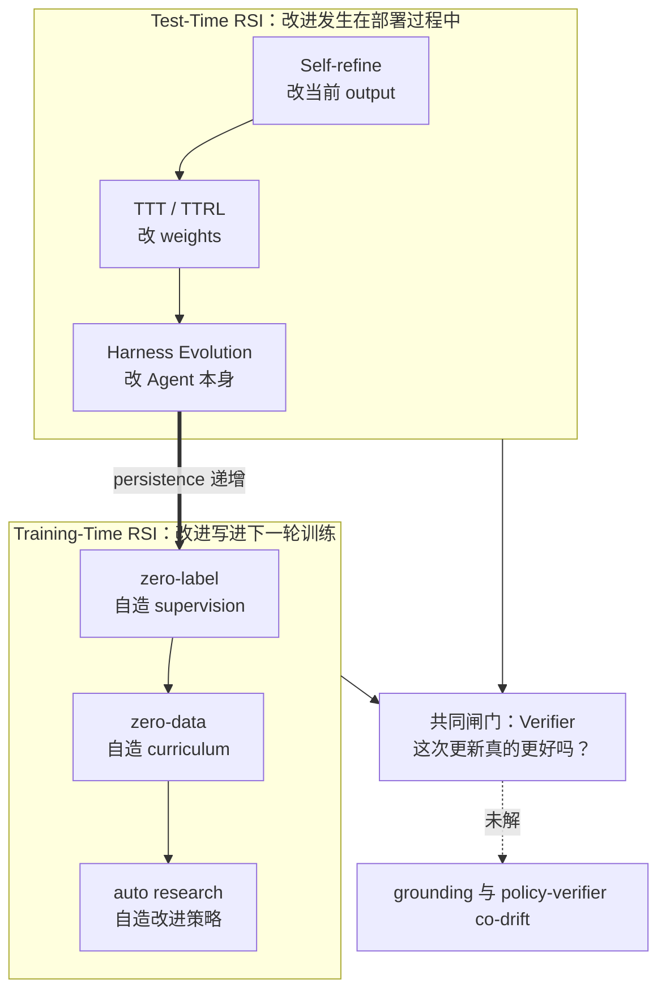

# RSI：Recursive Self-Improvement 分类图谱


# RSI：Recursive Self-Improvement 分类图谱

> [!info] TL;DR
> **核心思想**：RSI（Recursive Self-Improvement）= 让 LLM / Agent 不仅完成任务，还能利用自己产生的经验、数据、反馈甚至代码，迭代地改进自己。近义词极多（self-evolve / self-play / self-refine / self-reward / self-distill），但闭环程度和"被改进的东西"各不相同。
> **最大收获**：所有工作都沿同一条主线推进——**逐步把人移出 improvement loop**。Test-Time 侧，改进对象从 output → weights → Agent 本身（persistence 递增）；Training-Time 侧，从自造 supervision（zero-label）→ 自造 curriculum（zero-data）→ 自造改进策略（auto research）。
> **为什么重要**：闭环每扩展一层，最终都撞上同一个问题——**verification 是否可靠**。现状是绝大部分 self-evolving 工作仍停留在 human-on-the-loop，真正的 closed loop 远未实现。

## 笔记地图

- [x] §0 目标与全景
- [x] §1 Test-Time RSI：三级递进
- [x] §2 Training-Time RSI：zero-label / zero-data / auto research
- [x] §3 Verifier：真正的瓶颈
- [ ] 我的批注（待补充）

## §0 目标：把人移出 improvement loop

| 阶段 | 人的角色 |
|---|---|
| **human-in-the-loop** | AI 提出改进，但每次修改需人确认 |
| **human-on-the-loop** | data / reward / verifier 已自动产生，人监督结果、控制部署 |
| **closed loop** | 系统自己产生、验证并应用改进，无需人工审核 |

按"自我改进发生的阶段"，现有方法分两大类：



## §1 Test-Time RSI：persistence 的三级递进

严格说是 **Deployment-Time RSI**：self-improvement 直接发生在部署过程中，而非等下一轮 offline training。各方法的真正差别在于**改进能保留多久**；同时人从每一步的 critique / revision 参与者，退到对整个 loop 的监督者。

| 层级 | 改进对象 | 改进保留多久 | 代表 |
|---|---|---|---|
| ① Self-critique & Self-refine | 当前 output | episode 结束即消失 | Generate → Critique → Refine |
| ② Test-Time Training（TTT） | weights | 当前 query 内持续 | TTRL、ETTRL |
| ③ Harness Evolution | Prompt / Tool / Memory / Skill / Workflow / Agent Code | 跨 task 长期沉淀 | Darwin Gödel Machine、SkillMaster |

### ① Self-critique & Self-refine —— 改当前 output

权重冻结，针对当前 query 反复"生成 → 检查 → 修改"。**关键在 verification signal**：单靠模型自我 critique 并不稳定，有效做法通常引入 execution feedback、retrieval、solver 或 judge 来提供 grounding。但 refine 得再好，经验也随 episode 结束消失——提升的是单次回答，不是长期能力。

### ② Test-Time Training —— 改进写入 weights

TTT 不只改 output，而是直接更新参数，让当前 query 的 experience 有机会写进 weights：

> Experience → Update → Better Model → New Experience

这一范式可与不同后训练算法结合，热门的一类即 **Test-Time RL（TTRL）**，vault 内已有细读：[[TTRL：Test-Time Reinforcement Learning|TTRL]]（majority voting 伪标签 + GRPO）及其改进 [[ETTRL：BALANCING EXPLORATION AND EXPLOITATION IN LLM TEST-TIME REINFORCEMENT LEARNING VIA ENTROPY MECHANISM|ETTRL]]。

### ③ Harness Evolution —— 改 Agent 本身

优化对象从 output / weights 扩展到整个 Harness：Prompt、Tool、Memory、Skill、Workflow，甚至 Agent Code。

- 从真实 interaction 与失败 trajectory 积累经验：Computer-use Agent 从 failure 生成 training experience；Experience Graph 长期保存 branch / execution / failure / repair。
- SkillMaster、SkillSmith、Socratic-SWE：让 Agent 自动生成、修改、组合自己的 skills 和 tools（prompt 层的对应工作是 [[GEPA：REFLECTIVE PROMPT EVOLUTION CAN OUTPERFORM REINFORCEMENT LEARNING|GEPA]]）。
- 更激进的 Gödel Agent、Darwin Gödel Machine：直接 self-modify Agent code，搜索并保留更好的自身实现。

这里真正重要的变化是 **accumulation**：一次 response refinement 会消失，一次 test-time update 保留一段时间，而新的 memory / skill / tool / workflow 可跨 task 持续存在，成为下一轮 evolution 的基础。vault 内对应：[[ReasoningBank：Scaling Agent Self-Evolving with Reasoning Memor|ReasoningBank]]、[[AGENT WORKFLOW MEMORY]]、[[RAGEN：Understanding Self-Evolution in LLM Agents via Multi-Turn Reinforcement Learning|RAGEN]]。

> 本文 §1 主线：**改进从当前 output，逐渐进入 weights，最后沉淀到 Agent 本身。**

## §2 Training-Time RSI：自己产生 learning signal

核心变化：系统自己产生 learning signal 并送回 training loop，improvement 通过参数更新**跨 iteration 持续积累**，直接进入下一轮 model。人从直接提供 label / reward，退到设计 training rule、监督整个 loop。

### （1）zero-label：人出题，模型自造 supervision

Problem 仍由外部提供，但 supervision 由模型自己产生。三条路线：

| 路线 | learning signal | 代表 |
|---|---|---|
| Fine-tuning | 自筛高质量 trajectory 作下一轮 SFT 数据 | STaR（仍需正确答案）→ 只用 unlabeled questions + self-verification |
| RL（self-rewarding RL） | ① 内生信号：confidence / likelihood / entropy / self-certainty；② group 级：majority voting 伪 reward | [[RLPR：EXTRAPOLATING RLVR TO GENERAL DOMAINS WITHOUT VERIFIERS\|RLPR]]、[[GENERALIST REWARD MODELS：FOUND INSIDE LARGE LANGUAGE MODELS\|Generalist RM]]、[[TTRL：Test-Time Reinforcement Learning\|TTRL]]、[[The Majority is not always right：RL training for solution aggregation\|Majority]] |
| Distillation（on-policy self-distillation） | student 自己 rollout，teacher 在其实际轨迹上给 dense token-level supervision | OPSD（同一模型既当 student 又当 teacher，但仍需 verified solution）→ U-OPSD（连 reference label 也去掉，用 multi-rollout majority consensus 造 pseudo-solution） |

三条路线分别用 trajectory、reward、token-level distribution，但本质相同：**把原本由人提供的 supervision 搬进模型自己的 improvement loop**。

> [!warning] zero-label 的两大风险
> - **self-confirming loop**：generator 与 verifier 共享相似能力与 bias，错误沿 "model bias → biased evaluation → biased learning signal → stronger bias" 不断写回模型。
> - **training collapse**：即使 reward 完全正确，训练动态也可能不稳定——在用真实 binary verifier 的 code RL 中出现过典型 rise-and-collapse，KL / EWC 等约束也无法完全阻止。

### （2）zero-data：连"学什么"也自己定

zero-label 仍需外部出题；zero-data 进一步让模型**自己生成 problem / curriculum**，即 self-play：Absolute Zero、[[R-Zero：Self-Evolving Reasoning LLM from Zero Data|R-Zero]] 采用 proposer / challenger ↔ solver 的 co-evolution；Agent0 把这种关系扩展到 agentic task，curriculum agent 与 tool-using executor 从零外部数据共同 evolve。

> [!example]+ co-evolution 长什么样（以 R-Zero 为例）
> challenger 根据 solver 当前能力生成新问题 → solver 解题 → 多数投票产生 pseudo label → 双方被重新训练 → 更强的 solver 反过来改变"下一轮值得出什么题"。curriculum 不来自人，而来自 solver 自身的能力边界。同路线另见 [[BEYOND PASS@1：SELF-PLAY WITH VARIATIONAL PROBLEM SYNTHESIS SUSTAINS RLVR|Variational Problem Synthesis]]。

| | problem 来源 | learning signal | 交给模型什么 |
|---|---|---|---|
| zero-label | 人出题 | 自造 | how to learn |
| zero-data | 自造 | 自造 | what to learn |

但有一条边界：problem 与 learning signal 动态变化了，**improvement procedure 仍由人预设**——majority voting、uncertainty reward、filtering rule 等 evaluation mechanism 不会随 solver 提升而自动变强。

> [!warning] zero-data 的两大风险
> - **diversity collapse**：proposer 收敛到一小类最容易满足 reward 的问题，curriculum 越来越窄。
> - **reward grounding failure**：reward 无法锚定真实能力提升时，proposer 与 solver 的 co-evolution 共同偏离真正有价值的 learning frontier。

### （3）auto research：自造 improvement strategy

再往前一步：self-improvement 从 curriculum generation 扩展到 research process 本身。research agent 根据模型当前表现分析 failure、提出 hypothesis、选择 data / training recipe、运行实验，并按 evaluation result 持续调整后续 research decision。

| | self-generated 的东西 |
|---|---|
| zero-label | supervision |
| zero-data | curriculum |
| auto research | improvement strategy |

## §3 Verifier：RSI 的真正瓶颈

把两节放在一起，闭环实际在逐层扩展：

> answer → experience → learning signal → problem / curriculum → verifier

**verification 很可能比 generation 更接近 RSI 的核心瓶颈**——一个 self-improvement loop 能否持续，取决于它依赖的 evaluation signal 是否可靠。

| 任务域 | verification 手段 | 特点 |
|---|---|---|
| math / code | proof checker、unit test、execution feedback | 易形成稳定自动 loop，但 criterion 预先固定 → **bounded self-improvement** |
| open-ended agent / creative / research taste | 需评价 novelty、usefulness、importance | "什么算更好"本身难定义 → 越接近 open-ended RSI 越难 |

近期开始出现**直接针对 verifier 本身**的 self-improvement：

- **Self-Trained Verification**：把 verifier 当训练对象，让 verification capability 随 iteration 提升。
- **Self-evolving Deep Research Agent**：agent 能力演化时，同步更新评价 research output 的 rubric / verifier。
- **Meta-evaluation**：不只评价 output，而是评价 evaluator 本身。
- **Red Queen Gödel Machine**：agent 与 evaluator 共同 evolve，evaluation criterion 不再固定。

注意与 R-Zero 的区别：R-Zero 的 evaluation signal 随 solver 状态动态变化，但 majority voting、uncertainty reward 等 verification **mechanism 仍是人为设定**；上面这些工作进入 evolution loop 的，是 verifier 的能力乃至 criterion 本身。

> [!question] 全文悬而未决的核心问题
> verifier 可以被 meta-verifier 评价，evaluator 可以与 agent co-evolve，但**不断变化的 evaluation mechanism 如何保持与真实目标的 grounding**？如何让 verifier 持续进化、又不与 policy 共同 drift（co-drift）？这是 closed-loop RSI 最关键也最难的问题之一，目前没有成熟答案。

## 我的批注

- ⚡ 全文最有力的框架是两条线：**persistence**（output → weights → Agent）与**闭环逐层扩展**（supervision → curriculum → strategy → verifier），把一堆 self-* 术语统一在"人逐步退出 loop"之下。
- ⚡ §3 的判断与 [[Review：自进化Agent的RL Memory与Skill方法批判]] 形成互证：那边说 memory / skill 工作 over claim、真问题是 credit assignment；这边说 generation 侧已基本闭环、瓶颈全压到 verification——都指向 **evaluation 被高估、verification 被低估**。
- ❓ verifier 自进化四方向（Self-Trained Verification / meta-evaluation / Red Queen）都还较新，值得各建一条 paper 笔记跟踪。
- ❓ training collapse 机理文中未展开，可对照 [[CURE：Critical-Token-Guided Re-concatenation for Entropy-collapse Prevention|CURE]]（entropy collapse）与 [[ProRL：Prolonged Reinforcement Learning Expands Reasoning Boundaries in Large Language Models|ProRL]]。

## 行动项

- [ ] 精读参考文献：arXiv:2607.07663、《A Taxonomy of Self-Evolving Agents》(lsl.zone)、Anthropic《Recursive Self-Improvement》
- [ ] 建卡：Absolute Zero、Agent0、Darwin Gödel Machine、OPSD / U-OPSD、Red Queen Gödel Machine
- [ ] 想清楚：自己的 RLVR 实验里，怎么监测 reward / verifier 与 policy 的 co-drift？

## 相关笔记

```dataview
TABLE WITHOUT ID file.link AS "笔记", date AS "日期"
FROM "Research/Papers"
WHERE contains(tags, "Reading") AND (contains(file.name, "Self-Evolv") OR contains(file.name, "自进化") OR contains(file.name, "Self-Improvement") OR contains(file.name, "R-Zero") OR contains(file.name, "TTRL"))
SORT date DESC
```

## 参考文献

1. [arXiv:2607.07663](https://arxiv.org/pdf/2607.07663)
2. [A Taxonomy of Self-Evolving Agents (lsl.zone)](https://lsl.zone/blog/2026/a-taxonomy-of-self-evolving-agents/)
3. [Anthropic：Recursive Self-Improvement](https://www.anthropic.com/institute/recursive-self-improvement)

