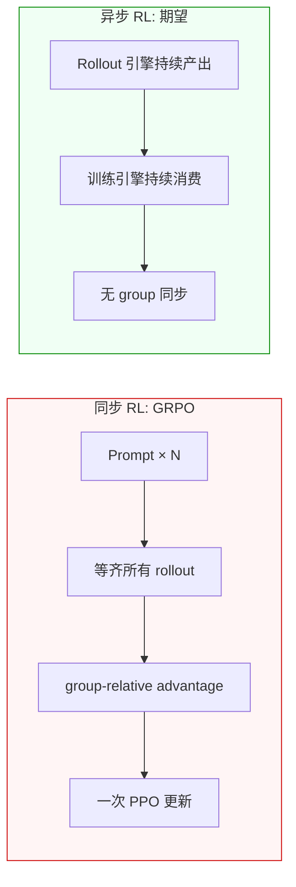
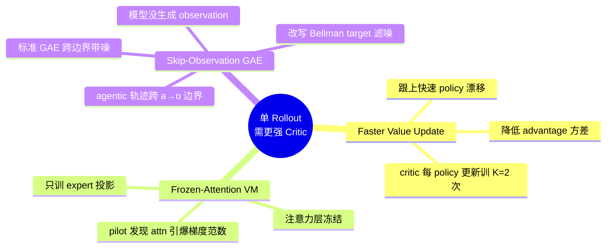
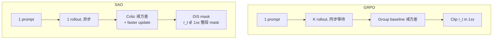
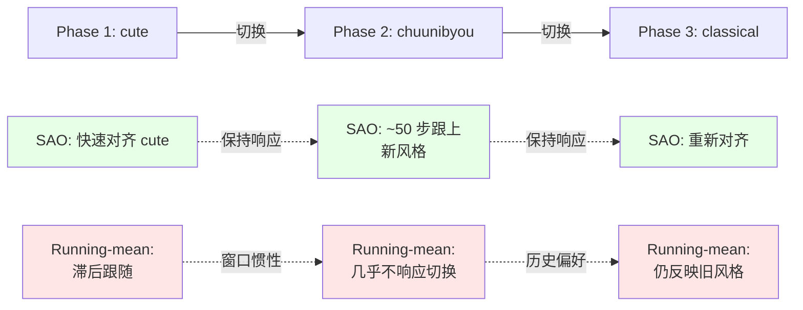

# SAO — Single-Rollout Asynchronous Optimization for Agentic RL


# SAO: Single-Rollout Asynchronous Optimization

## 笔记地图

- [x] 问题定义：同步 vs 异步 RL 的根本矛盾
- [x] 方法：DIS + Single-rollout + 三个 value 改进
- [x] 实验：6 个基准 + ablation + 训练动态 + 在线学习仿真
- [ ] 相关工作：与 GRPO / VAPO / AReaL 的关系
- [ ] 我的疑问：frozen-attention 的代价？DIS 在长 horizon 是否还有效？

> **阅读进度**：当前 `read-status: in-progress`，用 [[Meta Bind]] 插件可一键切换

```meta-bind
button
type: cycle
id: read-status
cycle: [todo, in-progress, done]
```

---

## §1 背景：为什么需要异步 agentic RL

### 同步 RL 的痛点
在长链路 agentic 任务里（一次 rollout 可能要走 100+ 步），**同步** pipeline 必须等一个 batch 里最慢的 rollout 跑完才能开始训练。常见症状：

- 长尾样本拖慢整轮迭代 → GPU 利用率低
- 工程上必须 padding 到统一长度，进一步浪费算力
- 在 coding agent 这种"百轮工具调用"的场景里尤其严重

### 异步 RL 的代价
异步 rollout 不需要等齐整 batch，但它引入 **policy lag**：

> rollout 模型 $\pi_{\text{rollout}}$ 是**几轮训练前的旧策略**，用它采出来的轨迹再去更新 $\pi_\theta$，等同于在 off-policy 数据上做 on-policy 更新。

**GRPO 在异步场景下结构上不工作**：GRPO 依赖**同一 prompt 的多条 rollout** 算 group-relative advantage，这要求所有 rollout 的 policy 差距不能太大；异步下 group 内政策漂移严重，advantage 估计失效。

> [!quote] 作者
> "group-wise sampling doesn't naturally fit asynchronous training — groups must wait for the slowest sample."



---

## §2 方法：SAO 三大组件

### 2.1 DIS: 直接 Double-Sided Importance Sampling

> [!note]+ 公式推导（折叠，先看思路）
> Decoupled PPO 引入三个 policy：$\pi_\theta$ (训练中)、$\pi_{\theta_{\text{old}}}$ (上次训练快照)、$\pi_{\text{rollout}}$ (采样用)。但在异步场景下 $\pi_{\theta_{\text{old}}}$ **根本追踪不了**——一个 rollout 可能横跨多次 policy 更新。
>
> SAO 的简化：丢掉 $\pi_{\theta_{\text{old}}}$，直接用 $\pi_\theta / \pi_{\text{rollout}}$：
> $$r_t(\theta) = \exp\left(\log\pi_\theta(a_t|s_t) - \log\pi_{\text{rollout}}(a_t|s_t)\right)$$
>
> **双侧 mask** 比标准 PPO 更激进：把落在 $[1-\epsilon_\ell, 1+\epsilon_h]$ 之外的 token **整段 mask 掉**（梯度为 0），而不是只裁剪梯度：
> $$f(x, \epsilon_\ell, \epsilon_h) = \begin{cases} x & \text{if } 1-\epsilon_\ell < x < 1+\epsilon_h \\ 0 & \text{otherwise} \end{cases}$$
>
> **直觉**：异步下 off-policy 比例分布长尾，单靠 PPO 的 clip 不足以抑制少量极端 token 对梯度的污染——直接 mask 更稳。

### 2.2 单 Rollout + 强化 Value Model

单 rollout 砍掉了 group 同步开销，但也让 advantage 估计**方差更大**（没有 group baseline 减方差）。SAO 通过加强 critic 来补：



### 2.3 Skip-Observation GAE（细节）

> [!example]+ 公式与直觉（折叠）
> Agentic 轨迹形式：$T = [a_0, o_0, a_1, o_1, \ldots]$，observation $o_i$ 由**环境生成**，不在策略分布内。
>
> 标准 GAE 在 $a_{i,N} \to o_{i+1} \to a_{i+1,0}$ 这条边界上的 bootstrapping value 噪声很大。SAO 改写为：
>
> $$\hat{A}(a_{i,N}) = \delta + \gamma\lambda \hat{A}(a_{i+1,0})$$
> $$\delta = r_t + \gamma V(a_{i+1,0}) - V(a_{i,N})$$
>
> **关键改动**：$\hat{A}(a_{i+1,0})$ 之前那一项本来是 $V(o_{i+1})$（环境 token 的 value），现在直接链到下一个 action 的 advantage。**绕过环境状态**，把"动作价值"链路直接打通。

### 2.4 GRPO vs SAO 对照



---

## §3 实验

### 3.1 设置

| 项 | 值 |
|---|---|
| Backbone | Qwen3-30B-A3B-Thinking-2507，SFT 在 Tool-Integrated Reasoning 数据 |
| Batch size | 128 |
| Group size | **1** (关键) |
| Max length | 128k |
| Policy LR | 1e-6 |
| $\epsilon_\ell$ / $\epsilon_h$ | 0.3 / 5.0 (reasoning) · 0.8 / 3.0 (coding) |
| K (critic 频次) | 2 |
| Coding scaffold | OpenHands，最多 300 轮 |

### 3.2 主结果

| Model | AIME2025 | BeyondAIME | HMMT | IMOAnswerBench |
|---|---|---|---|---|
| Claude-Sonnet-4.5 | 87.0 | 62.0 | 81.7 | 65.8 |
| GPT-5 High | 94.6 | 74.0 | 89.2 | 76.0 |
| GLM-4.7 | 95.7 | — | 93.5 | 82.0 |
| SFT (w/ python) | 80.4 | 53.3 | 75.2 | 53.3 |
| GRPO (w/ python) | 84.2 | 54.8 | 76.0 | 55.8 |
| **SAO** | **97.3** | **74.8** | **88.3** | **74.0** |
| SAO (DIS only) | 94.2 | 71.5 | 86.7 | 71.3 |
| GRPO (+ DIS) | 93.5 | 70.8 | 84.0 | 70.0 |

| 基准 | Qwen3-30B-A3B baseline | GRPO+DIS | **SAO** |
|---|---|---|---|
| SWE-Bench Verified | 23.0 | 27.0 | **29.8** |

> [!tip] 关键观察
> - SAO 在 4/4 reasoning 上**全面击败** GRPO 和加了 DIS 的 GRPO，说明不只是 DIS 的功劳，**整套单 rollout + value 改进**叠加才有效
> - SWE-Bench Verified 提了 **+6.8 绝对分**（vs baseline），这是 agentic coding 的大数字
> - **训练稳定性**：标准 GRPO 在 ~160 步崩，SAO 训了 **1000 步** 仍稳定

### 3.3 Ablation

| 变体 | AIME2025 | BeyondAIME |
|---|---|---|
| SAO（完整） | **97.3** | **74.8** |
| w/o Faster value | 95.0 (-2.3) | 69.8 (-5.0) |
| w/o Frozen attention | 90.6 (-6.7) | 74.5 (-0.3) |
| Vanilla VAPO（w/o DIS） | 91.3 | 69.0 |
| Running mean baseline | 79.8 | 55.3 |

> [!warning] 三个改动缺一不可
> - **frozen-attention** 在 AIME 上掉了 6.7 分——这是**最大单点贡献**
> - **faster value update** 在 BeyondAIME 上掉了 5.0 分——长链路任务里 critic 频率关键
> - **Vanilla VAPO** 在 ~90 步就崩——DIS 是**稳定性基础**，没有它其他都白搭

### 3.4 训练动态

> [!example]+ 训练曲线对比（折叠）
> **Explained variance（EV）**：SAO 在 ~400 步后 EV 显著高于 baseline；EV 衡量 critic 的预测质量，越接近 1 越好。
>
> **Critic gradient norm**：full-parameter 训练的 critic 梯度范数**比 frozen-attention 大一个数量级——直接对应上表 frozen-attention 那 6.7 分的损失。
>
> **Clip ratio**：VAPO 的 clip ratio 接近 0（说明它**根本没在裁剪**，gate 失效）；SAO 的 DIS 主动 clip 偏离更新。这是稳定性差异的根源。

### 3.5 在线学习仿真

构造任务：写作风格在 cute → chuunibyou → classical 三阶段切换，reward = $r_{\text{quality}} \times r_{\text{style}}$，judge 用 GLM-4.7。



> [!quote] 关键洞察
> Running-mean baseline 有**历史窗口惯性**，切换到新风格时它仍反映旧偏好，导致 reward 看起来"够好"，策略不更新。SAO 的 state-dependent baseline **只反映当前策略状态**，能跟上切换。

---

## §4 相关工作（折叠）

> [!note]+ RLHF 算法谱系
> - **PPO**：clipped surrogate + GAE，需 critic，是 SAO 的基础
> - **GRPO**：group-normalized rewards（无 critic），但 group 同步开销大
> - **RLOO**：REINFORCE leave-one-out，组规模小就方差爆炸
> - **VAPO**：async-friendly PPO 改进（已被 SAO 全面超越）
>
> [!note]+ 异步 RL 系统
> - **IMPALA**：actor-learner 分离
> - **AReaL**：异步 RLHF
> - **ROLL Flash**：异步 rollout flash attention
>
> 共同问题：都假设**仍能用 group baseline 或 trust region 约束**，而 SAO 论证这些约束在异步长链路下结构上失效。

---

## §5 部署：GLM-5.2 (750B-A40B)

- 模型规模：**750B 总参 / 40B 激活**（MoE）
- 训练规模：稳定 **1000 步**
- 是首批在异步 agentic pipeline 上训出大 MoE 的公开报告之一

---

## 我的批注

- ⚡ **双侧 mask vs 单侧 clip** 这个区别很微妙但关键——异步下 off-policy 比例分布长尾，单侧 clip 留了"边界附近的污染梯度"，mask 彻底干净。值得在自己做 async RL 时借鉴。
- ⚡ **frozen-attention 节省的训练成本**没单独报——如果 attn 冻结只训 expert projection，critic 显存/通信直接少一个数量级。这对 750B MoE 是**必要**而非"经验技巧"。
- ❓ **frozen-attention 的代价**：attn 不更新意味着 critic 对**长上下文位置编码**不敏感，多轮 agent 里 observation 的 token 位置是关键信号——会不会有 systematical bias？
- ❓ **DIS 在 1000+ 步外推**？$\epsilon_h = 5.0$ 这么宽是经验值，理论上没收敛性保证
- ❓ **Skip-Observation GAE** 把动作链路直接打通后，**observation 上的 reward 信息**还能传到前面吗？（$\delta$ 里只有 $r_t$，observation token 的价值如何被利用？）
- 🔗 与 [[VAPO：Efficient and Reliable Reinforcement Learning for Advanced Reasoning Tasks|VAPO]] 同源，SAO 把 VAPO 的失败原因归到"没做 DIS"
- 🔗 与 [[SAPO]]（Soft Adaptive Policy Optimization）名字像但完全不同的方法——SAPO 改 clip，SAO 改 group + clip + critic

## 行动项

- [ ] 精读 SAO 论文 §3.1 DIS 部分，跟自己以前写的 IS estimator 推导对比
- [ ] 在小规模 async RL 实验里试 frozen-attention critic
- [ ] 调研 GLM-5.2 公开技术报告，看 SAO 在更大规模下的参数选择是否一致
- [ ] 把 [[grpo]]、[[RLOO]]、[[VAPO：Efficient and Reliable Reinforcement Learning for Advanced Reasoning Tasks|VAPO]] 也整理一下，画一张"RLHF 算法谱系图"
