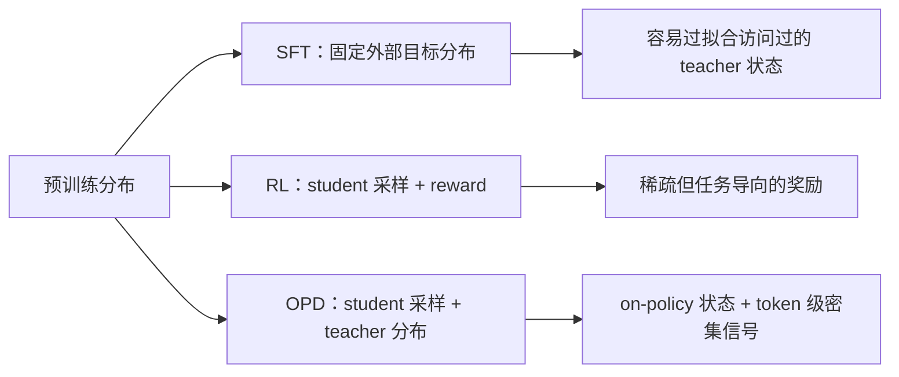
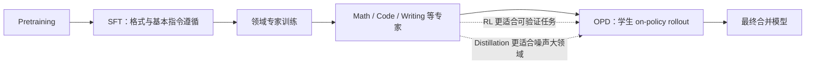

# SFT、RL 与 OPD：从分布视角理解后训练

# SFT、RL 与 OPD：从分布视角理解后训练

> [!info] TL;DR
> **核心思想**：把语言模型看成序列分布，post-training 就是在重塑这个分布。SFT 追随固定的外部数据分布，RL 从当前策略采样并用奖励筛选，OPD 在学生自己的状态上匹配 teacher 分布。
>
> **最大收获**：相比“用什么 loss”或“teacher 多强”，**数据是否来自 student 当前策略（on-policy）**更能解释泛化能力与灾难性遗忘差异。
>
> **为什么重要**：它把 SFT、RL、On-Policy Distillation 放进同一坐标系，也提示下一代算法应同时保留 on-policy、密集信用分配和尽量无偏的优化信号。

## 笔记地图

- [x] 问题：三种后训练方法究竟差在哪
- [x] 核心证据：不同 teacher 的 OPD 实验
- [x] 解释：为什么 RL / OPD 更抗遗忘、泛化更好
- [x] 流水线：SFT → 专家训练 → OPD 合并
- [ ] 我的批注与复现计划

---

## §1 统一视角：后训练是在重塑分布

语言模型并不是简单地记忆一个答案，而是在每个上下文中定义 next-token distribution。于是可以用两个问题比较训练方法：

1. **目标分布是什么？** 是人工/teacher 给出的固定分布，还是奖励定义的高质量策略？
2. **训练数据从哪里来？** 是预先收集的离线轨迹，还是 student 当前策略访问到的状态？

### SFT：固定外部分布

SFT 在训练前准备好 `(prompt, response)` 数据，通常通过交叉熵把模型拉向示范分布。它的优点是稳定、适合冷启动；但训练数据不随 student 的行为变化，且每个 token 都被近似同等地监督，因此可能导致灾难性遗忘。

### RL：当前策略分布上的奖励优化

RL 让 student 自己 rollout，再根据结果打分并更新 policy。RLVR 中 verifier 的奖励通常接近任务质量；RLHF 则依赖 reward model，可能带来偏差。RL 的主要弱点是奖励往往在序列末端给出，长 reasoning 中信用分配很稀疏。

### OPD：两者之间的桥

OPD 使用 student 自己生成的轨迹，所以状态分布与推理时一致；同时让 teacher 在这些状态上提供 per-token 分布，因此比序列级 reward 更密集。

> [!note]+ 一句话区分三者：目标与数据来源决定训练行为
> **SFT**：teacher 数据 + teacher 状态；**RL**：student 数据 + reward；**OPD**：student 数据 + teacher 分布。

---

## §2 OPD 的核心机制

令 student 策略为 $\pi_\theta$，teacher 分布为 $\nu$。student 先采样 $y \sim \pi_\theta(\cdot|x)$，再在每个状态 $s_t=(x,y_{<t})$ 上匹配 teacher：

$$
\mathcal{L}_{\mathrm{OPD}}(\theta)=
\mathbb{E}_{x, y\sim\pi_\theta}\left[\frac{1}{|y|}\sum_{t=1}^{|y|}D\left(\pi_\theta(\cdot|s_t),\nu(\cdot|s_t),y_t\right)\right]
$$

关键在于：**轨迹由 student 采样，更新时固定该轨迹**。因此 OPD 同时拆成两个设计问题：

- 如何定义 divergence：forward KL、reverse KL，还是 top-k / single-sample 估计？
- 如何传梯度：直接反传蒸馏 loss，还是把蒸馏信号当 reward 用 policy gradient？

<b>一个直观的 exposure bias 例子</b> —— teacher 走几何证明，student 推理时偏向代数证明，离线 KD 看不到 student 的状态

如果所有 KD 样本都是 teacher 生成的几何轨迹，student 只学会“在几何路径上如何继续”。但 student 实际 rollout 可能先走代数路径；一旦偏离 teacher 轨迹，后续 token 就没有对应监督。OPD 则让 teacher 直接回答“在 student 已经走到的这个状态下，下一步应如何分布”。

### GKD 与 PG 两种常见实现

| 维度 | GKD OPD | PG OPD |
|---|---|---|
| divergence | Forward KL $\mathrm{KL}(\nu\|\pi_\theta)$ | Reverse KL $\mathrm{KL}(\pi_\theta\|\nu)$ |
| 信号 | teacher top-k token 的完整分布 | sampled token 的单样本估计 |
| 反传方式 | 直接对 student 概率反传 | 将负 reverse KL 作为 reward / advantage |
| 特点 | 分布信息更充分，mode-covering | 可接入 PPO，但只利用采样 token |

Forward KL 的形式为：

$$D_t=\sum_{v\in V}\nu(v|s_t)\log\frac{\nu(v|s_t)}{\pi_\theta(v|s_t)}$$

工程上常使用 teacher top-k 近似。PG 版本则可用 sampled token 的估计：

$$r_t=\mathrm{sg}\left(\log\nu(y_t|s_t)-\log\pi_\theta(y_t|s_t)\right)$$

其中 `sg`（stop-gradient）很关键：否则 teacher 项不会真正作为固定奖励参与 policy gradient。

> [!warning] 实现时最容易混淆的配置
> `forward_kl_topk` 应直接反传，不能再配 `use_policy_gradient: true`；`k1` 是 policy-gradient 语义，不能期待关闭 PG 后还能得到有意义的 teacher 梯度。

---

## §3 实验：teacher 不如数据来源重要

作者构造了“最小代码编辑”任务：只修复被破坏的函数，尽量不改动其他代码；同时用测试集损坏类型衡量泛化，用 LiveCodeBench v6 衡量遗忘。

| 模型 | Pass@1 ↑ | Norm. Levenshtein ↓ | Added CC ↓ | LiveCodeBench ↑ |
|---|---:|---:|---:|---:|
| 教师 SFT | 0.775 | 0.450 | 0.450 | 0.286 |
| 教师 RL | 0.792 | 0.063 | 0.206 | 0.320 |
| OPD（SFT teacher） | **0.800** | 0.059 | **0.206** | 0.297 |
| OPD（RL teacher） | 0.787 | **0.055** | 0.228 | **0.314** |

**读表结论**：两个 OPD 学生都接近甚至超过 RL teacher，且遗忘显著少于 SFT teacher。即使 teacher 本身是退化的 SFT 模型，student 通过自己的 rollout 做 OPD 仍获得了更好的泛化与保留能力。

> [!quote] 作者的核心判断
> **数据来源（student 的 on-policy 轨迹）比 teacher 本身更重要。** Teacher 提供方向，但 on-policy 训练决定模型在哪些状态上学习。

---

## §4 为什么 RL / OPD 更抗遗忘？

原文讨论了三个互补解释。

### 4.1 KL 方向

SFT 可近似看作最小化 forward KL：

$$D_{KL}(p\|q_\theta)=-H(p)+H(p,q_\theta)$$

RL 更接近 reverse-KL / mode-seeking 行为，因此不必全面覆盖外部分布中的所有模式，可能更保留原模型已有能力。但作者强调：KL 正则并不能解释全部现象，弱化 KL 的 RLVR 仍可能抗遗忘。

### 4.2 逐 token 梯度的稀疏性

SFT 对每个 token 提供均匀、密集的监督，包括任务关键 token 与风格 token。RL 的 advantage 来自样本结果，更新更数据相关；模型越不确定，更新通常越小。已有工作还观察到 RL 可能只更新一个稀疏的全秩子网络，而 SFT 更新更密集。

### 4.3 最重要的解释：on-policy 数据本身形成正则

以二元奖励 REINFORCE 为例，奖励实际上像一种过滤器：保留当前策略采样中成功的轨迹。每次更新都寻找“距离当前策略最近的任务求解策略”，因此策略内采样隐式限制了更新不要离当前能力分布太远。这也直接解释了 OPD 比离线 SFT 更少遗忘。

<b>一个可操作的判断框架</b> —— 看到新算法时先问它是否在修复 state-distribution mismatch

如果算法只是在固定示范上增加更复杂的 loss，它未必解决 student 推理时走到未覆盖状态的问题；如果它让 student rollout 后再获得训练信号，即使信号来自 teacher，也可能同时改善泛化和抗遗忘。

---

## §5 为什么 student 可能超过 teacher？

这并不意味着 student 简单复制了 teacher：

1. **条件状态不同**：student 生成的 prefix 不同，teacher 对这个 prefix 的建议可能更有针对性。
2. **分布匹配不等于复现 greedy 输出**：teacher 的完整分布包含风格、不确定性和推理结构信息，student 可能借此改善采样行为。
3. **能力与熵的交换**：OPD 可能比 RL 更剧烈地降低熵，反向 KL 的 mode-seeking 可能造成围绕新能力的 mode collapse。

这里的最后一点仍是作者提出的猜想，不能当作已证实机制。

---

## §6 为什么 RL / OPD 泛化更好？

SFT 主要在 teacher 访问过的状态上训练；自回归推理时，student 只要某一步和 teacher 不同，就会进入数据未覆盖的状态，错误逐步累积。这是经典 imitation learning 中的 distribution mismatch / exposure bias 问题，与 DAgger 的动机一致。

OPD 的修复方式很直接：让 student 先走到自己的状态，再请 teacher 对这些状态提供指导。它不保证所有错误都能纠正，但监督位置至少和部署时的状态分布更接近。

---

## §7 从训练流水线看三种方法

作者描述的现代流水线是：预训练后先用 SFT 获得格式与指令遵循，再训练数学、代码等领域专家，最后用 OPD 或类似蒸馏方法将能力合并到最终模型。可验证的数学/代码任务更适合 RL；创意写作、知识类任务奖励噪声更大，蒸馏或自蒸馏可能更稳。

---

## §8 “最优算法”可能长什么样？

如果目标是在有限 KL budget 内最大化能力，那么作者认为任何真正更优的算法都应依赖 **on-policy data**。RL 和 OPD 最终可能收敛到相似结果，说明训练状态来源可能是核心，而不只是表面的 optimizer。

仍未解决的是 **credit assignment**：

- outcome reward 太稀疏；
- process reward model（PRM）难以大规模训练；
- logit distillation 虽然密集，但存在偏差，可能需要 clipping；
- 理想方法需要蒸馏的密度、RL 的无偏性，以及 on-policy 属性。

> [!question]+ 阅读后要继续追的问题
> 如果只能保留一个属性，究竟是 on-policy、dense token-level signal，还是 unbiased reward 更重要？不同任务（可验证推理、开放式写作、知识问答）可能给出不同答案。

---

## 与已有笔记的连接

- [[LLM Training/RLHF/OPD]]：verl 中 OPD 的工程实现、GKD / PG 配置与指标。
- [[LLM Training/RLHF/grpo]]：on-policy rollout 与组内 advantage 的 RL 流程。
- [[LLM Training/RLHF/ppo]]：policy gradient、reference KL 与 PPO 更新。
- [[LLM Architecture/model/llama系列]]：SFT + RLHF 在模型后训练流水线中的位置。

## 我的批注

- ⚡ **最有价值的抽象**：不要把 SFT / RL / OPD 只当作三个 loss；应同时记录“目标分布”和“状态分布”。
- ⚡ **对 OPD 工程实践的启发**：如果 teacher 很强但数据仍是离线 teacher rollout，可能没有充分利用 teacher 的能力；让 student 先暴露自己的错误状态更关键。
- ❓ **需要验证**：作者关于 on-policy 数据是主要承重结构的判断，是否在超长 reasoning、强 reward model 和不同 tokenizer 的设置下仍成立？
- ❓ **模式坍缩**：OPD 的熵下降是否意味着能力集中，还是会损害多样性？需要记录 token entropy、pass@k 和不同采样温度下的性能。

## 行动项

- [ ] 对照阅读 [[LLM Training/RLHF/OPD]] 的 GKD / PG 实现，确认分布视角与 verl loss 的对应关系。
- [ ] 复现实验时分别记录：训练集/测试集泛化、通用 benchmark、token entropy、pass@1 / pass@k。
- [ ] 比较离线 SFT、RL、OPD 在相同 teacher、相同 student 和相同 token budget 下的遗忘曲线。
- [ ] 延伸阅读：[[LLM Training/RLHF/grpo]]、[[LLM Training/RLHF/ppo]]。

---

## 原文信息

- 原文：[SFT, RL, and On-Policy Distillation Through a Distributional Lens](https://nrehiew.github.io/blog/sft_rl_opd/)
- 作者：wh.
- 站点：nrehiew.github.io

