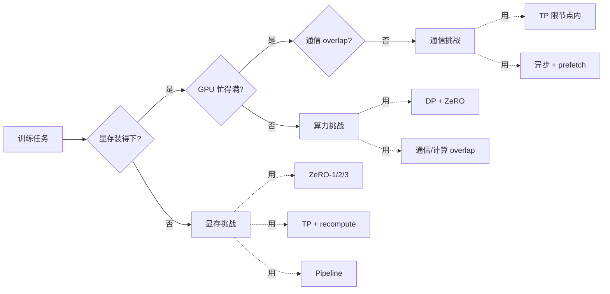
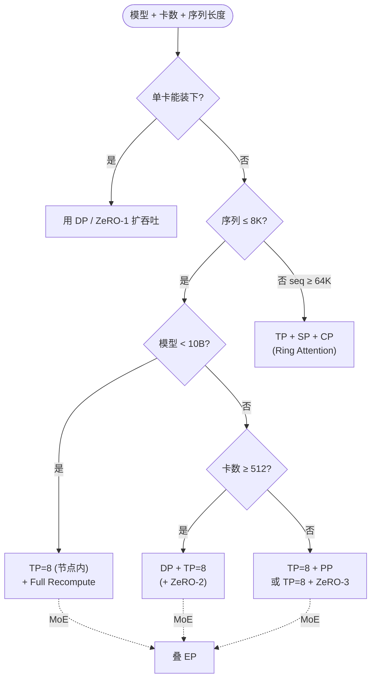

# Ultra-Scale Playbook · High-Level Overview 速查


# Ultra-Scale Playbook · High-Level Overview

> [!info] TL;DR
> **核心思想**：大模型训练永恒撞三堵墙——**显存装不下 / GPU 不够忙 / 通信拖死算力**。5D 并行（DP / TP / SP / CP / PP / EP）+ ZeRO 分别打一面，**没有银弹**，按模型规模 × 序列长度 × 网络带宽 × 卡数组合选。
> **最大收获**：trade-off 视角——任何并行方式都是拿"显存 / 算力 / 通信"中的一项换另一项。比如 activation recomputation 用算力换显存，TP 用通信换显存，ZeRO-3 用通信换显存。
> **为什么重要**：读完这一节，你就知道 "训练挂了 / 训练慢" 时该往哪个方向调并行度，而不是乱试。

```meta-bind
button
type: cycle
id: read-status
cycle: [todo, in-progress, done]
style: default
actions: []
```

---

## §1 三大挑战

整本 playbook 所有技术都围绕以下三个挑战展开——这是判断"该用哪种并行"的根坐标系。



> [!quote] 原文（Nouamane Tazi et al., 2025）
> All the techniques we'll cover in this book tackle one or several of the following three key challenges: **Memory Usage** (hard limitation), **Compute Efficiency** (keep GPUs busy), **Communication overhead** (overlap with compute).
> In many places we'll see that we can trade one of these for another — finding the right balance is key.

---

## §2 5D 并行 + ZeRO 速查

| 方法 | 切分维度 | 主要省什么 | 主要代价 | 适用场景 |
|---|---|---|---|---|
| **DP**（Data Parallelism）| batch | activation（按 mbs） | 受最大 batch 限制 | 模型能装下单卡 |
| **ZeRO-1** | DP 轴分片 opt state | optimizer state | params 通信 | 大模型第一档 |
| **ZeRO-2** | + grad 分片 | 同上 | 同上 | **性价比首选** |
| **ZeRO-3 / FSDP** | + param 分片 | params / grads / opt | 3Ψ 通信，prefetch | 极大规模；DP 度 ≤ ~512 |
| **TP**（Tensor Parallelism）| hidden dim | params + activation | 高频通信 | **限节点内（NVLink）** |
| **SP**（Sequence Parallelism）| seq dim（TP 区外） | activation | 与 TP 配对开销 | TP 区域外的 LN / Dropout |
| **CP**（Context Parallelism）| seq dim（TP 区内） | 长序列激活 | Ring / All-to-All 通信 | seq ≥ 64K |
| **PP**（Pipeline Parallelism）| model layers | params | bubble + 调度 | **跨节点扩展** |
| **EP**（Expert Parallelism）| expert dim | MoE 专家参数 | 路由 all-to-all | MoE 模型 |

**三个组合铁律**：
1. **TP 留在 node 内**——8 卡 NVLink 域内；跨 node 改用 PP / ZeRO-3。
2. **ZeRO-3 与 PP 一般不叠**——两者都打"沿深度切 param"，叠加通信吃不消；PP 通常与 ZeRO-1 / ZeRO-2 同用（DeepSeek-V3 即此组合）。
3. **TP 度 ≤ Q/K/V head 数**——GQA 模型更受限于 KV head 数（Llama-3 70B KV head = 8，TP 上限 8）。

---

## §3 选型决策树

按"先解决什么瓶颈"的顺序推：



**节点配置经验**：

| 场景 | 推荐拓扑 |
|---|---|
| < 10B + 8 卡 | TP=8 + Full Recompute |
| 10B–100B + > 8 卡 | (TP=8 + PP) / (TP=8 + ZeRO-3) / 纯 ZeRO-3，三选一 |
| 512+ 卡 | 纯 ZeRO-3 通信绷不住 → DP + TP 或 DP + PP |
| 1024+ 卡 | **TP=8 + ZeRO-2 + PP** |
| seq ≥ 128K | 叠 CP（跨节点） |
| MoE | 叠 EP（与 DP 正交） |

---

## §4 集合通信原语速查

```dataview
TABLE WITHOUT ID
  原语 AS "原语",
  功能 AS "功能",
  用途 AS "典型用途"
FROM #reading-note
WHERE type = "reading-note" AND contains(tags, "Parallelism")
SORT file.name ASC
LIMIT 0
```

> 上方查询用于本笔记其他位置的引用聚合（无直查数据时为空属正常）。

<details>
<summary><strong>9 个集合通信原语速查表（点击展开）</strong></summary>

| 原语 | 功能 | LLM 训练中的典型用途 |
|---|---|---|
| **Broadcast** | 1→N 广播 | 主节点广播初始权重 |
| **Reduce** | N→1 归约 | 单节点收梯度 |
| **AllReduce** | N→N 归约 + 广播 | DP 梯度同步 |
| **Gather** | N→1 收集 | 收集 log / 监控 |
| **AllGather** | N→N 收集 | ZeRO-3 收集分片参数 |
| **Scatter** | 1→N 分发 | 初始化分发 |
| **ReduceScatter** | N→N 归约 + 分片 | ZeRO-1/2 梯度同步（**比 AllReduce 快 2×**）|
| **Ring AllReduce** | AllReduce 带宽最优实现 | 大规模 DP |
| **Barrier** | 同步屏障 | checkpoint 同步 |

实现：NCCL（NVIDIA Collective Communications Library）事实标准。
</details>

---

## §5 显存四件套

<details>
<summary><strong>权重 / 梯度 / 优化器状态 / 激活 各占多少？</strong></summary>

| 项 | 依赖输入？ | 数量级（BF16 混合精度，N=参数量）|
|---|---|---|
| 权重 | 否 | $2N$（BF16）+ $4N$（FP32 master）|
| 梯度 | 否 | $2N$（BF16）|
| 优化器状态 | 否 | $8N$（Adam: FP32 momentum + variance）|
| 激活 | **是** | $L \cdot seq \cdot bs \cdot h \cdot (34 + \frac{5 \cdot n_{heads} \cdot seq}{h})$ |

直观感受（BF16 混合精度）：

| 模型 | 1B | 7B | 70B | 405B |
|---|---|---|---|---|
| 显存 | 20 GB | 140 GB | 1400 GB | 8100 GB |

> **7B 已经超过单张 H100（80 GB）**——这是所有分布式方案的起点。

**激活最特别**：随 batch 线性、随 sequence **二次**增长。长序列下激活 = 主要瓶颈。
</details>

<details>
<summary><strong>Activation Recomputation：拿算力换显存的两档选择</strong></summary>

| 策略 | 做法 | compute 开销 | 显存收益 |
|---|---|---|---|
| **Full recompute** | 每个 transformer layer 边界处 checkpoint | +30–40% | 最大 |
| **Selective recompute** | 丢 attention（重算便宜），checkpoint FFN | GPT-3 175B：**仅 2.7%** | **70%** 激活减少 |

现代训练默认开 Flash Attention——它内置 selective recomputation（不物化 attention 矩阵），绝大多数用户已经"白嫖"到 selective 收益。
</details>

---

## §6 Batch Size & 学习率

<details>
<summary><strong>batch size 的三种单位 + 经验区间</strong></summary>

- `bst = bs * seq`（token 总数）——LLM 社区通用报法
- `bs = gbs = mbs × grad_acc × dp`（分布式全公式）

**现代 LLM 训练 batch size 区间**：4M – 60M tokens / step
- Llama 1：~4M tokens 训 1.4T tokens
- DeepSeek-V3：~60M tokens 训 14T tokens
- DeepSeek-V3 还做了**渐进式 batch 增大**：3072 序列 → 15360 序列（前 469B tokens）

**Sequence length 经验区间**：2K – 8K tokens（pretraining 默认）。
</details>

---

## §7 作者推荐的两条路径

> [!success] GPU-rich case（卡多）
> 1. 先把单卡训练跑通 → 2. 凑到目标 GBS → 4. 优化吞吐
>
> 优化吞吐的常见动作：把 TP 度一路加到 node size（8）→ DP + ZeRO-3 同步扩保持 GBS 不变 → DP 通信撑不住时换 PP。

> [!warning] GPU-poor case（卡少）
> - 开启 full activation recomputation（牺牲 30–40% 速度换显存）
> - 增大 grad_acc
> - 用 ZeRO-3 / FSDP 把 params 分片出去

---

## §8 反向链接与延伸阅读

- **同主题完整笔记**：[[UltraScale Playbook 笔记]]（逐章节详解，含公式推导、ZeRO 演进、集合通信 overlap 数学、FP8 训练、GPU kernel 优化）
- **DeepSeek V3 显存实战**：[[DeepSeek V4 Infra 4.4 - 训练显存管理]]
- **配套代码**：
  - [nanotron](https://github.com/huggingface/nanotron) — 生产级分布式训练框架
  - [picotron](https://github.com/huggingface/picotron) — 教学级实现，配套 playbook 每章代码示例
- **配套工具**：
  - [Predict Memory](https://huggingface.co/spaces/nanotron/predict_memory) — 交互式 Transformer 显存计算器
  - [Ultra Cheatsheet SVG](https://huggingface.co/spaces/nanotron/ultrascale-playbook/blob/main/assets/images/ultra-cheatsheet.svg) — 全书一页速查图

---

## 我的批注

- ⚡ **"trade-off 视角"是这本 playbook 最值钱的框架**——任何并行方式都可以画进"显存 / 算力 / 通信"三角形，问"它交换了什么"。
- ❓ **DP 通信瓶颈的具体阈值**——原文提到 512+ 卡时 ring latency bound，但没给统一公式。是否要查一下 Megatron / DeepSpeed 的实测？
- 🔗 **5D 并行的"互相正交"性**——这套分类（batch / hidden / seq / layers / expert）几乎覆盖所有切法，未来新方案大概率是它们的组合。
